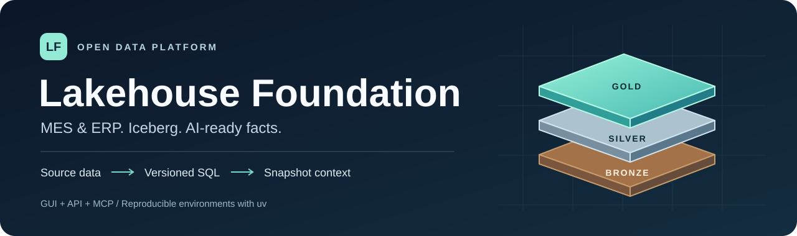
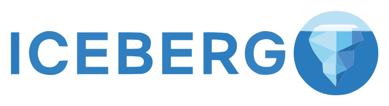
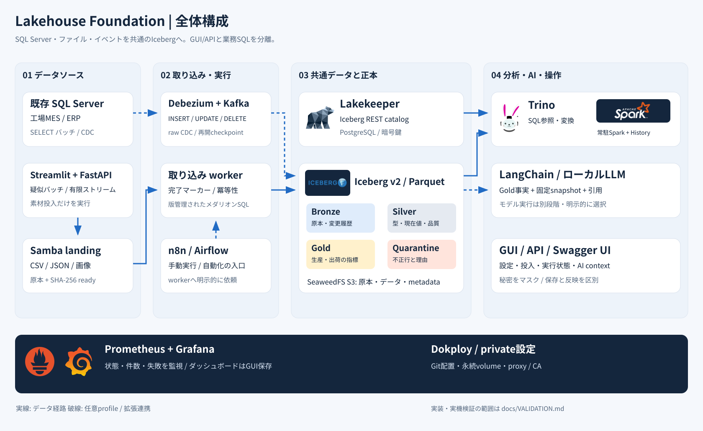

<p align="center">
  
</p>

<p align="center">
  <a href="https://github.com/hiromura16/lakehouse-foundation/actions/workflows/validate.yml"></a>
</p>

<p align="center">
  <a href="docs/START-HERE.md">はじめに</a> ·
  <a href="docs/DOCUMENTATION-MANIFEST.md">全MDの目的とリンク</a> ·
  <a href="#dokployで管理する場合">Dokployで導入</a> ·
  <a href="docs/COMPANY-ROLLOUT.md">会社へ導入</a> ·
  <a href="docs/POC-PORTAL.md">GUIで操作</a> ·
  <a href="docs/API.md">API / Swagger</a> ·
  <a href="docs/IMPLEMENTATION-STATUS.md">実装・検証状況</a>
</p>

# Lakehouse Foundation

<!-- doc-purpose:start -->
> **役割:** MES・ERP向けPoC基盤の機能、構築入口、任意機能と報告素材を見渡す。
>
> **対象読者:** 初めて使う人 / 基盤構築担当 / 評価・報告担当
>
> **読むタイミング:** clone直後に、何を構築できるかと最初の手順を選ぶとき。
>
> **前提となる資料:** なし。必要な用語は本文で確認します。
>
> **次に読む資料:** [初めての理解から運用・設計へ進む道順](<docs/LEARNING-PATH.md>) / [初めて構築する人の一本道ガイド](<docs/START-HERE.md>)
>
> **文書一覧:** [目的・読者から探す文書マニフェスト](<docs/DOCUMENTATION-MANIFEST.md>)
<!-- doc-purpose:end -->

<!-- shell-usage:start -->
**コマンドのシェル:** 「Bash / Zsh共通」は同じ内容を使い、専用例は自分のシェルを選びます。[詳しい使い分け](docs/SHELLS.md)。

Zshの対話端末では、コメント付きの例を貼る前に一度だけ次を実行します。Bashでは不要です。

**Zsh**

```zsh
setopt INTERACTIVE_COMMENTS
```
<!-- shell-usage:end -->

**MES・ERPの素材を受け取り、Icebergで保存し、SQLとGUI・APIから使うデータレイクハウス基盤。** 公開Gitをcloneし、導入先の接続先・資格情報・保存先をGit外のprivate設定へ入力して構築します。会社のSQL Serverは既存の外部DBへ接続します。

| Apache Iceberg | Lakekeeper | Trino | Apache Spark | Prometheus | Grafana | Cloudflare |
| :---: | :---: | :---: | :---: | :---: | :---: | :---: |
|  |  |  |  |  |  |  |

[公式ロゴの出典](docs/assets/README.md)を記録しています。Cloudflareは任意の外部連携候補で、接続済みの構成要素ではありません。

## できること

| 目的 | 同梱するもの | 詳細 |
| --- | --- | --- |
| **受け取る・蓄積する** | Samba landing、SQL読取、Debezium / Kafka CDC、SeaweedFS S3、Lakekeeper | [SQL抽出](docs/SOURCE-SQLSERVER.md) · [CDC](docs/CDC.md) |
| **整える・集計する** | Bronze原本、Silver最新版・型検査、Quarantine、Gold生産・出荷指標 | [メダリオン](docs/MEDALLION.md) |
| **画面から使う** | Streamlit操作ハブ、サービス入口、データカタログ、品質・履歴・ヘルプ | [操作ポータル](docs/POC-PORTAL.md) |
| **試す・壊れ方を確かめる** | 6ソースの合成データ、有限マイクロバッチ、選択式の26異常シナリオ | [異常シナリオ](docs/ANOMALY-SCENARIOS.md) |
| **API・AIから参照する** | 認証付きFastAPI / Swagger、main snapshot固定context、LangChain例、MCPアダプター | [API](docs/API.md) · [AI](docs/AI-READINESS.md) · [MCPの設定](docs/MCP.md) |
| **分析を広げる** | Superset、JupyterLab + Spark、Qdrant、Marquezを独立profileで追加 | [PoCツール](docs/POC-TOOLS.md) |
| **運用する** | Dokploy、n8n、Airflow、Grafana / Prometheus、uv・hash lock、企業proxy / CA | [運用](docs/OPERATIONS.md) · [会社proxy](docs/COMPANY-PROXY.md) · [SSRF設定](docs/SSRF.md) |



会社VMで一時修正したcloneを更新する場合は、[修正取り込み・Dokploy再配置手順](docs/COMPANY-UPDATE.md) を先に確認してください。

## PoC報告書へ使う素材

[詳細・用途別の図版集](docs/reports/README.md)に、全36serviceの配置、メダリオン、CDC、Spark、AI、proxy/認証、監視、配置・復旧、検証結果の**14図**を用意しています。編集可能なSVG/Mermaid、キャプションと根拠、報告書・評価計画・スライド構成の雛形を同梱し、uvの専用環境からPNG・PDF集・PowerPointへ一括出力できます。

[オフラインHTML一覧](docs/reports/gallery.html) · [報告書雛形](docs/reports/POC-REPORT-TEMPLATE.md) · [評価計画](docs/reports/EVALUATION-PLAN.md)

## 導入の順番

初めて触れる用語は [用語集](docs/GLOSSARY.md)、空のVMからの準備は [ホスト構築](docs/HOST-SETUP.md) にあります。[習熟度別の学習経路](docs/LEARNING-PATH.md) は操作担当・構築担当・拡張担当それぞれの到達点を示します。

**初めての構築は [一本道ガイド](docs/START-HERE.md) を上から進めてください。** 作業する端末、入力場所、期待結果、全機能を追加する順序をまとめています。採用版ごとの根拠は [公式リファレンス・全ドキュメント監査表](docs/REFERENCES.md) にあります。

**会社でDokploy管理にする場合は、レイクハウスをDeployする前にDokployを導入します。** Docker・社内proxy/CAの準備 → cloneとprivate設定 → Dokploy導入 → GUIから公開GitをDeploy、の順です。

会社VMのログインシェルはBashでもZshでも使えます。各コマンドの共通/専用ラベルを確認し、Zshでは最初に [コメントと対話入力の準備](docs/SHELLS.md) を済ませます。Bash wrapperはZsh端末からもshebangで起動します。

| 導入方法 | 共通準備の後に行うこと |
| --- | --- |
| Dokployを新規導入して管理 | 下記のインストーラー → DokployのGUIからDeploy |
| 導入済みのDokployで管理 | 既存GUIへ公開Gitを登録してDeploy |
| Docker Composeを直接操作 | 下記「CLIで直接起動する場合」の `lakehouse.sh up` |

### 共通準備

Linux x86-64、Docker Engine / BuildKit、Docker Compose **2.23.1以上**、Python **3.12以上**、[uv **0.13.7**](https://docs.astral.sh/uv/getting-started/installation/)を用意します。通常ユーザーがDockerを管理できる環境を前提とします。会社のproxyが必要なら、image取得前に [企業proxy・CA手順](docs/COMPANY-PROXY.md) を済ませます。

**Bash / Zsh共通**

```bash
git clone https://github.com/hiromura16/lakehouse-foundation.git
cd lakehouse-foundation

# 秘密値はGit外へ生成します。既存ファイルは上書きしません。
python3 scripts/configure.py \
  --output "$HOME/.config/lakehouse-foundation/site.env"
export LAKEHOUSE_ENV_FILE="$HOME/.config/lakehouse-foundation/site.env"

# 既定のlanding例。別の保存先はprivate設定のLANDING_DIRへ指定します。
LANDING_PATH=/srv/lakehouse/landing
if [ -e "$LANDING_PATH" ] || [ -L "$LANDING_PATH" ]; then
  stat -c '%a %u:%g %n' "$LANDING_PATH"
else
  sudo install -d -m 0770 -o "$(id -un)" -g "$(id -gn)" "$LANDING_PATH"
fi
```

private設定をエディターで開き、`LANDING_DIR`、`WORKER_UID/GID`、portを確認します。最初は `COMPOSE_PROFILES` を空にしてcoreを確認し、その後 `demo,monitoring` を追加すると操作画面と監視を使えます。既存環境では生成済みの秘密値・暗号鍵を保持します。

### Dokployで管理する場合

新規導入では、同じprivate設定に次の項目を入力します。配置先サーバーで作業し、実アドレスを公開ファイルへ書き戻しません。

| private設定 | 入力する内容 |
| --- | --- |
| `DOKPLOY_BIND_IP` | 管理画面を公開する、配置先の限定IPv4アドレス |
| `DOKPLOY_ALLOWED_CIDRS` | 管理画面へ接続してよいクライアントのCIDR |
| `SWARM_ADVERTISE_ADDR` | 配置先サーバーに割り当てられたSwarm通信用IPv4アドレス |
| `SWARM_ADDRESS_POOL` / `SWARM_SUBNET_SIZE` | 会社LAN・VPNと重ならないDocker用アドレス範囲 |
| `DOKPLOY_ADMIN_PORT` | 管理画面のport。既定は `3100` |

まず設定値を検査・表示し、ホスト前提を検査して導入する時に `--apply` を付けます。一つ目はホストを変更せず、Docker・port等の全ホスト検査も行いません。既存Dokployを使う場合は、次のGUI設定へ進みます。

**Bash / Zsh共通**

```bash
bash infra/dokploy/install.sh --env-file "$LAKEHOUSE_ENV_FILE"
sudo bash infra/dokploy/install.sh --env-file "$LAKEHOUSE_ENV_FILE" --apply
```

導入後、設定した管理画面へ接続して初期管理者を登録し、次の順で配置します。

1. Projectを作り、Environment（初期は `production`）で `Create Service` → `Compose` を作成します。Compose Typeは `Docker Compose` です。
2. `General` → `Provider` カードの **Git** タブで、`Repository URL` を `https://github.com/hiromura16/lakehouse-foundation.git`、`Branch` を `main`、`Compose Path` を `infra/lakehouse/compose.yaml` にして保存します。
3. サービス画面ヘッダーの表示名直下で**生成後の確定appName**を確認します。作成時の入力名にはsuffixが付きます。private設定の `COMPOSE_PROJECT_NAME` を確定名へ合わせます。
4. **Composeサービス自身のEnvironmentタブ**へprivate設定を登録し、`Create Environment File` をONにして保存します。Project/Environmentへ置いた変数は自動継承されません。このCompose Pathでは `infra/lakehouse/.env` を生成します。
5. `Advanced` → **Run Command** カード → `Command` へ下記を一行で入力して保存します。`APP_NAME_FROM_HEADER` は確定appNameへ置き換えます。欄には `compose` から入力し、pipeや `&&` は使いません。
6. `Deploy` を実行し、サービスの起動とone-shotの終了コード0を確認します。DeployはGitを再取得し、Rebuildは取得し直しません。[0.31.0の画面と公式tagの根拠](docs/DOKPLOY.md)

```text
compose -p APP_NAME_FROM_HEADER --env-file infra/lakehouse/.env -f infra/lakehouse/compose.yaml -f infra/compute/compose.yaml -f infra/orchestration/compose.yaml -f infra/demo/compose.yaml -f infra/cdc/compose.yaml -f infra/poc/compose.yaml -f infra/mcp/compose.yaml up -d --build --remove-orphans --wait --wait-timeout 600
```

この方法の初回起動はDokployのDeployで行います。Grafanaを使う場合は、配置後に同じprivate設定で `./scripts/lakehouse.sh grafana-init` を実行すると、標準dashboardを一度だけ投入できます。Projectの分け方、既存Swarm、既存データの移行は [Dokploy手順](docs/DOKPLOY.md) を参照してください。

### CLIで直接起動する場合

Docker Composeを直接管理する場合は、共通準備の後に実行します。

**Bash / Zsh共通**

```bash
./scripts/lakehouse.sh plan
./scripts/lakehouse.sh up
./scripts/lakehouse.sh status
```

### 配置後に画面を開く

サーバー自身のブラウザーから **[操作GUI](http://localhost:8501/)** ／ **[Swagger UI](http://localhost:8502/docs)** を開きます（`demo` profile）。最初はloopbackに限定し、遠隔利用はSSHポート転送等を使います。利用者認証・HTTPS・接続制限、別環境の名前・port・volumeは [会社導入](docs/COMPANY-ROLLOUT.md) と [設定一覧](docs/CONFIGURATION.md) に沿って準備します。

## 素材を投入し、結果を確かめる

**素材の生成と、取り込み・変換は別の操作です。** GUIでbatch / finite stream、投入先、異常のpreset・個別選択・率を指定できます。型不正と、遅延・不良増等の業務異常を区別し、期待する隔離理由・Goldの変化・ファイル拒否を表示します。

**Bash / Zsh共通**

```bash
# 利用できる26シナリオを確認します。
python3 scripts/generate-demo.py --list-scenarios

# 再現可能な素材だけをlandingへ生成します。
python3 scripts/generate-demo.py --destination landing \
  --output /srv/lakehouse/landing --seed 42 --orders 20 --days 7 \
  --scenario clean --anomaly reject_spike --anomaly-rate 20

# ここから先は明示した後続処理です。
./scripts/lakehouse.sh medallion
./scripts/lakehouse.sh verify
```

従来のランダムSQL schema方式は、専用DB・SOURCE/system DB拒否・明示同意の下で新規schemaへINSERTします。CDCテストの固定追加・更新・削除は、さらに専用DBの所有権tokenを照合します。通常のsource生成からworker・n8n・Airflowを起動しません。[素材投入](docs/DEMO-GUI.md) · [異常の期待結果](docs/ANOMALY-SCENARIOS.md)

## 必要なprofileだけを追加する

| profile | 用途 |
| --- | --- |
| `demo` / `monitoring` | 操作ハブ・API / Grafana・Prometheus |
| `cdc` / `automation` | SQL Server CDC・Kafbat / n8n |
| `compute` / `orchestration` | 常駐Spark Master・Worker・History / Airflow手動DAG |
| `bi` / `notebooks` | Superset / JupyterLab + Spark |
| `vector` / `lineage` | Qdrant / Marquez |
| `mcp` | AIクライアント向けMCP。内部APIを一緒に起動 |

追加profileには専用の秘密設定・workspace・メモリが必要です。[PoCツールの起動条件](docs/POC-TOOLS.md)を確認し、設定を保存した後に再配置します。GUIの「保存済み」は反映済みを意味しません。

**MCP**は標準Python SDK **2.3.0**を使い、9個のread toolと2個のresourceを同梱します。書き込み3 toolは既定で公開せず、operatorのopt-inと呼出ごとの`confirm`を必要とします。任意SQL・shell・任意ファイル読取は公開しません。HTTP認証と公式SDKからの参照を検証し、[実装・検証状況](docs/IMPLEMENTATION-STATUS.md)で配置の確認を追跡します。

**AI向けcontext**はGoldの各main snapshotを固定し、表とsnapshot IDを根拠にします。export側のコード・参照SQLのhashは、過去のsnapshotを生成したSQL版の保証には使いません。LangChain例は外部tracingを無効化し、モデル推論は任意の別操作です。[AIの境界](docs/AI-READINESS.md)

## 再現性と開発チェック

自作Python環境はuvで構築し、依存はhash付きlock、imageとJARはdigest / checksumで固定します。Airflowは公式venvとconstraintsを維持します。[互換性](docs/COMPATIBILITY.md)

**Bash / Zsh共通**

```bash
uv venv --python 3.12 /absolute/private/lakehouse-dev
uv pip sync --python /absolute/private/lakehouse-dev/bin/python \
  --require-hashes requirements-dev.lock
/absolute/private/lakehouse-dev/bin/python -m unittest discover -s tests
```

[公開CI](https://github.com/hiromura16/lakehouse-foundation/actions/workflows/validate.yml)でsource / history、Python、SQL、全profileのComposeを検査します。各導入先の受入は [検証記録](docs/VALIDATION.md) と分けます。会社の実DB・proxy / CA・IdP、復元、並列負荷、ARM64・GPUモデル推論は個別の確認が必要です。Qdrantの埋め込み生成や実ジョブのlineage自動収集も、profile追加だけでは完成しません。

## 目的別のガイド

**文書が多くて迷ったら [ドキュメント・マニフェスト](docs/DOCUMENTATION-MANIFEST.md) を開いてください。** 全MDの役割、読者、使う時点、前提・次の文書を一覧化しています。個々のMD冒頭にも同じ役割説明があります。

| やりたいこと | 読む文書 |
| --- | --- |
| 初めて導入・会社へ展開する | [はじめに](docs/START-HERE.md) · [会社導入](docs/COMPANY-ROLLOUT.md) · [企業proxy / CA](docs/COMPANY-PROXY.md) |
| 設定・配置・既存データを引き継ぐ | [設定](docs/CONFIGURATION.md) · [配置](docs/DEPLOYMENT.md) · [Dokploy](docs/DOKPLOY.md) |
| データ・GUI・APIを理解する | [メダリオン](docs/MEDALLION.md) · [操作ハブ](docs/POC-PORTAL.md) · [API](docs/API.md) |
| 監視・更新・復旧を扱う | [Grafana](docs/GRAFANA.md) · [運用](docs/OPERATIONS.md) · [障害対応](docs/TROUBLESHOOTING.md) |
| AIや外部サービスを検討する | [AI / LangChain](docs/AI-READINESS.md) · [Cloudflare](docs/CLOUDFLARE.md) · [PoCツール](docs/POC-TOOLS.md) |

Dokploy管理ではGUIのStop、CLI管理では `./scripts/lakehouse.sh down` で停止します。名前付きvolumeを保持します。原本、カタログDB、暗号鍵、GUIの保存内容を一組として保管し、復元は別環境で確認します。

## 習熟度に応じた使い方

| 担当 | 最初の到達点 | 次に進む条件 |
| --- | --- | --- |
| 初心者・操作担当 | 合成素材をGUIで投入し、変換後のGoldと品質件数を見る | 素材生成と変換、保存と反映、合成値と実績値の違いを説明できる |
| 構築・運用担当 | core→必要profileの順に配置し、停止・再開後も同じvolumeを使う | proxyの層、appName、秘密の保管先、設定反映担当を確認済み |
| 開発・データ担当 | 入力契約→SQL→品質検査→Gold指標→APIの対応を追う | [拡張手順](docs/CUSTOMIZATION.md)に沿って専用環境と回帰条件を用意する |
| 評価・意思決定担当 | 対象commitと根拠を付けてPoC結果を整理する | 未評価の会社接続・性能・復元・AI精度を別の受入として扱う |

この基盤は、固定の入力契約と明示的な処理APIを持つPoCの出発点です。GUIで設定できる範囲は [GUIの選択](docs/GUI-OPTIONS.md)、コード変更を伴う範囲は [拡張手順](docs/CUSTOMIZATION.md) で確認します。任意のMES/ERPスキーマを接続するだけで自動的に業務指標へ変換する機能ではありません。

固定SQL Serverの疑似ERP/MESは、[所有権付き固定sourceの手順](docs/SQLSERVER-FIXED-DEMO.md)で準備します。GUIの固定投入→フルsnapshot→watermark増分→固定6表CDC→Raw履歴と再構築可能なCurrent Stateを段階的に検証できます。SOURCE readerは読取専用を維持し、checkpointには別の限定principalを使います。GUI・Swagger・固定Gold previewを備え、実SQL Server/Kafka/Icebergの受入は導入先で別途行います。
