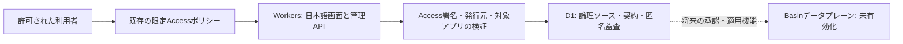

# Cloudflare管理プレーンの無料枠PoC

<!-- doc-purpose:start -->
> **役割:** Workers・D1の論理メタデータ管理を、認証・版管理・試験・配備と復旧の境界まで説明する。
>
> **対象読者:** 開発・設計担当 / 基盤構築担当
>
> **読むタイミング:** Cloudflare上の無料管理機能を開発・検証・配備するとき。
>
> **前提となる資料:** [Cloudflareを使う場所と社内に残す場所](<../../docs/CLOUDFLARE.md>)
>
> **次に読む資料:** [ソース・指標・API・計算基盤を拡張する](<../../docs/CUSTOMIZATION.md>)
>
> **文書一覧:** [目的・読者から探す文書マニフェスト](<../../docs/DOCUMENTATION-MANIFEST.md>)
<!-- doc-purpose:end -->

このプロジェクトは、Workers上の日本語管理画面・APIと、D1上の論理メタデータを実装します。
VMのReact試作とは独立した入口です。ソース定義を登録し、列・主キー・鮮度・削除方針を
データ契約の下書きとして版管理できます。

業務データの収集・送信は実行しません。Workers Paidへの変更、R2有効化、Basin資源の作成を
行うコードや自動配備は含みません。ローカル検証にはCloudflareへのログインも不要です。

## 1. 現在できること

| 対象       | 実装した動作                                             | 実行しない処理                             |
| ---------- | -------------------------------------------------------- | ------------------------------------------ |
| ソース     | 論理識別子・表示名・種類・担当・下書き／保留の登録と編集 | DB接続、物理ホストの探索、資格情報の保存   |
| データ契約 | 列・型・分類・主キー・鮮度・削除方針を新しい版として保存 | 承認、コネクター設定、Silverへの反映       |
| 競合防止   | 読み込んだ版と一致する場合だけ更新                       | 他の編集を無条件に上書き                   |
| 監査       | 操作・対象・版・時刻・操作IDを変更と同時に記録           | メール、IP、JWT、入力本文の保存            |
| 稼働表示   | 管理API・D1の応答、データ転送の未有効化を表示            | 架空の取り込み件数や未実施の接続成功の表示 |

契約は常に下書きです。ソースが「下書き」の場合だけ契約を作成できます。「保留」にすると
新しい契約版の保存を止めます。実行中のパイプラインを停止する機能ではありません。



## 2. 保存範囲と上限

- ソース100件、契約100件、契約ごと100版、契約の列数50列まで。
- 要求本文はUTF-8のJSONで32KiBまで。読み込み中にも上限を検査します。
- 論理識別子は英小文字で始まり、英小文字・数字・下線・ハイフンだけを受け付けます。
- 表示名は文字・数字・空白・下線・ハイフンに限定します。自由記述欄はありません。
- 未定義の入力項目を拒否します。URL、IP、ファイルパス、接続文字列の専用欄はありません。
- 入力規則は汎用の秘密情報検出器ではありません。論理名に実際の接続名や秘密値を入れない
  運用が必要です。元DBの実列名を無条件にクラウドへコピーする手順もありません。
- 型は文字列・整数・小数・真偽値・日付・日時、分類は公開・内部・機密から選びます。
  列名は一意、主キーは1列以上必要です。
- 監査は最新1000件を保持し、画面は最新50件を表示します。長期監査保管ではありません。

契約の識別子・ソース・データセットは初版で固定します。定義を変えると過去版を残して
次の版を追加します。最新の定義は一覧APIで取得できます。履歴版の閲覧・差分比較・削除は
まだ画面に実装していません。利用者ごとの役割分離もなく、Accessが許可した利用者は
同じ管理操作を実行できます。

## 3. ディレクトリの役割

| パス                          | 役割                                                      |
| ----------------------------- | --------------------------------------------------------- |
| `cloudflare.config.ts`        | cf設定と型生成の正本。配備識別子は架空例                  |
| `src/index.ts`                | ルーティング、要求サイズ、同一オリジン制限、安全な応答    |
| `src/auth.ts`                 | Access JWTのRS256署名・発行元・対象アプリ・有効期限の検証 |
| `src/schema.ts`               | 許可する論理メタデータの入力契約                          |
| `src/store.ts`                | D1のパラメーター付きSQL、競合防止、一覧取得               |
| `src/ui/`                     | 日本語HTML・CSS・JavaScript。取得値はHTMLとして挿入しない |
| `migrations/0001_control.sql` | 独立したD1用のテーブルと監査トリガー                      |
| `tests/control.test.ts`       | Workers実行環境・実D1互換ストレージでの試験               |
| `tests/browser.spec.ts`       | 合成APIを使うChromiumでの画面操作試験                     |

既存の社内VM、既存のD1、既存のWorkerやDNSを転用しない構成です。Basinへの有限件数
リレーは別の[実装と説明](../../docs/CLOUDFLARE.md#新構想のkafkaからbasinへの初期転送)を参照します。
管理画面の保存とKafkaからの転送は連動していません。

## 4. ローカルで検査する

Node.jsの採用版は`package.json`、依存の固定版は`package-lock.json`で管理します。
インストール時のライフサイクルスクリプトを実行しません。cf・Vite・VitestのCloudflare
プラグインは対応版を固定しています。新規のWrangler設定ファイルは作成しません。

**Bash / Zsh共通**

```bash
cd cloudflare/control-plane
npm ci --ignore-scripts --no-audit --no-fund
npm run typecheck
npm run format:check
npm test
npm run build
```

型は`cf workers types`が`.cloudflare/types/index.d.ts`へ生成します。独自のEnvを手書きで
複製しません。ビルド出力・生成型・ローカルD1・ブラウザー結果はGitの対象外です。

ブラウザー試験を実行する場合は、別途Chromiumを用意します。

**Bash / Zsh共通**

```bash
npx playwright install chromium
npm run test:browser
```

`npm test`はJWTの合成署名とローカルD1を使います。クラウドのアカウントや業務DBへ
通信しません。ブラウザー試験は合成APIで画面の操作を確認するため、実Accessログインや
クラウド配備の成功を証明するものではありません。

`npm run dev`はローカルのWorkers環境を起動できますが、画面にもAccess JWTが必要です。
認証を解除する開発用ルートや万能トークンは用意していません。通常の開発検証は上記の
自動試験で行い、実画面は保護済みの評価環境で確認します。

## 5. APIと競合時の扱い

全ルートでAccess JWTを確認します。公開鍵の取得先は配備設定の固定ドメインに限定し、
リダイレクトを拒否、取得時間4秒・本文64KiBで制限します。公開鍵は最大300秒のキャッシュを
利用します。ローテーション直後に認証できない場合は少し待って再試行します。

| メソッドとパス                         | 操作                                          |
| -------------------------------------- | --------------------------------------------- |
| `GET /`、`GET /app.css`、`GET /app.js` | 認証後の日本語画面と同梱ファイル              |
| `GET /api/sources`                     | 論理ソース一覧                                |
| `POST /api/sources`                    | ソースの下書き作成                            |
| `PUT /api/sources/{id}`                | `expectedRevision`で版を照合して更新          |
| `GET /api/contracts`                   | 契約ごとの最新の下書き                        |
| `POST /api/contracts`                  | `expectedRevision`を元に次の版を追加。初版は0 |
| `GET /api/audit`                       | 最新50件の匿名化した操作履歴                  |
| `GET /api/status`                      | D1の応答確認と実装範囲                        |

更新は`Origin`が配備した`PUBLIC_ORIGIN`と一致し、`X-Lakehouse-Request: 1`が必要です。
CORSの許可は返しません。競合時は409を返し、自動再送で他の変更を上書きしません。
画面を再読込し、最新の定義から編集し直します。保存の応答は常に`applied: false`です。

D1の更新件数には監査トリガーの変更も含まれるため、更新成功は`RETURNING id`の結果で
判定します。監査記録に失敗した場合は本体の変更も同じトランザクションで取り消されます。
監査用の利用者識別子は発行元と署名済み`sub`のSHA-256です。元のメールやJWTは保存しません。

## 6. 保護してから配備する

以下は構成の説明です。無料枠のアカウントでも割り当て・上限は実アカウントで確認します。
料金や制約は[Workers](https://developers.cloudflare.com/workers/platform/pricing/)と
[D1](https://developers.cloudflare.com/d1/platform/pricing/)の公式資料を参照してください。

1. 対象のzone、既存のWorker・D1・Access・DNSを読み取り、専用名の衝突を確認します。
2. 既存の限定された再利用可能Accessポリシーを、そのまま新アプリへID参照で関連付けます。
   EveryoneやBypassを追加せず、既存ポリシー自体を編集しません。公開ホスト全体を保護します。
3. 新しい管理用D1を1個だけ作成し、`0001_control.sql`を適用します。既存の業務・制御D1へ
   このSQLを実行しません。SQLは初回作成用で、将来の変更は別の移行ファイルにします。
4. `npm run build`のWorkerモジュールを配備し、次のバインディングを非公開の配備記録から
   設定します。公開設定の架空値のまま実環境を配備しません。
5. `workers.dev`とプレビューURLを両方無効にします。Accessが保護している専用のカスタム
   ドメインを関連付け、未認証でAccessへリダイレクトされることを確認します。
6. 再利用ポリシーの参照、許可対象、D1バインディング、公開ドメイン、プレビュー無効を
   APIで読み直します。許可した本人のブラウザーで登録・再読込・競合時の動作を確認します。
   自動試験の成功を本人の実ログイン成功の代わりにしません。

| バインディング       | 配備時の値                                            |
| -------------------- | ----------------------------------------------------- |
| `CONTROL_DB`         | 今回だけの管理用D1のID                                |
| `ACCESS_TEAM_DOMAIN` | `https://<team>.cloudflareaccess.com`形式の固定発行元 |
| `ACCESS_AUD`         | 新しいAccessアプリのAudience                          |
| `PUBLIC_ORIGIN`      | 専用のHTTPS origin。パス・末尾スラッシュなし          |

アカウントID、Audience、利用者、鍵や実際の接続設定を公開Gitへ保存しません。実配備の
識別子・実URL・確認結果は導入先の非公開の状態ディレクトリで管理します。公開ソースには
`control.example.invalid`の架空例を使います。手元のcfをログインさせるために、別ホストや
連携サービスのOAuth情報をコピーしません。

Workers LogsとTracesを個別に有効化し、サンプリングとクエリ文字列の伏せ字を設定します。
アプリの構造化ログは操作ID・メソッド・HTTP状態だけで、パス・JWT・入力本文を出しません。
プラットフォーム自身が記録する情報と保持・料金は、配備先の設定を別途確認してください。

## 7. 問題が起きた場合と復旧

- 401はAccess JWT・発行元・Audience・期限・公開鍵取得を確認します。認証を無効にして
  切り分けるルートは作りません。D1は変更されません。
- 403は利用ホスト、同一オリジン、更新用ヘッダーを確認します。CORS全許可で通しません。
- 409は重複、古い版、ソースの保留、上限、固定項目の変更を確認します。
- 422は入力規則を確認します。エラー応答やログに元の入力をそのまま返しません。
- 500は画面に出る操作IDで調査します。監査の失敗を握り潰して保存成功にしません。
- 配備を戻す場合は同じAccessとD1を保持したまま、検証済みの前版Workerへ戻します。
  新旧両方のスキーマ互換性を確認してから切り替えます。
- 評価環境を撤去する場合は、先に今回のカスタムドメインを停止します。Accessだけを
  先に削除して保護のない公開経路を残しません。D1の削除は保存定義の扱いを決めてから
  対象IDを照合して実施し、既存アプリ・既存D1を削除対象にしません。

次は承認と適用の境界、契約版の差分表示、最小の合成データによるBasin接続へ進みます。
Basin接続は無料部分の完成とは別の段階です。有料プランやR2の有効化は、その時点で
利用者が明示的に決めます。
