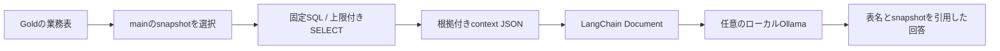

# AIへ渡せるデータとLangChain連携

この構成では、AIが利用する事実と、その根拠を取り出す経路を用意します。モデルの推論、画像OCR、埋め込みの生成、ベクトル索引は別の段階です。モデルやクラウドのアカウントを用意しなくても、データの参照とLangChain Documentへの変換を検証できます。

## AIが使うもの

| 対象 | 目的 | この実装での扱い |
| --- | --- | --- |
| Goldの型付き業務値 | 生産、歩留まり、出荷、遅延の説明 | 固定の2データセットを読み取る |
| Iceberg snapshot ID | 回答がどの時点の表に基づくか追跡 | main参照のsnapshotを取得して `FOR VERSION AS OF` で同じ版を読む |
| 参照SQLのSHA-256 | export時checkoutの参照SQLを識別 | `exporter_reference_sql_sha256`。実snapshotの生成SQLの証明ではない |
| adapterのSHA-256 | context取得コードを識別 | `exporter_code_sha256`。exportに使用したコードを記録 |
| 元ファイルのハッシュとS3参照 | 原本への追跡、再処理 | Bronzeと原本保存で保持 |
| モデル名・処理版 | 推論の再現と比較 | 推論例の応答に選択モデルと参照を含める |

テーブルごとにsnapshotを固定します。複数テーブルを一度に固定するグローバルトランザクションを提供するものではありません。上限付きのデータを、全工場の完全な母集団と解釈しないよう `complete_dataset: false` を付けます。

snapshotは各表の `$refs` から `name='main'` を選びます。作成時刻が最も新しいsnapshotを選ぶ方法ではないため、rollback後も現在のmainが指す版を読みます。[TrinoのIceberg参照情報](https://trino.io/docs/current/connector/iceberg.html#refs-table)

`exporter_reference_sql_sha256` は、export時のcheckoutにある `03_gold.sql` のハッシュです。過去のsnapshotを生成した時のSQLと一致する保証はありません。生成版は現時点では不明として扱い、将来はsnapshotと実行SQLのhash・commitを対応付けるrun監査台帳を追加します。`exporter_code_sha256` もデータの生成版を証明する値ではありません。

## 参照の流れ



モデルへSQL実行器、workerの操作トークン、S3鍵、MES/ERPの接続資格情報は渡しません。初期の閉域Trinoは利用者認証を完成した環境ではないため、`lakehouse-ai-reader` というuser名を指定しただけで強い権限分離ができるとは扱いません。共有運用ではTrino認証・認可とGoldの参照権限を設定します。

## GUIから確認する

`demo` profileのStreamlitで「AIの準備」を開き、production、sales、allと件数上限を選びます。FastAPIの `/ai/context` が既定のGoldを読み、表とsnapshotを返します。画面に取得中と表示し、この要求だけ最大120秒待ちます。通常ジョブの受付・進捗確認は15秒です。context JSONは業務情報を含むので、取得したファイルの保存先を社内の管理対象にします。

Goldが未作成なら、素材投入とメダリオン処理を先に実行します。AIの取得ボタンはデータを生成したり変換したりしません。

## CLIでcontextを保存する

独立したPython環境を使います。worker、Spark、Airflowの依存をこの環境へ混在させません。

```bash
python3 -m venv /absolute/private/ai-venv
/absolute/private/ai-venv/bin/python -m pip install \
  -r examples/ai/requirements.txt

/absolute/private/ai-venv/bin/python scripts/ai_context.py \
  --env-file /absolute/private/site.env \
  --dataset all --limit 100 \
  --output /absolute/private/ai-facts/context.json
```

出力先はGit外の絶対パス、親は0700、新規ファイルは0600です。既存ファイルは上書きしません。`--limit` は各データセットの行数で、1〜500です。行はproductionなら工場・日、salesなら受注IDで固定順に選びます。ここでモデルや外部AI APIは呼びません。

```json
{
  "context_version": 1,
  "exporter_reference_sql_sha256": "...",
  "exporter_code_sha256": "...",
  "datasets": [
    {
      "table": "iceberg.gold.sales_fulfillment",
      "snapshot_id": "...",
      "complete_dataset": false,
      "rows": []
    }
  ]
}
```

上は構造を示す短縮例です。snapshot IDを固定値として設定する見本ではありません。

## LangChainで使う

同梱例は `langchain-core` のDocumentとprompt、`langchain-ollama` のChatOllamaを使います。LangChainを変換エンジンの代わりに使うものではなく、確定した事実をモデルへ渡す役割です。[LangChainの統合パッケージ](https://reference.langchain.com/python/integrations/overview)、[Ollama統合](https://reference.langchain.com/python/langchain-ollama)

```bash
# Document化だけを確認。推論は起動しません。
/absolute/private/ai-venv/bin/python examples/ai/context_chain.py \
  --context /absolute/private/ai-facts/context.json
```

Documentには行のJSON、表名、snapshot ID、export時の参照SQLとadapterのハッシュ、上限付きサンプルの印を持たせます。生成時SQLの確定情報としては扱いません。Document IDは参照と内容のハッシュです。実機では34件のGold行をDocumentへ変換できることを確認しました。

ローカルOllamaへ導入済みのモデルがある場合だけ、明示的に推論します。モデルの取得・ライセンス・必要メモリは選択モデルごとに確認し、モデルの正確な版も運用記録へ残します。

```bash
/absolute/private/ai-venv/bin/python examples/ai/context_chain.py \
  --context /absolute/private/ai-facts/context.json \
  --ollama-url http://localhost:11434 \
  --model '<導入済みのモデル名とタグ>' \
  --question '取得した範囲で、出荷が遅れた受注を根拠と一緒に説明して'
```

この例に外部AI APIキーは不要です。context本文は最大1MiB、promptへ組み込む事実は最大64,000文字です。文章内に指示に見える内容があってもデータとして扱うpromptを使い、実行ツールをモデルへ付与しません。回答の正確さは、引用元と業務ルールを照合して評価します。

推論の呼び出しは `langsmith.tracing_context(enabled=False)` で囲み、呼び出し元の環境でLangSmith tracingを有効にしていても、この例から根拠データを外部tracingへ送らないようにします。[公式のtracing制御](https://reference.langchain.com/python/langsmith/run_helpers/tracing_context)

## 次に追加するもの

| 段階 | 追加する実装 | 確認すること |
| --- | --- | --- |
| 画像・文書 | OCR、画像モデル、chunk分割 | 原本ハッシュとページ・座標への参照、誤読率 |
| 検索 | Qdrant等の索引とembedding | モデル版、次元、原本削除時の索引削除、権限filter |
| 分析対話 | 許可された指標の検索、回答評価 | 正解例、引用、欠損時の回答、誤った因果推論 |
| 共有運用 | IdP、利用者別認可、監査 | 検索結果と原本の両方で権限を確認 |
| 外部AI | 送信対象、保持、ログ方針を決める | 会社の通信・情報管理要件、費用、処理地域 |

CloudflareのAI機能を使う選択肢は [CLOUDFLARE.md](CLOUDFLARE.md) に整理しています。現時点でモデル推論や外部サービス接続が検証済みであるとは記載しません。
