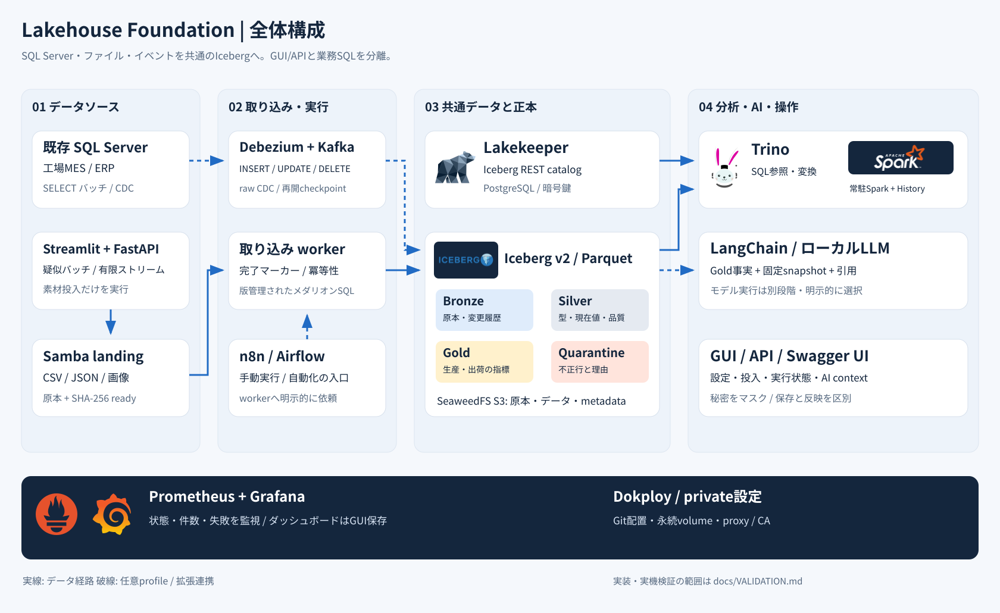
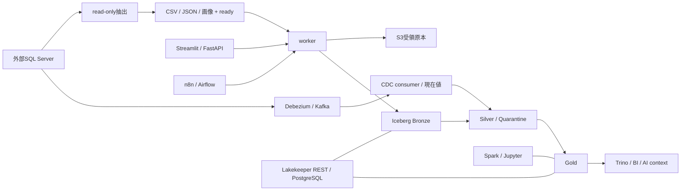
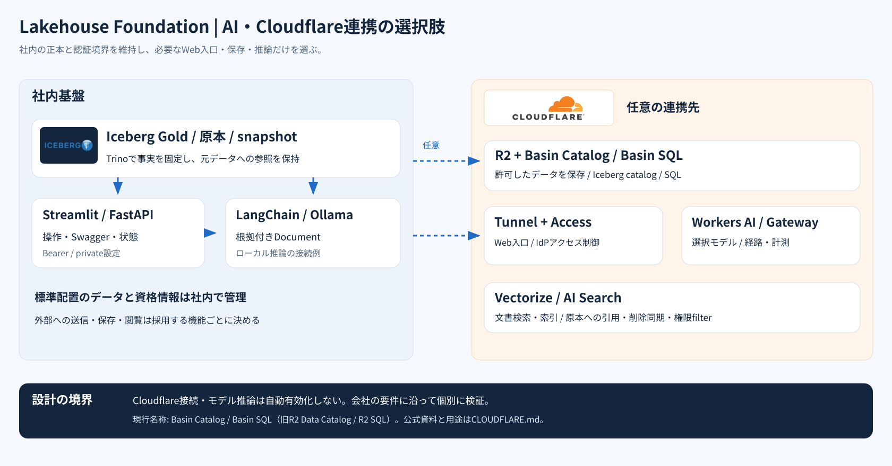

# Lakehouse Foundation アーキテクチャ

確認日: 2026-11-10（JST）。会社MES/ERPのファイル・SQLを受け、Icebergで保持し、SQL・GUI・API・AIクライアントから利用する単一ホストPoC基盤です。新規構築は [START-HERE.md](START-HERE.md) を使います。以下は採用中の構成で、各製品の最新版一般を意味しません。[版と一次資料](REFERENCES.md)

## 全体像と責任範囲

| 層 | 実装 | 役割・境界 |
| --- | --- | --- |
| 管理 | Dokploy 0.31.0、Docker Compose | Gitから配置。ホスト管理権限を持つ。Samba・daemon proxyは別作業 |
| ファイル入力 | Samba、外部LANDING_DIR | CSV/JSON/画像の受け口。完成後のreadyを契約にする |
| SQL入力 | 外部SQL Server、read-only抽出 | 許可した6表の列を素材へ対応付け。SQL Server本体は含めない |
| CDC | Debezium 3.7.1 / Kafka 4.4.0 / Kafbat | 任意profile。raw変更、現在値、派生表、checkpoint/offsetを管理 |
| 保存 | SeaweedFS 4.53 S3 | 受領原本とIcebergデータ/metadata。landingとは別の保存領域 |
| カタログ | Lakekeeper 0.14.3 / PostgreSQL 18.6 | Iceberg REST catalogとストレージ資格情報を保持 |
| 処理 | Python worker / PyIceberg 0.12.0 / Trino 484 | 原本取込、Bronze、Silver、隔離、Gold。SQL業務ルールはGitで管理 |
| 分散計算 | Spark 4.1.4 / Iceberg 1.12.0 | 常駐Master/Worker/History。Jupyterからremote投入も可能 |
| 操作 | Streamlit 1.67.0 / FastAPI 0.162.2 | 設定保存・合成素材・処理開始・状態・catalog・診断・Swagger |
| 実行の自動化 | n8n 2.46.7、Airflow 3.4.0 | 同梱の手動workflow/DAGからworkerへ依頼。定期担当は一つに決める |
| 監視 | Grafana 13.3.0 / Prometheus 3.16.0 | worker/Prometheus指標。Grafana GUI編集をDBへ保持 |
| 分析拡張 | Superset / Jupyter / Qdrant / Marquez | 別profileで追加。初期化と保存先は [PoCツール](POC-TOOLS.md) |
| AIの入口 | snapshot固定context、LangChain例、MCP 2.3.0 | 上限付き固定データ参照。MCPは既定read-only |

coreは6service、全機能の定義は34serviceです。one-shotと明示実行smokeも含む数なので、起動中コンテナ数と一致しません。Compose・digest lock・requirements lockが機械的な正本です。図のロゴと線は [出典](assets/README.md) を持ち、第三者による認定を意味しません。

## 保存・制御・参照の経路

ファイルは素材生成→明示取込→明示変換の順です。素材投入ツール自体はworkerを呼びません。CDCは接続済みconsumerが継続処理する別経路です。両経路を同じ表への無計画な二重writerとして使わず、CDC専用namespaceとsource mappingを確認します。[メダリオン](MEDALLION.md)・[CDC](CDC.md)

Bronzeは文字列と由来、Silverは主キーの最新候補の検証結果、Quarantineは不正最新版と理由、Goldは工場UTC日別の生産と受注別の出荷です。最新が不正でも過去の正常版へ戻しません。原本ハッシュはファイルの内容、snapshot IDは表の版で、役割が異なります。表の置換は1表ごとにatomicで、14SQL全体のtransactionではありません。[Trino 484の置換・snapshot](https://github.com/trinodb/trino/blob/484/docs/src/main/sphinx/connector/iceberg.md#replace-tables)

## coreの接続契約

### SeaweedFSとS3

[4.53](https://github.com/seaweedfs/seaweedfs/releases/tag/4.53) のS3認証を使い、private設定から `identities` / `credentials` / `actions` を生成します。匿名許可は追加しません。原本は `S3_BUCKET_RAW`、Icebergは `S3_BUCKET_WAREHOUSE` です。共有するlandingを内部volumeへ直接割り当てません。[公式S3資格情報](https://github.com/seaweedfs/seaweedfs/wiki/S3-Credentials)

外部エンジンにはDocker内部の `storage` 名が解決できない場合があります。host公開portと内部S3 endpointを混同せず、追加clientの到達性・認証を確認します。SeaweedFSはTrino公式の全S3試験対象ではないため、この組合せの実機結果を別に残します。[Trino 484 S3対応範囲](https://github.com/trinodb/trino/blob/484/docs/src/main/sphinx/object-storage/file-system-s3.md)

### LakekeeperとPyIceberg

PostgreSQL healthy→`catalog-migrate` 正常終了→`catalog serve`→worker bootstrapの順です。workerが `GET /management/v1/info` で初期化状態を確認し、未実施時だけbootstrapし、warehouseを準備します。Iceberg RESTの入口は `/catalog` です。[0.14.3公式起動例](https://github.com/lakekeeper/lakekeeper/blob/v0.14.3/docker-compose/docker-compose.yaml)

この構成は固定S3鍵をclient側で使う `client-managed` を明示します。remote signingやSTSを利用者別認可と取り違えません。PyIcebergのFileIO・S3 endpoint・signerの違いは [0.12.0設定リファレンス](https://github.com/apache/iceberg-python/blob/pyiceberg-0.12.0/mkdocs/docs/configuration.md) を照合しています。カタログDBと `CATALOG_ENCRYPTION_KEY` は一組で保管します。鍵を失うとDB内のストレージ資格情報を復号できません。

### TrinoとSpark

Trinoは `iceberg.catalog.type=rest`、REST URI/warehouse、`fs.s3.enabled=true`、S3 endpoint/region/path-styleと鍵を使います。実設定は [iceberg.properties](../infra/lakehouse/iceberg.properties) です。[484のREST設定](https://github.com/trinodb/trino/blob/484/docs/src/main/sphinx/object-storage/metastores.md)・[484のS3設定](https://github.com/trinodb/trino/blob/484/docs/src/main/sphinx/object-storage/file-system-s3.md)

会社SQLは標準では専用抽出スクリプトを使います。SQL Server用Trino catalogの自動生成は実装していません。別catalogを追加する場合は、TLS・権限・接続先のprivate化を別途設計します。

Sparkは4.1向けScala2.13 runtimeと同版AWS bundleを固定します。Master/Worker/Historyは常駐し、Jupyterはcompute有効時remote、無効時local[2]を明示します。独立したspark-checkはlocal smokeです。API上の互換性と、driver/executorのPython・Arrow一致を別々に検証します。[互換性](COMPATIBILITY.md)

## GUI・API・AIの境界

操作ポータルはDocker socketやsudoを持ちません。設定保存はGit外ファイルの更新だけで、DokployのEnvironment、ホストproxy、mount、稼働中の環境変数を自動変更しません。Dokploy再配置時はprivateファイルとComposeサービス自身のEnvironmentを揃えます。[配置手順](DOKPLOY.md)・[操作ポータル](POC-PORTAL.md)

n8nはSSRF保護をこの構成で有効化し、内部例外はworkerだけを既定にします。NO_PROXYは経路選択、SSRFは接続許可です。両者は別に設定・確認します。[SSRF](SSRF.md)

AI contextは固定Gold2表をmain snapshot単位で読み、各表最大500行を返します。MCPは9read toolsと2resources、3write toolsは明示opt-inと個別同意が必要です。LangChain Document変換例は同梱しますが、LLM・埋め込み・OCR・モデル推論は自動配備しません。Qdrantの疎通用合成vector、Marquezの手動demo lineageも、その自動化の完成を示すものではありません。[AI](AI-READINESS.md)・[MCP](MCP.md)

Cloudflare Tunnel/Access/R2/AI機能やClickHouseは拡張候補です。外部account・課金・送信・公開は設定していません。採用時は保存先、認可、通信経路、会社の許可を決めます。[Cloudflareの選択肢](CLOUDFLARE.md)

## 環境から独立したコードと復旧

Compose7ファイルは同じprojectへ結合し、clone先に依存しない相対パスを使います。実接続先・landing/workspace・proxy/CA・秘密値は外部private設定に置きます。service名・imageとデータvolumeの関係は [配置](DEPLOYMENT.md)、変更するファイルは [ディレクトリ案内](DIRECTORY-GUIDE.md) にあります。

初期のIceberg形式はv2/Parquetです。v3はTrino 484でexperimentalであり、全エンジンでの読書き確認なしに切り替えません。原本、Iceberg metadata/data、カタログDB、暗号鍵、各GUI状態DBを整合した時点で保存し、別環境へ復元して確認します。通常停止はvolumeを保持します。[運用・復元](OPERATIONS.md)

PoCは単一ホスト・一部内部サービス共通資格情報の構成です。企業IdP、利用者別テーブル認可、HA、会社の実proxy/SQL、並列負荷、復元・RPO/RTOは導入先で受入します。実装と実機結果は [追跡表](IMPLEMENTATION-STATUS.md)・[検証記録](VALIDATION.md) を参照してください。
