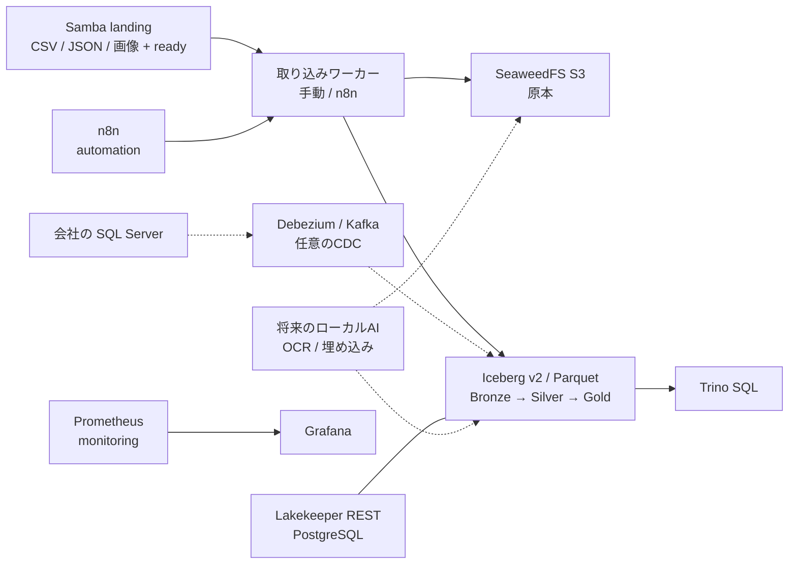

# Lakehouse Foundation アーキテクチャ

更新日: 2026-11-09。公開用の新規リポジトリ名は `lakehouse-foundation` です。正式な clone URL はリポジトリの README を参照します。

## 目標と提供範囲

会社のサーバーで公開リポジトリを clone し、公開ソースとは別の設定ファイルを生成・編集して同じ基盤を導入できる構成です。接続先、実データ、共有ディレクトリ、プロキシ、資格情報はサイトごとの非公開設定に置きます。公開ソースと Git 履歴には特定の導入先のホスト名・アドレス・ユーザー名・実ディレクトリを含めません。

標準の core は **SeaweedFS + Lakekeeper + PostgreSQL + Trino** です。n8n は `automation`、Grafana / Prometheus は `monitoring`、Sparkの相互参照スモークは `compute`、Airflowの手動DAGは `orchestration` プロファイルで追加します。Dokploy、Samba、Docker daemon のプロキシは、それぞれ独立したホスト設定として扱います。会社の既存 SQL Server は外部データソースとして接続し、この基盤の Compose では新たなSQL Serverを構築しません。

ファイル取り込みとTrino SQLによるメダリオン、任意のSQL Server CDC、Streamlit/FastAPIの操作画面を提供します。AI向けにはsnapshot付きcontextとLangChain連携例を用意し、モデル推論や業務BI等の拡張計画は後半に示します。構想に含まれることと、導入・実地検証が完了していることは区別します。

## 全体構成図

ロゴの公式配布元と再生成手順は [図版の出典](assets/README.md) を参照してください。

## 標準構成

| 役割 | 構成 | 責務 |
| --- | --- | --- |
| オブジェクト保存 | SeaweedFS S3 API | 原本、画像、IcebergのParquetとmetadataを永続化 |
| テーブル形式 | Apache Iceberg v2 + Parquet | スナップショットと型付きテーブルを複数エンジンで共有 |
| カタログ | Lakekeeper 0.14.3 | Iceberg REST APIとWarehouseの登録を管理 |
| カタログDB | PostgreSQL | Lakekeeperのメタデータと暗号化したストレージ資格情報を保持 |
| SQLエンジン | Trino 484 | RESTカタログからIcebergを参照・検証 |
| 初期化・取り込み・検証 | 専用ワーカー | S3/Warehouseの準備、ファイル取り込み、SQL実行、合成データの往復試験 |
| メダリオン変換 | PyIcebergでBronze、Trino SQLでSilver/Gold | 原本の由来を保持し、型変換・重複排除・隔離・日次集計 |
| ファイル受け口 | ホストのSamba共有（別設定） | `LANDING_DIR` にCSV・JSON・画像等を投入 |
| 外部業務DB | 会社のSQL Server | サイト設定で指定。読み取り専用抽出と任意CDCの接続先 |
| 任意の自動化 | n8n + 専用PostgreSQL | HTTP連携、依頼・承認、ジョブの呼び出し |
| 任意の常駐計算 | Spark Master / Worker / History | Jupyterからクラスタへ投入し、GUIで資源・実行・履歴を参照 |
| 任意の監視 | Prometheus + Grafana | メトリクス保存と可視化 |
| 管理基盤 | Dokploy（別導入） | コンテナの配置管理。coreの手動起動も独立して可能 |

Spark・Iceberg・Airflowの採用版と依存関係は [COMPATIBILITY.md](COMPATIBILITY.md) にまとめています。

イメージの正確なタグ・digestとリソース上限は Compose と設定ファイルを正とします。互換性を確認してから更新し、浮動 `latest` だけで再現性を管理しません。

実線は標準のデータ経路、点線は任意profileまたは外部拡張の接続を表します。点線だけで未実装を意味するものではなく、CDCは同梱済み、OCR・埋め込みは追加計画です。n8nは任意プロファイルです。Samba投入後の取り込みは明示的な実行で行います。CDCは専用の任意profileとnamespaceを使い、会社DBでの有効化・接続はDBA手順に従って確認します。

## 起動と接続の契約

### SeaweedFS

S3の資格情報を private env から生成し、明示的な設定として渡します。基本形式は `identities`、`credentials` の `accessKey` / `secretKey`、`actions` です。初期化に必要な権限を与える構成で、匿名ユーザーの許可は追加しません。認証なしのアクセスと誤った鍵が拒否されることも検証項目にします。[公式のS3資格情報](https://github.com/seaweedfs/seaweedfs/wiki/S3-Credentials)

S3原本用バケットは `S3_BUCKET_RAW`、テーブル用バケットは `S3_BUCKET_WAREHOUSE` で指定します。Sambaの共有先をSeaweedFSの内部ボリュームに直接割り当てません。公開先のS3 URLとDocker内部のS3 URLは異なるため、外部エンジンを追加するときは到達性を改めて設定します。

### Lakekeeper

PostgreSQLが正常になった後に `migrate` を実行し、成功後に `serve` を起動します。初期化では `GET /management/v1/info` の `bootstrapped` を確認し、未初期化の場合だけ `POST /management/v1/bootstrap` を実行します。Warehouseは `/management/v1/warehouse` で管理し、Iceberg REST APIの入口は `/catalog` です。[0.14.3の起動例](https://github.com/lakekeeper/lakekeeper/blob/v0.14.3/docker-compose/docker-compose.yaml) / [初期化手順](https://docs.lakekeeper.io/docs/latest/bootstrap/)

カタログDBの暗号鍵は非公開envで生成・保持します。DBだけを復元しても、暗号鍵を失うとストレージ資格情報を読み戻せません。バケット名、Warehouse名、region、path-style設定をサイトの構成と一致させます。

標準構成は閉じた検証環境向けで、カタログの利用者別認証・認可を完成したものではありません。初期段階は固定のS3資格情報を使用し、短命STS資格情報や利用者単位の隔離は後続の運用設計に分けます。

### Trino

484では `iceberg.catalog.type=rest`、`iceberg.rest-catalog.uri`、`iceberg.rest-catalog.warehouse` を設定します。S3ファイルシステムの有効化は `fs.s3.enabled=true` です。S3互換接続には endpoint、region、path-style、アクセス鍵を設定します。[RESTカタログ設定](https://trino.io/docs/current/object-storage/metastores.html) / [S3設定](https://trino.io/docs/current/object-storage/file-system-s3.html)

coreではDocker内部名を使ってLakekeeperとS3に接続します。会社SQL Serverを追加する場合は、公開されたサンプルから別のSQL Serverカタログを生成し、private env の接続先と参照用資格情報を使用します。coreのSQL検証と外部DBへの接続成功は別の検証結果として記録します。

## 公開ソースと非公開設定

| 公開するもの | サイト内で保持するもの |
| --- | --- |
| Compose、Dockerfile、スクリプト、設定見本 | `site.env`、プロキシ資格情報、企業CA |
| 構想・導入・停止・検証手順 | 実際のIP、ホスト名、共有パス、業務DB名 |
| 合成CSV・JSON・画像の検証データ | 業務ファイル、DBダンプ、オブジェクトデータ |
| 上流URL、イメージの版、ライセンス情報 | パスワード、API鍵、SSH鍵、復号鍵 |

`configure.py --output /absolute/private/site.env` で設定を生成します。公開チェックアウトに実際のenvや出力データを保存しません。`LANDING_DIR` とDockerの永続領域もソース管理から分離します。新しい公開Git履歴を作成し、導入先情報を含む過去の履歴を取り込みません。

標準の `BIND_IP` は `127.0.0.1` です。他端末から利用する際はprivate envでアドレスを指定し、そのネットワークのアクセス制御と各サービスの認証を整備します。

## 会社のSQL Serverとの接続

外部接続項目は `SOURCE_SQLSERVER_HOST`、`SOURCE_SQLSERVER_PORT`、`SOURCE_SQLSERVER_DATABASE`、`SOURCE_SQLSERVER_USER`、`SOURCE_SQLSERVER_PASSWORD` です。実値をリポジトリに書かず、用途に合う権限の利用者を設定します。

バッチ抽出は許可した表・列のSELECTと完了マーカーの発行を提供します。CDCはDebezium/Kafkaと専用consumerでrawイベント・現在値・派生表・再開checkpointを管理します。詳細は [SQL抽出](SOURCE-SQLSERVER.md) と [CDC](CDC.md) を参照してください。到達性チェックでは名前解決・TCP接続を区別し、TCP接続だけで認証・SQL実行・CDCが成功したとは判断しません。会社の実機で確認できるまで、外部DBの疎通・認証・証明書・権限は未検証です。

`cdc` profileではDebezium + Apache Kafka（KRaft）を使い、DB管理者と対象DB・表のCDC設定、SQL Server Agent、参照権限を確認します。初期スナップショット、追加・更新・削除、再起動、DDL変更、重複イベントを試験します。ソースLSNとイベント順序を保持し、主キーごとの現在値を再生成できる設計にします。[Debezium公式](https://debezium.io/documentation/reference/connectors/sqlserver.html)

## ファイル取り込みとメダリオン

取り込みは `lakehouse.sh ... ingest`、取り込みからSilver・隔離・Goldまでの一括実行は `lakehouse.sh ... medallion` です。ワーカーが実行制御とファイルI/Oを行い、業務上の変換規則は `medallion/` のSQLファイルで管理します。

### 投入完了とBronze

CSV・JSON・画像は `LANDING_DIR` の形式別ディレクトリへ配置します。コピー完了後に `scripts/mark-ready.py` で `<file>.ready` を作成します。取り込みはこのSHA-256と原本を照合し、コピー途中や内容が変わったファイルを確定データとして扱いません。

原本はS3へ保存し、Bronzeに由来のファイル名、SHA-256、取り込み時刻を保持します。CSVの業務列はBronzeでは文字列として保持し、型変換はSilverで行います。再投入は原本のハッシュと取り込み状態で識別します。JSONは宣言した業務ソースを処理し、画像等は原本とメタデータを保持します。画像へ業務用の数値変換SQLを当てはめません。

### MES・ERPの型契約

疑似業務データはERPの製品・製造指図・受注・出荷と、MESの製造実績・停止実績の6ソースです。形式と主キーは次のとおりです。生成する値は合成データだけで、実在の顧客・工場・製品を使いません。

| ソース | 形式 | 主キー |
| --- | --- | --- |
| `erp_products` | CSV | `product_id` |
| `erp_work_orders` | CSV | `work_order_id` |
| `erp_sales_orders` | CSV | `sales_order_id` |
| `erp_shipments` | CSV | `shipment_id` |
| `mes_events` | JSON Lines | `event_id` |
| `mes_downtime` | JSON Lines | `downtime_id` |

Bronzeでは業務列を文字列として保持します。宣言型のソース定義とSQLを契約とし、Silverで数値・日付・時刻を `TRY_CAST` します。NULL、型不正、業務上不正な値を理由付きで隔離し、有効行は主キーごとに最新 `updated_at` を採用します。更新時刻が同じ行は原本ハッシュ等の固定順序で選び、再実行時の結果を安定させます。列・型・許容範囲・参照関係の詳細は [DEMO-DATA.md](DEMO-DATA.md) と実装SQLを参照します。

`generate-demo.py` はseed・件数・期間を指定して再現可能な素材を作る **ソース専用ツール** です。`landing`、`sqlserver`、`both` の投入先を選択し、ランディングではSHA-256の完了マーカーを作ります。SQL投入では別の `DEMO_SQLSERVER_*` 資格情報と明示的な `--allow-sql-write` を必要とし、専用DBの新しいランダム名schemaに6つのnvarchar staging表を作ります。SOURCE接続先のDB、システムDB、既存schemaの再利用を拒否し、CREATE DATABASEや既存業務表の変更は行いません。

生成器はIcebergやTrinoを操作せず、メダリオンやその検証を起動しません。生成manifestは件数・ハッシュ・seed等の出力情報です。変換結果の期待値は独立した `medallion/expected-demo.json` に置き、メダリオン側の検証で照合します。`edge` シナリオの欠損、不正値、重複を、後続処理が採用・隔離できることを確認します。

### Silver・隔離・GoldのSQL

| ファイル | 処理 |
| --- | --- |
| `medallion/01_silver.sql` | 6ソースの型変換、必須値・妥当性判定、主キー単位の最新化 |
| `medallion/02_quarantine.sql` | 6ソースの無効行と理由を同名の隔離表へ保存 |
| `medallion/03_gold.sql` | `gold.factory_daily_production` と `gold.sales_fulfillment` を生成 |

Goldは良品・不良・停止時間・歩留まり・計画達成率と、受注・出荷・残数・履行率を集計します。OEEは算出しません。日跨ぎの停止は開始日へ計上する検証上の定義です。指標の式と期待値はSQL、`medallion/expected-demo.json`、[DEMO-DATA.md](DEMO-DATA.md) で確認します。

派生表は `CREATE OR REPLACE TABLE AS` で再構築し、同じ入力で繰り返しても追記による二重計上を生じさせません。置き換えの単位は各テーブルです。全SQLと複数テーブルをまとめた一つのトランザクションではないため、途中失敗時には処理結果を確認して再実行します。

n8nテンプレートはGUIからワーカーの `/run` を呼び、`medallion` を実行する入口です。Header AuthのBearerトークンはn8nの資格情報画面で設定し、テンプレートへ埋め込みません。n8nは開始条件や接続をGUIで設定するもので、列のマッピングや型規則はSQLを編集します。

初期の共通形式はIceberg v2 + Parquetです。更新表はcopy-on-writeから始め、v3機能は採用する全エンジンで互換性を試験してから有効にします。Bronzeの原本ハッシュと取り込み時刻を残し、将来のAI処理でモデル名・版・処理版・参照snapshotを追加できる由来情報を確保します。snapshotを固定したGold contextとLangChainの連携例は [AI連携](AI-READINESS.md) へ追加しています。モデル推論自体の実機評価は別の段階です。[Iceberg仕様](https://iceberg.apache.org/spec/)

## AI・分析・運用の拡張

| 拡張 | 推奨する役割 | 導入条件 |
| --- | --- | --- |
| 定期取り込み | 提供ワーカーの定時実行 | n8n等で開始条件・再試行・監視を追加 |
| Spark（compute） | 常駐Master/Workerと履歴、Jupyterからの分散計算。明示スモークも保持 | Java/Scala/Iceberg runtimeを固定し、実行時に確認 |
| Superset | Trino経由の業務BI | 利用者認証とデータ権限を確定 |
| Airflow（orchestration） | 提供する手動DAGからworkerへ依頼。将来の依存関係・バックフィル管理 | 企業運用ではstandaloneから構成を分離 |
| Apache Hop / NiFi | 列のマッピング等をGUIで設計 | SQL編集で足りない要件と運用負荷を評価 |
| ClickHouse | 高頻度分析を高速化する派生層 | 必要な表だけを取り込み、Icebergを正本として維持 |
| Ollama / vLLM | ローカルLLM、画像理解、埋め込み | 実機のGPU/CPUアーキテクチャと空きメモリを確認 |
| Qdrant | 文書・画像の検索索引 | モデル・次元・原本への対応を固定 |
| Alloy / Loki / Alertmanager | ログ、保存期間、通知の管理 | ディスク予算と監視方針を確定 |
| Cloudflare Tunnel / Access | 許可したWebサービスの接続 | 公開範囲と会社の通信許可を確定 |
| Cloudflare R2 | 任意の外部S3保存先 | 保存データと送信先、運用費用を確定 |

AI生成物には原本ハッシュ、モデル名・版、処理版、参照したIceberg snapshotを残します。検索結果から根拠へ戻れ、文書削除時には索引も削除できる設計にします。外部AI APIを必須にしません。

ClickHouseのカタログ経由の書き込みには機能上の制約があるため、初期は参照・加速層として使います。[公式の対応表](https://clickhouse.com/docs/guides/use-cases/data-warehousing/support-matrix)

Lakekeeperの利用者別認可を追加する段階ではOIDCとSTSを検討します。SeaweedFSへのremote signingだけでテーブル単位の隔離を完成できると扱わず、S3への直接アクセスを含めて試験します。[LakekeeperのS3設定](https://docs.lakekeeper.io/docs/latest/storage-s3/) / [ストレージの制約](https://docs.lakekeeper.io/docs/latest/storage/)

ログ収集はPromtailの代わりにAlloyを候補にします。Promtailは2026-03-02にEOLです。[Grafanaの公式案内](https://grafana.com/docs/loki/latest/send-data/promtail/)

Cloudflare TunnelにはUDPまたはTCPの7844が必要で、一般的なHTTPプロキシを設定すれば必ず利用できるものではありません。会社の許可された接続方法に合わせます。[公式通信要件](https://developers.cloudflare.com/cloudflare-one/networks/connectors/cloudflare-tunnel/configure-tunnels/tunnel-with-firewall/)

## プロキシ・永続化・復旧

プロキシはDocker daemonのpull/push、build中のダウンロード、コンテナ実行時のHTTP、各言語ランタイムで適用箇所を分けます。`NO_PROXY` は内部サービス名・社内宛先を含めます。企業CAが必要な場合はホスト・コンテナ・Java等の信頼ストアへ追加します。詳細は [PROXY.md](PROXY.md) を参照します。

`down` は通常の停止であり、永続ボリュームを保持します。バックアップ対象はS3の原本とIceberg全体、LakekeeperのPostgreSQLと暗号鍵、任意のn8n DBと暗号鍵、管理基盤の状態です。書き込みと整合する時点を確定して保存し、別環境でSQL参照と原本ハッシュを確認します。単一ホスト構成の可用性やRPO/RTOは、冗長化・バックアップ・復元の実地検証が済むまで確定しません。

## 選定とライセンス

SeaweedFS、Lakekeeper、Trino、Icebergを中心に、APIとオープンな保存形式を境界とします。PolarisはRESTカタログ、RustFSはS3保存先の代替候補です。MinIO本家OSSは公式リポジトリが2026-04-25にアーカイブされているため、新規導入では保守継続性を別に評価します。[Polaris](https://polaris.apache.org/downloads/) / [RustFS](https://github.com/rustfs/rustfs) / [MinIO](https://github.com/minio/minio)

n8n CommunityはSustainable Use Licenseのソース公開ソフトウェアで、社内利用と外部利用者への編集機能提供では条件が異なります。GrafanaはAGPL系です。製品のライセンス、依存イメージ、モデルの利用条件をそれぞれ記録します。[n8n公式](https://support.n8n.io/article/can-i-use-your-license-for-my-use-case?trk=article-ssr-frontend-pulse_little-text-block) / [Grafanaライセンス](https://grafana.com/licensing/)

## AI・外部サービスの配置図

[AI連携](AI-READINESS.md) と [Cloudflareの用途](CLOUDFLARE.md) に、同梱実装と選択式の拡張を説明しています。Streamlit/FastAPIは [GUI](DEMO-GUI.md)、CDCは [CDC](CDC.md) を参照してください。
