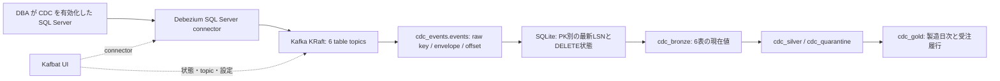

# SQL Server の変更を Iceberg へ反映する

CDC は SQL Server の初回スナップショットと、その後の INSERT・UPDATE・DELETE を
継続して取り込む追加機能です。`cdc` profile で Kafka、Debezium、consumer、
Kafbat UI を起動します。通常のファイル投入と、SELECT だけの
[SQL Server スナップショット抽出](SOURCE-SQLSERVER.md) は引き続き独立しています。
この構成に SQL Server のコンテナイメージは含めません。

この profile は単一ノード・単一 consumer の検証用基盤です。Kafka のレプリカ数は
1 なので、ノードやディスクの故障に対する冗長性はありません。会社の継続運用へ
進む前に、DBA と保持期間・復旧方法・認証・監視を決めてください。

## 1. どこに保存されるか



| 保存先 | 粒度と役割 |
| --- | --- |
| Kafka のデータ topic | 1 source table ごとの変更履歴。初回 read、作成、更新、削除、tombstone |
| `iceberg.cdc_events.events` | topic・partition・offset ごとの key と Debezium envelope 原文。append-only |
| `cdc-state` volume | SQLite の主キー別最新行・LSN・削除マーカー・完了 offset。再起動に必須 |
| `iceberg.cdc_bronze.<6tables>` | 削除済み主キーを除いた現在値。業務列は既存契約と同じ文字列 |
| `iceberg.cdc_silver` / `cdc_quarantine` | 既存の型変換、参照検査、不正データ隔離 |
| `iceberg.cdc_gold` | 既存の `factory_daily_production` と `sales_fulfillment` |

通常の `bronze/silver/quarantine/gold` は更新しません。`cdc_bronze` には過去版を
残さず、履歴を raw event と Iceberg snapshot に残します。Silver と Gold の式、
品質理由、時刻の意味は [MEDALLION.md](MEDALLION.md) と同じです。

## 2. 対応する入力と境界

入力は [6 source の契約](../medallion/sources.json) です。外部の `table-map.json`
で会社の schema・table・column を対応付けます。形式は
[スナップショット抽出の例](../infra/source/sqlserver-tables.example.json) と同じです。
source 名や会社の接続情報を公開ファイルに書き込まないでください。

各 source table には、契約の先頭列に対応する **単一列の主キー** が必要です。
複合キー、キーなし、1 source から複数 target への展開は未対応です。列の追加・削除や
型変更は自動追従せず、mapping と契約を確認してから再開します。

SQL の date は日付、Debezium の Connect timestamp はミリ秒の UTC 時刻として
文字列へ変換します。timestamp 列はソース側で UTC として扱う前提です。
SQL の型と Debezium の変換結果が会社の意味に合うか、専用検証で確認してください。
デモは NVARCHAR の契約列と NVARCHAR(128) の主キーです。本物の MES/ERP の型、
外部キー、トランザクション設計を再現するものではありません。

consumer は 1 バッチ最大 `CDC_BATCH_SIZE` 件、既定 100 件です。1 event の上限は
16 MiB、1 table の SQLite current-state 上限は削除マーカー込み 100,000 keys です。
これは小さく動作を確認するための実装です。各バッチで 6 current table とメダリオンを
再構築するので、大規模・低遅延の本番ストリーミング性能を示すものではありません。
複数 source table をまたぐ SQL トランザクションの境界は、分析側の一括 commit として
維持していません。バッチの途中には関連行がまだ届いていない場合があります。

## 3. 会社の SQL Server 側で DBA が準備すること

[prepare-source.sql](../infra/cdc/prepare-source.sql) は **T-SQL のレビュー用雛形** です。
`@DbaApproved = 0` と未設定 DB 名で、そのまま実行できないようにしています。
DBA が対象 DB、schema、表、取得列、capture reader を実環境に合わせます。
既存 capture instance があれば上書きせず停止するので、その設定を DBA が確認します。
この SQL は connector や consumer から自動実行しません。

準備には次が含まれます。

1. 対象 DB と 6 table の CDC 有効化、SQL Server Agent の稼働確認。
2. 専用 CDC reader の login/user と capture role。業務更新権限は与えません。
3. 取得列と選択した 6 capture table の SELECT、3 CDC metadata table の SELECT、
   必要な DB 内の状態参照権限。全 cdc schema への包括 SELECT は付与しない。
4. capture/cleanup job の保持期間、ログ増加、停止中に保持できる時間の確認。
5. SQL Server のサーバー証明書と CA、接続先 DNS 名の準備。

`SOURCE_SQLSERVER_*` は従来の SELECT 抽出用、`DEMO_SQLSERVER_*` はデモ作成管理用、
`CDC_SQLSERVER_*` は継続 capture reader 用です。資格情報を使い回さないでください。
Agent の状態確認にサーバー全体の参照権限が必要な環境では、DBA の署名付き
読取 scalar function を用意し、`CDC_SQLSERVER_AGENT_STATUS_QUERY` に
`SELECT [#db].[dbo].[YOUR_APPROVED_FUNCTION]()` の形で設定できます。
この項目は任意の SQL を受け付けません。capture reader に sysadmin や db_owner を
自動付与する処理はありません。

## 4. 外部 private 設定を用意する

[導入手順](DEPLOYMENT.md) で生成した private `site.env` を編集します。
`CDC_CONFIG_DIR` はその checkout 外の所有者だけが入れるディレクトリにし、
`table-map.json` を保存します。consumer/register は `WORKER_UID/GID` で読むので、
そのユーザーに読み取りを許可してください。資格情報は env ファイルに保管し、
mapping に埋め込まないでください。

| 項目 | 内容 |
| --- | --- |
| `COMPOSE_PROFILES` | 既存の profile に `cdc` を追加。例 `monitoring,automation,cdc` |
| `CDC_CONFIG_DIR` | 外部 private directory。`table-map.json` を置く |
| `CDC_SQLSERVER_HOST/PORT/DATABASE` | 対象の SQL Server と DB。既定 port 1433 |
| `CDC_SQLSERVER_USER/PASSWORD` | DBA が準備した専用 capture reader |
| `CDC_SQLSERVER_TRUSTSTORE` | 独自 CA 使用時 `/run/cdc/sqlserver-truststore.p12`。JVM 標準 CA なら空 |
| `CDC_SQLSERVER_TRUSTSTORE_FILE` | host 上の PKCS12/JKS truststore。公開 CA 証明書だけを格納 |
| `CDC_SQLSERVER_TRUSTSTORE_PASSWORD` | truststore の password。private env のみ |
| `CDC_SQLSERVER_HOSTNAME_IN_CERTIFICATE` | 接続先とは異なる証明書 DNS 名を明示する必要がある場合のみ |
| `CDC_SQLSERVER_AGENT_STATUS_QUERY` | 任意。DBA が用意した読取 scalar function |
| `CDC_TOPIC_PREFIX` | source の識別子。既定 `factory`。運用開始後に不用意に変えない |
| `CDC_CONNECTOR_NAME` | 既定 `factory-source` |
| `CDC_GROUP_ID` | 既定 `lakehouse-cdc` |
| `CDC_KAFKA_CLUSTER_ID` | configure が生成する永続 cluster ID。volume と対で保管 |
| `CDC_CONNECT_PORT` / `CDC_UI_PORT` | 既定 8083 / 8084。どちらも loopback で公開 |
| `CDC_BATCH_SIZE` / `CDC_POLL_SECONDS` | 既定 100 件 / 5 秒。バッチを集める上限 |

TLS は `driver.encrypt=true`、証明書検証は有効です。独自 CA は DBA から受け取った
信頼済みの証明書を Java truststore へ登録します。名前検証を無効にする設定には
しないでください。truststore は CA 公開証明書だけなのでファイルを 0644 で読み取り
可能にしても、接続 password は含まれません。親 directory は 0700 のままにでき、
Connect には truststore ファイル単体を read-only mount します。

JVM 標準 CA を使う場合は `TRUSTSTORE` を空にします。Compose は未使用の target に
Linux の `/dev/null` を read-only mount し、connector は trustStore/password 項目を
送信しません。host の CA bundle の場所や、存在しない private file に依存しません。
`CDC_TEST_TRUST_SERVER_CERTIFICATE=true` は loopback 接続かつ `lh_cdc_demo_` DB だけに
限定したテスト例外です。会社接続には使えません。

Connect 内部の password は環境変数 ConfigProvider の参照として登録します。
API や GUI で扱う接続設定を管理者以外に公開しないでください。内部 Kafka はこの
単一 host の private Compose network のみで、broker の host port は公開しません。
企業内で別 host へ分離するときは Kafka の TLS/SASL・ACL と Connect の認証を別途
構成する必要があります。この profile はその多拠点構成を自動構築しません。

## 5. 起動して状態を見る

private 設定と mapping を準備した後、通常の入口を使います。

```sh
export LAKEHOUSE_ENV_FILE="$HOME/.config/lakehouse-foundation/site.env"
python3 scripts/control.py plan
python3 scripts/control.py up
```

core の warehouse bootstrap が完了してから consumer が起動します。
`cdc-register` は最初に connector を登録し、同じ設定なら再実行しても変更しません。
同名 connector の設定が違えば停止し、GUI の編集を自動で元に戻しません。
`cdc-consumer` は失敗時の無限再起動を避けるため、異常終了後は operator が確認して
再開します。通常の host 再起動後も、状態を確認して consumer を明示起動してください。

Kafbat UI は `http://localhost:8084`、Connect REST は `http://localhost:8083` です。
GUI に独立したユーザー認証は設定していないので、管理者専用の loopback として
利用します。会社で複数利用者に公開するときは、認証付き reverse proxy / SSO と
利用者の権限を先に設定してください。

GUI では次を確認します。

1. `factory-cdc` cluster の **Brokers** で KRaft broker が online かを見る。
2. **Kafka Connect** の `sqlserver-capture` を開き、source connector と task が
   `RUNNING` であることを見る。`FAILED` なら private log で権限/TLS/CDC job を調べる。
3. **Topics** で 6 source table の topic を選ぶ。SQL Server connector の版によって
   topic 名に DB 名が入る形もあるため、consumer は両方の命名を受け付ける。
4. **Messages** で envelope の `op`（`r/c/u/d`）、`before/after`、source の
   `commit_lsn/change_lsn/event_serial_no` を見る。実データを画面共有しない。
5. **Consumers** で consumer group の lag と offset を見る。0 だけで Gold の整合を
   判断せず、Iceberg の SQL 結果も合わせて確認する。
6. connector の **Config** は管理設定である。秘密を保存したり、対象表を増やしたり、
   snapshot/offset をリセットする前に影響を確認する。初期 mapping と違う設定へ
   変えると consumer が不正イベントとして停止する場合がある。

Kafbat の設定から任意の host/cluster を動的登録する機能は無効です。
通常の n8n/Airflow workflow は従来の snapshot namespace を扱います。
CDC consumer はそれらから別途起動されるジョブではなく、自分で継続 poll します。

## 6. 冪等性と障害時の順序

1. Kafka の key と envelope を `cdc_events.events` へ保存する。
   event ID は `[topic, partition, offset]`。再配送済み ID は二重 append しない。
2. SQLite に業務主キーごとの最新イベントを保存する。source の commit LSN、
   change LSN、event serial の順で比較する。初回 snapshot は streaming より古い。
3. 現在値を 6 `cdc_bronze` table へ書き、`cdc_` prefix で既存 14 SQL を完了させる。
4. SQLite の完了 checkpoint を更新し、その後に Kafka offset を同期 commit する。

Iceberg commit 前に Kafka offset を進めません。途中でプロセスが落ちても、raw の
存在確認と同じ LSN の再適用抑止、current table の再構築で再実行します。
削除の LSN も SQLite に残すので、古い INSERT を再配送しても行を復活させません。
同じ主キーを後から正当に INSERT した場合は、新しい LSN の行が現れます。

この順序全体が分散トランザクションになるわけではありません。Iceberg は table
単位の atomic commit で、6 Bronze + 14 SQL 全体は一括 atomic ではありません。
実行途中は各層が異なる時点を示すことがあり、成功後に結果を照合します。

| 状況 | 動作・復旧時の注意 |
| --- | --- |
| 同じ Kafka record の再配送 | raw ID と LSN で冪等。current/SQL は再構築できる |
| TLS・権限・mapping 不正 | 停止。private 設定と source 契約を確認する |
| Trino query が失敗し cancel が確定した | offset は進めない。原因を修正し再開する |
| cancel 完了が確認できない | SQLite に blocked を保存して停止。再起動だけでは解除しない |
| durable `cdc-state` を紛失 | 既存 CDC table が非空なら自動再開を拒否。volume を復元する |
| Kafka の保持期間が checkpoint を追い越した | 自動で最新へ飛ばさず停止。DB snapshot からの再構築を計画する |
| Kafka cluster/offset が巻き戻った | durable offset の整合が取れず停止。volume の組を調べる |

blocked の解除前に、Trino の query が本当に終了し、古い処理が table を書き換えて
いないことを管理者が確認してください。SQLite の `metadata.blocked` を直接変更する
作業は通常の GUI 操作ではありません。必要時は状態を backup し、個別の復旧手順を
管理者が確認してください。自動の強制解除ボタンは用意していません。

Kafka data、Connect internal topics、schema history topic、SQLite、catalog/S3 は
同じ復旧点として扱います。`docker compose down -v` は CDC の状態を失うので、
通常停止には使わないでください。SQL Server の CDC cleanup 保持期間と Kafka の
既定 7 日/1 topic 1 GiB の保持上限は別です。遅延が長いほど先にどちらかを失います。
schema history と Connect internal topics は通常のデータ topic と別の保持設定です。

## 7. 自宅・試験用の専用 DB を準備する

本物の DB で CDC を有効化して試す代わりに、既存の検証用 SQL Server へ新しい DB を
1 つ作れます。`scripts/cdc-demo.py` は generator と別の、明示操作用 helper です。
実行には [requirements-demo.txt](../requirements-demo.txt) の optional driver が必要です。

```sh
uv venv --python 3.12 "$HOME/.venvs/lakehouse-demo"
uv pip sync --python "$HOME/.venvs/lakehouse-demo/bin/python" \
  requirements-demo.txt

"$HOME/.venvs/lakehouse-demo/bin/python" scripts/cdc-demo.py create \
  --env-file "$HOME/.config/lakehouse-foundation/demo-admin.env" \
  --output "$HOME/.config/lakehouse-foundation/cdc/demo.env" \
  --allow-create-demo-database
```

管理用 private env の `DEMO_SQLSERVER_HOST/PORT/USER/PASSWORD/CA_FILE` を読みます。
証明書の名前が接続先と異なる試験環境では、private 設定の
`DEMO_SQLSERVER_HOSTNAME_IN_CERTIFICATE` で照合対象を明示できます。
CA 検証と hostname 検証は有効のままです。
新 DB 名は `lh_cdc_demo_<random>` です。既存 DB は再利用しません。
6 table の primary key、CDC、専用 capture login、DB 内の参照権限、clean seed42 /20件/
7日 の 144 行を作ります。server role や instance-wide permission は付与しません。
出力 env は 0600、同じ directory に private `table-map.json` を作ります。
接続する前に output directory を 0700 にしてください。失敗時の自動 DROP はなく、
新 DB の途中状態を DBA が確認できるよう出力情報を残します。

SQL Agent の有効化や SQL Server 自体の設定変更は helper の対象外です。
既存 generator は今までどおりダミーを投入するだけで、CDC や分析処理を開始しません。

固定シナリオでは、生成した `demo.env` と管理用 DEMO 設定を 1 つの external private
scenario env にまとめます。所有確認の `CDC_DEMO_OWNERSHIP_TOKEN` を維持してください。
CLI は DB 名の prefix と DB 内の所有 token の一致を両方確認します。

```sh
"$HOME/.venvs/lakehouse-demo/bin/python" scripts/cdc-demo.py insert \
  --env-file "$HOME/.config/lakehouse-foundation/cdc/scenario.env" \
  --allow-demo-dml

"$HOME/.venvs/lakehouse-demo/bin/python" scripts/cdc-demo.py update \
  --env-file "$HOME/.config/lakehouse-foundation/cdc/scenario.env" \
  --allow-demo-dml

"$HOME/.venvs/lakehouse-demo/bin/python" scripts/cdc-demo.py delete \
  --env-file "$HOME/.config/lakehouse-foundation/cdc/scenario.env" \
  --allow-demo-dml
```

各操作は 6 fixed records を 1 source transaction で変更します。INSERT 前に同じ行が
あったり UPDATE/DELETE の対象がなければ rollback します。任意 SQL や任意 table を
指定する引数はありません。`apply_scenario(values, action)` は GUI/API から呼べる
source-only 関数で、下流処理を起動しません。

| 観測点 | INSERT 完了後 | UPDATE 完了後 | DELETE 完了後 |
| --- | --- | --- | --- |
| `cdc_silver.erp_products` の `CDC-P` | 1件 | 名前が改訂 | 0件 |
| `cdc_gold.factory_daily_production` の `CDC-F` / 2026-02-01 | plan20 / good10 / reject1 / down5分 | plan25 / good14 / reject1 / down5分 | 0行 |
| `cdc_gold.sales_fulfillment` の `CDC-SO` | ordered10 / shipped3 / open7 / late3 | ordered12 / shipped5 / open7 / late5 | 0行 |
| `cdc_events.events` | 作成 event が増加 | 更新 event が増加 | 削除 event と tombstone が増加 |

それぞれ source の commit から非同期に反映されます。Kafka に1イベントが見えただけで
成功とせず、上の Silver/Gold と raw の三種類の `op` を SQL でも照合してください。
DELETE 後はデモ追加分が消え、初期 clean データが残ります。

## 8. この構成で照合した結果

専用の新 DB と独立した catalog/S3/Trino で、次を照合しました。
会社の既存 DB や通常の snapshot table で試す手順ではありません。

| 項目 | 確認した結果 |
| --- | --- |
| 初回 snapshot | 6 source、計 144 行 |
| INSERT / UPDATE / DELETE | 各 6 件が Kafka と raw に現れ、上記の Silver/Gold 期待値と一致 |
| 削除後の現在値 | 4 products / 20 work orders / 20 sales orders / 40 shipments / 40 events / 20 downtime |
| raw 履歴 | snapshot144 + create6 + update6 + delete6 + tombstone6 = 168 行 |
| raw の一意性 | topic/partition/offset の distinct 件数も 168 |
| consumer 再起動 | raw 件数と現在値が変わらず、durable checkpoint から再開 |
| 接続 | JDBC とデモ DML の FreeTDS とも CA と hostname の検証を有効にして成功 |
| GUI | KRaft broker 1、connector/task RUNNING、consumer group STABLE / lag 0 |

この確認は単一 host の正常系と再起動の検証です。停電、ディスク喪失、Kafka replica
障害、保持期限を超える長期停止の実障害試験を済ませたという意味ではありません。
順序逆転、古い INSERT の再配送、DELETE 後の再 INSERT、SQL 失敗で offset を
進めないこと、cancel 未確定時の blocked 永続化、保持期限や broker reset による
欠落を拒否することは [unit tests](../tests/test_cdc_state.py) でも検証します。

## 9. 固定した OSS と参照先

[images.lock.json](../infra/cdc/images.lock.json) で multiarch image digest を固定しています。
Kafka 4.4.0、Debezium 3.7.1.Final、Kafbat UI v1.5.0、Python Kafka client 2.16.1 を
組み合わせています。client の追加依存は hash 付き lock、基盤依存は既存 worker の
lock を使います。更新時は SQL Server の対応版と protocol を再確認してください。

- [Debezium releases](https://debezium.io/releases/): stable と対応する runtime。
- [SQL Server connector](https://debezium.io/documentation/reference/3.7/connectors/sqlserver.html): CDC 設定、TLS、LSN、snapshot、権限、schema history。
- [Kafka downloads](https://kafka.apache.org/community/downloads/): Kafka の公開 release。
- [Kafbat UI configuration](https://ui.docs.kafbat.io/configuration/configuration-file): cluster と Connect 接続。
- [Kafbat UI releases](https://github.com/kafbat/kafka-ui/releases): UI の版と変更点。
