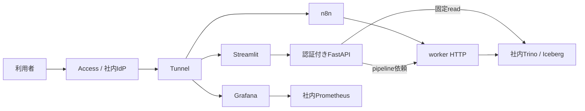

# Cloudflareを使う場所と社内に残す場所

<!-- doc-purpose:start -->
> **役割:** Cloudflareの入口保護・外部保存・AI候補を、社内に残す処理と分けて評価する。
>
> **対象読者:** 基盤構築担当 / 開発・設計担当
>
> **読むタイミング:** 未接続の外部サービスを追加する前に、通信・認証・費用・データ範囲を検討するとき。
>
> **前提となる資料:** [Lakehouse Foundation アーキテクチャ](<ARCHITECTURE.md>) / [AIへ渡せるデータとLangChain連携](<AI-READINESS.md>)
>
> **次に読む資料:** [ソース・指標・API・計算基盤を拡張する](<CUSTOMIZATION.md>) / [PoCの意思決定記録テンプレート](<reports/DECISION-RECORD-TEMPLATE.md>)
>
> **文書一覧:** [目的・読者から探す文書マニフェスト](<DOCUMENTATION-MANIFEST.md>)
<!-- doc-purpose:end -->

React版を公開する場合は[同一originの認証と設定](REACT-PORTAL.md#3-外部ブラウザーから開く)も
確認します。`DEMO_GUI_PUBLIC_URL`とアクセスするPortalのHTTPS originを一致させます。
Accessの認証とPoC所有者sessionは別で、Access loginを管理者権限へ自動変換しません。
各製品への公開リンク設定だけでTunnel/Access/native URLが完成したとは扱いません。

照合日: 2026-11-10。Cloudflareは外部のmanagedサービスで、このリポジトリに同梱するOSS・Compose profileではありません。社内のIceberg基盤を維持したまま入口を整える用途と、許可したデータをクラウド側へ置く用途を分けます。この資料は連携の設計・評価手順で、アカウント・ドメイン・Tunnel・課金サービスを自動的に有効化するものではありません。cloudflaredの採用版・lockも未設定です。

## 無料部分の管理プレーン実装

2026-11-15に、[独立したWorkers・D1の管理プロジェクト](../cloudflare/control-plane/README.md)を
追加しました。論理ソースの登録・編集、データ契約の下書きの版管理、監査と日本語画面を
実装しています。VMのReact試作とは別の実装です。実配備のURL・識別子・確認結果は
非公開のアクセス一覧で管理し、コード追加だけで実アカウントへの配備済みとは扱いません。

管理用のD1に業務行や物理接続情報は保存しません。Accessの限定ポリシーを再利用し、
保存した契約を実コネクターやSilverへ適用する機能はまだありません。有料プラン変更・
R2有効化・Basin資源作成を行わず、先に無料部分を検証する構成です。

## この基盤への当てはめ

| 機能 | この基盤で考えられる用途 | 導入時に決めること |
| --- | --- | --- |
| Tunnel | Streamlit、Grafana、n8n等の許可したWeb入口へ接続 | 公開するアプリ、接続元、会社からの外向き通信 |
| Access | IdPログインやポリシーで入口を制限 | 利用者、グループ、MFA、機械用サービス認証 |
| R2 | 許可した原本・Parquet・文書の外部保存 | 送信可能なデータ、暗号化、保持、復元、費用 |
| Basin Catalog | R2上のIcebergをmanaged REST catalogで管理 | 社内Lakekeeperとのcatalog境界、移行・writerの正本 |
| Basin SQL | Basin Catalog上のIcebergへserverless SQL | SQL機能、データ配置、性能・費用の実測 |
| Workers AI | 許可した文書の抽出、分類、embedding、推論 | モデル、送信範囲、評価、応答時間 |
| AI Gateway | 外部推論への経路、計測、制限、ログ方針 | provider、費用、prompt/responseログ、認証 |
| Vectorize | 文書・画像embeddingの検索索引 | 次元、metadata、利用者filter、削除同期 |
| AI Search | R2等の文書を検索・回答するmanaged経路 | 文書選別、chunk、検索品質、権限と引用 |

TunnelとAccessはWeb入口と利用者認証の候補です。Samba、SQL Server、Kafka、内部S3、Trino、カタログ管理APIを、Webアプリと同じ公開設定へまとめて登録しません。内部向けサービスを遠隔利用する必要がある場合は、会社のネットワーク設計として別に扱います。[Tunnel](https://developers.cloudflare.com/cloudflare-one/networks/connectors/cloudflare-tunnel/)、[Access](https://developers.cloudflare.com/cloudflare-one/access-controls/)

## 照合時点のIceberg関連名称

従来のR2 Data Catalogは、公式資料で **Basin Catalog** として案内されています。Iceberg REST catalogを公開し、Spark、PyIceberg、Trino等の接続手順があります。従来のR2 SQLも **Basin SQL** となっています。名称が変わる前のサンプルをそのまま新規構成へコピーせず、現行の接続・APIを確認します。[Basin Catalog](https://developers.cloudflare.com/basin-catalog/)、[Basin SQL](https://developers.cloudflare.com/basin-sql/)

2026-11-10に確認した公式文書では、旧設定/APIは引き続き動作する一方、将来の非推奨化が案内されています。「既に全廃された」「このキットがBasinへ移行済み」とは扱いません。SaaSの画面・APIはComposeのdigestで固定できないため、採用時のAPI、SDK/CLI版、確認日を別途記録します。

社内構成はSeaweedFSにデータ、Lakekeeperにcatalogを置きます。Basinを採用するなら、R2側のデータとcatalogを一つの配置単位として設計します。同じ表のmetadataを別々のcatalogから独立して更新する構成にはしません。エンジンの接続先を切り替えるだけで既存のデータや権限が移行するわけではありません。

## 入口だけを使う案



この案では業務表と原本を社内に残し、認証したWebアプリだけを接続対象にします。ただし画面の表示や操作に伴う通信がどこを経由するかは、会社の要件に沿って評価します。Tunnelを作ったことだけで、アプリ自身の権限やAPIのBearer認証が不要になるわけではありません。

会社がHTTP proxyだけを許可している場合、Tunnelの利用可否を先に確認します。Cloudflare TunnelにはUDP/TCPの7844等の通信要件があり、`HTTP_PROXY` を設定しただけで接続できるとは仮定しません。[公式の通信要件](https://developers.cloudflare.com/cloudflare-one/networks/connectors/cloudflare-tunnel/configure-tunnels/tunnel-with-firewall/)

### 任意の評価: Grafanaの入口を1つだけ作る

以下は会社がCloudflare利用、対象画面、IdPと外向き通信を認めた後の評価順です。現在のComposeを起動する手順には含めません。まず合成データの検証先を使います。

1. 既存Grafanaを導入先自身のブラウザーで開き、ログインと保存ができることを確認します。公開名には会社で許可されたzoneのhostnameを用意します。説明中の `grafana.example.invalid` は実際には登録できない見本です。
2. Cloudflare dashboardの **Zero Trust → Access controls → Applications → Create new application** から **Self-hosted and private** を選び、許可された公開hostnameを登録します。
3. 対象IdPとAllow policyの利用者/グループを指定し、セッションの設定を保存します。全員向けBypassを作らず、公開ルートを作る前にそのhostnameへのAccess制限を準備します。[公式Access操作](https://developers.cloudflare.com/cloudflare-one/access-controls/applications/http-apps/self-hosted-public-app/)
4. **Networking → Tunnels** でtunnelを作成します。会社で選定したcloudflaredの版・導入方法を使い、接続tokenは専用private保管へ置きます。本キットに実装済みのinstallerではありません。
5. connectorが接続したらtunnelの **Routes → Add route → Published application** を開き、同じ公開hostnameを指定します。この例ではconnectorをhostで動かす方式を選び、Service URLに `http://localhost:<GRAFANA_PORT>` の実portを入れます。[公式Tunnel操作](https://developers.cloudflare.com/cloudflare-one/networks/connectors/cloudflare-tunnel/get-started/create-remote-tunnel/)
6. 未認証・許可されていない利用者が拒否され、許可された利用者だけがAccessログイン後にGrafanaのログイン画面へ進めることを確認します。AccessはGrafana側のログイン・権限を自動設定しません。
7. Dashboard表示・保存・再読み込みを確認します。失敗したらTunnelの接続状態、Access policy、hostからのorigin到達、アプリの外部URL設定を順に確認します。

connectorを独立コンテナへ変えると、そのコンテナのlocalhostはhostのGrafanaではありません。内部networkやoriginの設計も変更になるため、上のhost向けURLをそのまま流用しません。社内HTTPS originを使う場合は信頼するCAとhostnameを設定し、TLS検証を無効にして通す手順にはしません。

n8nのwebhook外部URL・cookie、Streamlit/JupyterのWebSocket、MCPのHost/Origin制限は製品ごとに追加確認が必要です。Grafana1画面の試験成功を、全UIやAPIの公開成功へ広げて扱いません。Samba、SQL Server、Kafka、S3管理APIをこの公開アプリ一覧へ追加する手順は用意していません。

### 並行PoCを外から開く場合

[並行PoC](PARALLEL-POC.md)の新projectだけを対象にします。既存mainのTunnelやDNSを
転用せず、公開hostname、許可する利用者、origin、選択commitをprivateに記録します。
次の名前は登録できない架空例です。実ドメイン、利用者のメール、Tunnel tokenはGitへ
保存しません。表は**設定候補**で、DNS・Access・Tunnelを作成した結果ではありません。

| 画面 | 公開hostnameの例 | hostで動くconnectorからのorigin候補 |
| --- | --- | --- |
| 合成metadataの単独preview | `onboarding-poc.example.invalid` | `http://127.0.0.1:8510` |
| 新PoCのPortal | `poc.example.invalid` | `http://127.0.0.1:28501` |
| 新PoCのGrafana | `grafana-poc.example.invalid` | `http://127.0.0.1:23000` |
| OpenObserve Lab | `observe-poc.example.invalid` | `http://127.0.0.1:25080` |

最初は動作確認済みの1画面で評価し、未起動のLabを公開済みとは扱いません。
同じzone直下の別名を使い、既存名との衝突と適用されるedge証明書を事前確認します。
container実行のconnectorへ上のloopback URLをコピーしません。networkの接続範囲や
originを変更する場合は、その差分を別にレビューします。

1. Cloudflareの **Zero Trust → Access controls → Applications** で
   **Self-hosted and private** を選び、使うhostname全体を保護します。
   `/dashboard`等の一部pathだけの制限では、他のAPI/WebSocket pathが対象外になり得ます。
   Allow policyは本人または承認した利用者に限定し、Everyone/Bypassを追加しません。
   Accessは既定拒否です。IdPとsession期間を選び、必要なMFAを設定します。
   メールのone-time PINだけをMFA達成とは記録しません。
2. Access applicationを保存した**後**で、専用Tunnelのpublished application routeを
   追加します。公式手順の **Protect with Access** でconnectorによるapplication tokenの
   検証を設定し、正しいteam/applicationに対応することを確認します。
   origin側のtoken検証を選ぶ場合も、未検証のまま公開しません。
3. 未認証、許可外アカウント、期限切れsessionが拒否され、許可した本人だけが
   originへ到達することを確認します。nativeのアプリ認証・権限は維持します。
   Accessのログインをアプリ管理者権限へ自動変換しません。
4. Streamlitのwidget/session、Grafanaの保存/Explore、OpenObserveの検索など、
   対象画面で必要なWebSocket・POST・redirect・cookieを確認します。
   CORS/XSRFやTLS検証を無効化して通しません。外部URLの変更が必要なら、
   対象アプリだけの設定差分としてレビューします。
5. 解除時は新PoCのrouteとAccess applicationの対応を確認し、routeを先に停止します。
   Accessだけを削除して、保護のないrouteを残しません。mainの入口・volume・GUI編集は
   この解除の対象にしません。

Tunnelは内側から外向きに接続するため、origin向けの新しい受信port開放を前提にしません。
外向き到達・組織の利用許可は別に必要です。Tunnel接続、DNS/Access作成、実ブラウザーの
認証/拒否試験は未実施で、cloudflaredの採用版・配布物もまだ固定していません。
この章にconnectorのインストールや起動を自動実行するコマンドはありません。
Docker APIの拒否がある場合に、別経路で配置を強行する手順として使いません。

Jupyter/n8n/Superset等を広げるときも別hostnameと許可対象を個別確認します。
SQL Server、Samba、Kafka、S3/catalog管理API、Spark/Sail RPC、Docker/Dokploy管理入口は
この画面公開に含めません。機械向けAPI/MCPはAccessのService Authと既存Bearer認証、
CSRF/Host/Originの扱いを別に設計します。

2026-11-12に公式資料を再確認しました。
[Tunnelの接続方向](https://developers.cloudflare.com/tunnel/concepts/)、
[Access作成順・既定拒否・token検証](https://developers.cloudflare.com/cloudflare-one/access-controls/applications/http-apps/self-hosted-public-app/)、
[dashboardからのTunnel作成](https://developers.cloudflare.com/cloudflare-one/networks/connectors/cloudflare-tunnel/get-started/create-remote-tunnel/)
を参照してください。

### LakekeeperのUIが「Unreachable」と表示される場合

LakekeeperはUIとカタログ管理APIが同じportにあります。この項目は、管理APIも含めた
公開を別途承認し、hostname全体をAccessで保護した導入だけに適用します。

内部の`/health`が200でも、UIのJavaScriptが`http://catalog:8181/`へ接続すると、
外部のPCはDocker内の名前を解決できません。HTTPS画面からのHTTP要求も失敗します。
Lakekeeper 0.14.xの`LAKEKEEPER__UI__LAKEKEEPER_URL`は、ブラウザー向けの接続先です。
本構成では既存の`CATALOG_PUBLIC_URL`をこの設定へ渡し、内部用の
`LAKEKEEPER__BASE_URI=http://catalog:8181`は保持します。
[採用版の公式UI設定](https://docs.lakekeeper.io/docs/0.14.x/configuration/#ui)

```dotenv
CATALOG_PUBLIC_URL=https://catalog.example.invalid
```

公開URLが空の場合、UIは`http://localhost:<CATALOG_PORT>`を使用します。
これは導入先本人のブラウザーまたは同portのSSH転送用で、他のPCのlocalhostではありません。
設定を同じmanagerで`catalog`へ反映した後、ブラウザーを再読み込みし、開発者ツールの
Networkで管理APIの要求先が承認したHTTPS originになっていることを確認します。
初期化・migration・warehouse作成をやり直す必要はありません。
CORSを`*`にしたりAccess・認証・TLS検証を解除する方法で解決しません。

## AIの補助に使う案

文書はR2、検索索引はVectorize、検索・回答はAI Search、独自処理はWorkers AIという役割分担が考えられます。これらは、本リポジトリのGold数値の集計規則を置き換えるものではありません。数値は確定したGoldから取得し、文書は根拠ページや原本ハッシュを持たせます。[Workers AI](https://developers.cloudflare.com/workers-ai/)、[Vectorize](https://developers.cloudflare.com/vectorize/)、[AI Search](https://developers.cloudflare.com/ai-search/)

AI Gatewayを使う場合は、providerへの経路と同時にprompt/responseのログ方針を決めます。業務データを含む本文の保存、cache、閲覧者、保持期間を確認します。[AI Gateway](https://developers.cloudflare.com/ai-gateway/)

LangChainからも接続候補はありますが、今回の同梱例はローカルOllamaを使う独立した例です。Cloudflareの認証情報や実データを公開コードへ入力しません。まず [AI-READINESS.md](AI-READINESS.md) のsnapshot付きcontextで、参照・引用・評価の契約を確かめます。

## 採用する順序

1. 社内のcore、GUI、監視、メダリオンを完成させます。
2. 遠隔利用が必要なら、許可したWeb入口についてTunnelとAccessを評価します。
3. 原本の外部保存が必要なら、R2への保存・参照・削除・復元を小さな合成データで試します。
4. catalogやSQLのmanaged運用が必要なら、Basinを別環境で評価します。
5. 文書検索や推論が必要なら、AI機能を品質と費用の評価付きで追加します。

同時に全機能を有効にする計画にはしません。それぞれの採用理由、データの所在、認証、社内通信許可、検証結果を残して判断します。

## 今回照合した一次資料と未実装の範囲

| 公式資料 | 確認した内容 |
| --- | --- |
| [Basin Catalog](https://developers.cloudflare.com/basin-catalog/)、[Basin SQL](https://developers.cloudflare.com/basin-sql/) | 2026-10-01更新の名称・GA・旧API継続と将来の非推奨化。社内Lakekeeperとは別catalog |
| [Tunnelのdashboard作成](https://developers.cloudflare.com/cloudflare-one/networks/connectors/cloudflare-tunnel/get-started/create-remote-tunnel/) | Networking / Tunnels、Published application route、origin URL |
| [Accessのself-hosted app](https://developers.cloudflare.com/cloudflare-one/access-controls/applications/http-apps/self-hosted-public-app/) | Access controls / Applications、IdP、Allow policy |
| [Tunnelとfirewall](https://developers.cloudflare.com/cloudflare-one/networks/connectors/cloudflare-tunnel/configure-tunnels/tunnel-with-firewall/) | QUICはUDP7844、HTTP/2はTCP7844。通常のHTTP proxy設定だけの保証ではない |
| [AI Search](https://developers.cloudflare.com/ai-search/) | managed検索・入力・索引・回答の候補。今回のGold context取得とは別機能 |

リポジトリ内にCloudflareのtoken、Tunnel設定、R2資格情報、稼働済みBasin writer、Workers deployment、Vectorize索引同期はありません。新構想のBasin転送用初期コードは末尾の節で説明します。リンクは導入判断用の一次資料で、会社側の疎通・公開・課金・データ移行を検証した記録ではありません。

## 初心者の確認: 公開入口とアプリ本体は別

この文書を読む段階ではCloudflareのaccount、token、Tunnel、R2、課金は未設定です。操作するのは、会社で利用を認められたネットワーク/IdP管理者と、対象アプリの管理者です。基盤のPoCを試すだけなら、まずloopbackとSSH転送で完了でき、Cloudflareを導入する必要はありません。

| 言葉 | 役割 | このキットとの境界 |
| --- | --- | --- |
| 公開hostname | 利用者がブラウザー等へ入力する名前 | 会社で許可された名前を別途用意 |
| connector | 外部入口からoriginへ接続するcloudflared | このCompose/lockへ未同梱 |
| origin | 実際に画面/APIを提供する内部アプリ | 既存Grafana/Streamlit等。起動と認証は元のまま必要 |
| Access policy | 外部入口へ来た利用者等の接続条件 | アプリ内のroleやテーブル認可を自動生成しない |

origin URLのlocalhostは、connectorを動かす場所から見たlocalhostです。host実行と別コンテナ実行で同じ意味ではありません。最初の試験は、既に内部で正常に動く合成環境の1画面だけを選びます。UIごとに内部の接続経路も異なり、StreamlitはFastAPI、n8nはworker、GrafanaはPrometheusへ接続します。

## 採用前に残す通信とデータ所在の表

以下は設計用の記入表で、送信を承認したという記録ではありません。実hostname、URL、IdP利用者、token、価格条件は社内版へだけ記入します。

| 経路 | 送るもの | 受け取るもの | 保存/ログ/認証で確認すること |
| --- | --- | --- | --- |
| Web入口だけ | 画面の要求・表示内容・操作 | アプリの画面/結果 | 利用者、session、経由先、アプリ自身の認証 |
| 外部object保存 | 許可した原本/文書/Parquet | object参照・読出し | data/metadataの所在、鍵、保持、削除、復元 |
| 外部検索/推論 | 許可した文書・context・質問 | 検索結果/回答 | 入力/出力のlog、権限filter、引用、再利用、費用 |
| managed catalog/SQL | 合意した表とmetadataの操作 | catalog/SQLの結果 | writerの正本、移行、互換性、失敗/切戻し |

Tunnel/Accessの評価に成功したから、原本をR2へ移す必要が生じるわけではありません。R2の採用に成功したから、LakekeeperとBasinの同じ表への独立writerを並べてよいことにもなりません。入口、保存、catalog、推論は別の意思決定として記録します。

## 中級・上級: 1画面から広げるための受入

1. 内部originへの到達とnativeログイン、画面の保存を先に確認します。
2. 外部入口で未認証/許可外が拒否され、許可した利用者だけがoriginへ進めることを確認します。
3. 画面表示だけでなく、長い要求・WebSocket・Download等、そのアプリで必要な操作を試します。成功した画面の範囲を記録します。
4. 機械クライアントではAccess側の認証とMCP/API側のBearerを別々に扱えるか、採用する公式のclient手順で確認します。1つのtokenを全層へ使い回しません。
5. 接続解除時のDNS/route/policy、アプリの内部利用、社内へ保持するデータへの影響を確認します。data移行の切戻しは別計画です。

現コードへ統合する前にcloudflared等の版・配布元・lock、proxy/CA・origin到達、tokenの非公開保管、監視、利用範囲を決めます。Cloudflareに関する図は [用途別素材](reports/README.md) と [AIの入口](AI-READINESS.md) を使い、未導入の選択案として示します。実単価や上限は採用時の公式資料で確認し、測っていない費用削減や通信成功を報告しません。[意思決定記録](reports/DECISION-RECORD-TEMPLATE.md)


## 新構想のKafkaからBasinへの初期転送

基盤PoCのReact移植・メタデータ下書きと、Cloudflare中心の新構想は別の到達点です。本節の送信部分は新構想用checkoutだけに追加する最初の実装で、既存TrueNASの生成ツール・DB・CDCや、基盤PoCのconsumerを置換しません。

### 実装した範囲と、まだ未確認の範囲

実装は [basin_relay.py](../infra/cloudflare/basin_relay.py) です。Debeziumの作成・更新・削除・snapshot・tombstoneを、選択列だけのJSONイベントへ変換します。実topic名・source内のDB名やホスト情報はイベントへ入れず、private設定で対応付けた論理名を使います。

HTTP受付成功後だけ、専用Kafka consumer groupの次のoffsetを同期commitします。自動commitと自動offset保存、topicの自動作成は無効です。HTTP成功はBasin Streamの受付確認として扱い、R2への永続化、Icebergへの反映、Silver/Goldの計算完了を保証しません。HTTP成功とKafka確定を一つのtransactionにする実装でもありません。

送信の応答が不明な場合は位置を進めず停止します。HTTP成功後・Kafka確定前に停止した場合は再送され得ます。source_id・capture_epoch・論理topic・partition・offsetから同じevent_idを計算しますが、これは重複を識別する仕組みで、重複排除済みという意味ではありません。後続のSilverではevent_idと業務上の更新順序を使う設計・受入が必要です。元Kafkaを作り直してoffsetを再利用する場合、capture_epochを切り替えます。

合成テストは列の射影、主キー欠落の拒否、更新・削除・tombstoneの区別、再送ID、送信前の全件検査、応答不明時の未commit、SDKの手動commit設定、件数・サイズ、privateファイルと送信先、redirect拒否を検査します。実Kafkaとの再接続・rebalance・部分commit障害、Cloudflareの実受付、Basin Catalog/SQL、D1との契約同期、実負荷は未受入です。合成senderとconsumerの成功を、これらの実績へ読み替えません。

### private設定の契約

設定JSONはGit外・実行者所有の0600ファイルにします。接続値をD1へ登録したり、公開Gitへ保存したりしません。

| 項目 | 意味・拒否条件 |
| --- | --- |
| source_id | オンプレの接続値を含まない論理ソース名 |
| capture_epoch | 元Kafkaの履歴・offsetが継続する単位。新規作成時は別の値を選ぶ |
| group_id | lakehouse-basin-で始まる専用group。既存CDCのgroupは再利用しない |
| endpoint | 公式のHTTPS Stream ingest URLだけを許可。query・userinfo・別path・別hostは拒否 |
| kafka | オンプレに保持する接続設定。許可したSDK項目だけを受け付け、auto commitの上書きは拒否 |
| topics | 実topicごとのalias・table・columns・key_columns。実topic名は外へ送らない |
| initial_offset_policy | 既定error。専用groupに確定位置がなければ暗黙にスキップしない。earliestは担当者が開始範囲を確認して明示する |

次は形式確認専用の合成例です。このendpointは実Streamではなく、Kafkaへも接続しません。実運用値はオンプレのprivateファイルで別途用意します。

```json
{
  "source_id": "synthetic-mes",
  "capture_epoch": "demo-v1",
  "group_id": "lakehouse-basin-synthetic",
  "endpoint": "https://synthetic.ingest.cloudflare.com",
  "initial_offset_policy": "error",
  "kafka": {
    "bootstrap.servers": "localhost:9092"
  },
  "topics": {
    "synthetic.orders": {
      "alias": "orders",
      "table": "orders",
      "columns": ["id", "quantity"],
      "key_columns": ["id"]
    }
  }
}
```

各topicではkey_columnsをcolumnsにも含めます。主キー欠落、不正なJSON、未対応operation、更新後rowの欠落は送信前に拒否し、そのbatchを確定しません。選択列の名前に明らかな資格情報名を指定することも拒否します。ただし列名の検査は任意の機密値を識別するDLPではありません。JSON文字列や業務列に個人情報・秘密値が入る可能性を含め、送信列とデータを事前に確認してください。メタデータGUIのチェック欄を正式な輸出承認と扱う実装はありません。

tokenはBasin Pipelines Send権限の専用値を別のGit外0600ファイルに置き、URLや設定JSONへ埋め込みません。公式endpoint、JSON配列、Bearer認証は [公式のStream書き込み手順](https://developers.cloudflare.com/basin-pipelines/streams/writing-to-streams/) に基づきます。認証を無効化するサンプル設定は採用しません。

### 実行と制限

初期配置を自動起動サービスやDokployへ追加する段階ではありません。まずオンプレの専用groupと、送信可能なデータ・認証済みStreamを担当者が用意します。R2・Basinのリソースや課金を、このコードの実行で新規作成することもありません。

専用venvへ infra/cloudflare/requirements.lock をhash付きで同期し、Kafka SDKを既存CDCと同じ版に揃えます。--helpは標準ライブラリだけで動きます。設定を指定した通常実行はplanで、Kafka参加もHTTP送信も行いません。実送信には--applyと--token-fileが必要です。

1回の既定上限は100件、1batchは50件、入力が10秒間なければ終了します。最大は1回10000件、1batch100件・256KiB、入力の単一JSONは1MiBです。大きすぎるbatchは勝手に分割・切捨てせず、未送信のまま停止します。担当者がbatch-sizeを下げて再実行します。未知の接続障害やcommit応答不明も停止し、原文・接続先・tokenをエラーへ反射しません。

次は、専用Kafka groupによる有限の合成送信、Stream受付とR2/Iceberg到達の別々の確認、再接続・再送・障害復旧、Silver/Goldの整合、D1管理情報・AI Gatewayの順で受け入れます。既存のAccess許可範囲、TrueNAS Apps、DB、CDCの保存位置は維持します。
