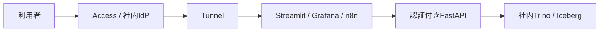

# Cloudflareを使う場所と社内に残す場所

照合日: 2026-11-10。Cloudflareは外部のmanagedサービスで、このリポジトリに同梱するOSS・Compose profileではありません。社内のIceberg基盤を維持したまま入口を整える用途と、許可したデータをクラウド側へ置く用途を分けます。この資料は連携の設計・評価手順で、アカウント・ドメイン・Tunnel・課金サービスを自動的に有効化するものではありません。cloudflaredの採用版・lockも未設定です。

## この基盤への当てはめ

| 機能 | この基盤で考えられる用途 | 導入時に決めること |
| --- | --- | --- |
| Tunnel | Streamlit、Grafana、n8n等の許可したWeb入口へ接続 | 公開するアプリ、接続元、会社からの外向き通信 |
| Access | IdPログインやポリシーで入口を制限 | 利用者、グループ、MFA、機械用サービス認証 |
| R2 | 許可した原本・Parquet・文書の外部保存 | 送信可能なデータ、暗号化、保持、復元、費用 |
| Basin Catalog | R2上のIcebergをmanaged REST catalogで管理 | 社内Lakekeeperとのcatalog境界、移行・writerの正本 |
| Basin SQL | Basin Catalog上のIcebergへserverless SQL | SQL機能、データ配置、性能・費用の実測 |
| Workers AI | 許可した文書の抽出、分類、embedding、推論 | モデル、送信範囲、評価、応答時間 |
| AI Gateway | 外部推論への経路、計測、制限、ログ方針 | provider、費用、prompt/responseログ、認証 |
| Vectorize | 文書・画像embeddingの検索索引 | 次元、metadata、利用者filter、削除同期 |
| AI Search | R2等の文書を検索・回答するmanaged経路 | 文書選別、chunk、検索品質、権限と引用 |

TunnelとAccessはWeb入口と利用者認証の候補です。Samba、SQL Server、Kafka、内部S3、Trino、カタログ管理APIを、Webアプリと同じ公開設定へまとめて登録しません。内部向けサービスを遠隔利用する必要がある場合は、会社のネットワーク設計として別に扱います。[Tunnel](https://developers.cloudflare.com/cloudflare-one/networks/connectors/cloudflare-tunnel/)、[Access](https://developers.cloudflare.com/cloudflare-one/access-controls/)

## 照合時点のIceberg関連名称

従来のR2 Data Catalogは、公式資料で **Basin Catalog** として案内されています。Iceberg REST catalogを公開し、Spark、PyIceberg、Trino等の接続手順があります。従来のR2 SQLも **Basin SQL** となっています。名称が変わる前のサンプルをそのまま新規構成へコピーせず、現行の接続・APIを確認します。[Basin Catalog](https://developers.cloudflare.com/basin-catalog/)、[Basin SQL](https://developers.cloudflare.com/basin-sql/)

2026-11-10に確認した公式文書では、旧設定/APIは引き続き動作する一方、将来の非推奨化が案内されています。「既に全廃された」「このキットがBasinへ移行済み」とは扱いません。SaaSの画面・APIはComposeのdigestで固定できないため、採用時のAPI、SDK/CLI版、確認日を別途記録します。

社内構成はSeaweedFSにデータ、Lakekeeperにcatalogを置きます。Basinを採用するなら、R2側のデータとcatalogを一つの配置単位として設計します。同じ表のmetadataを別々のcatalogから独立して更新する構成にはしません。エンジンの接続先を切り替えるだけで既存のデータや権限が移行するわけではありません。

## 入口だけを使う案

この案では業務表と原本を社内に残し、認証したWebアプリだけを接続対象にします。ただし画面の表示や操作に伴う通信がどこを経由するかは、会社の要件に沿って評価します。Tunnelを作ったことだけで、アプリ自身の権限やAPIのBearer認証が不要になるわけではありません。

会社がHTTP proxyだけを許可している場合、Tunnelの利用可否を先に確認します。Cloudflare TunnelにはUDP/TCPの7844等の通信要件があり、`HTTP_PROXY` を設定しただけで接続できるとは仮定しません。[公式の通信要件](https://developers.cloudflare.com/cloudflare-one/networks/connectors/cloudflare-tunnel/configure-tunnels/tunnel-with-firewall/)

### 任意の評価: Grafanaの入口を1つだけ作る

以下は会社がCloudflare利用、対象画面、IdPと外向き通信を認めた後の評価順です。現在のComposeを起動する手順には含めません。まず合成データの検証先を使います。

1. 既存Grafanaを導入先自身のブラウザーで開き、ログインと保存ができることを確認します。公開名には会社で許可されたzoneのhostnameを用意します。説明中の `grafana.example.invalid` は実際には登録できない見本です。
2. Cloudflare dashboardの **Zero Trust → Access controls → Applications → Create new application** から **Self-hosted and private** を選び、許可された公開hostnameを登録します。
3. 対象IdPとAllow policyの利用者/グループを指定し、セッションの設定を保存します。全員向けBypassを作らず、公開ルートを作る前にそのhostnameへのAccess制限を準備します。[公式Access操作](https://developers.cloudflare.com/cloudflare-one/access-controls/applications/http-apps/self-hosted-public-app/)
4. **Networking → Tunnels** でtunnelを作成します。会社で選定したcloudflaredの版・導入方法を使い、接続tokenは専用private保管へ置きます。本キットに実装済みのinstallerではありません。
5. connectorが接続したらtunnelの **Routes → Add route → Published application** を開き、同じ公開hostnameを指定します。この例ではconnectorをhostで動かす方式を選び、Service URLに `http://localhost:<GRAFANA_PORT>` の実portを入れます。[公式Tunnel操作](https://developers.cloudflare.com/cloudflare-one/networks/connectors/cloudflare-tunnel/get-started/create-remote-tunnel/)
6. 未認証・許可されていない利用者が拒否され、許可された利用者だけがAccessログイン後にGrafanaのログイン画面へ進めることを確認します。AccessはGrafana側のログイン・権限を自動設定しません。
7. Dashboard表示・保存・再読み込みを確認します。失敗したらTunnelの接続状態、Access policy、hostからのorigin到達、アプリの外部URL設定を順に確認します。

connectorを独立コンテナへ変えると、そのコンテナのlocalhostはhostのGrafanaではありません。内部networkやoriginの設計も変更になるため、上のhost向けURLをそのまま流用しません。社内HTTPS originを使う場合は信頼するCAとhostnameを設定し、TLS検証を無効にして通す手順にはしません。

n8nのwebhook外部URL・cookie、Streamlit/JupyterのWebSocket、MCPのHost/Origin制限は製品ごとに追加確認が必要です。Grafana1画面の試験成功を、全UIやAPIの公開成功へ広げて扱いません。Samba、SQL Server、Kafka、S3管理APIをこの公開アプリ一覧へ追加する手順は用意していません。

## AIの補助に使う案

文書はR2、検索索引はVectorize、検索・回答はAI Search、独自処理はWorkers AIという役割分担が考えられます。これらは、本リポジトリのGold数値の集計規則を置き換えるものではありません。数値は確定したGoldから取得し、文書は根拠ページや原本ハッシュを持たせます。[Workers AI](https://developers.cloudflare.com/workers-ai/)、[Vectorize](https://developers.cloudflare.com/vectorize/)、[AI Search](https://developers.cloudflare.com/ai-search/)

AI Gatewayを使う場合は、providerへの経路と同時にprompt/responseのログ方針を決めます。業務データを含む本文の保存、cache、閲覧者、保持期間を確認します。[AI Gateway](https://developers.cloudflare.com/ai-gateway/)

LangChainからも接続候補はありますが、今回の同梱例はローカルOllamaを使う独立した例です。Cloudflareの認証情報や実データを公開コードへ入力しません。まず [AI-READINESS.md](AI-READINESS.md) のsnapshot付きcontextで、参照・引用・評価の契約を確かめます。

## 採用する順序

1. 社内のcore、GUI、監視、メダリオンを完成させます。
2. 遠隔利用が必要なら、許可したWeb入口についてTunnelとAccessを評価します。
3. 原本の外部保存が必要なら、R2への保存・参照・削除・復元を小さな合成データで試します。
4. catalogやSQLのmanaged運用が必要なら、Basinを別環境で評価します。
5. 文書検索や推論が必要なら、AI機能を品質と費用の評価付きで追加します。

同時に全機能を有効にする計画にはしません。それぞれの採用理由、データの所在、認証、社内通信許可、検証結果を残して判断します。

## 今回照合した一次資料と未実装の範囲

| 公式資料 | 確認した内容 |
| --- | --- |
| [Basin Catalog](https://developers.cloudflare.com/basin-catalog/)、[Basin SQL](https://developers.cloudflare.com/basin-sql/) | 2026-10-01更新の名称・GA・旧API継続と将来の非推奨化。社内Lakekeeperとは別catalog |
| [Tunnelのdashboard作成](https://developers.cloudflare.com/cloudflare-one/networks/connectors/cloudflare-tunnel/get-started/create-remote-tunnel/) | Networking / Tunnels、Published application route、origin URL |
| [Accessのself-hosted app](https://developers.cloudflare.com/cloudflare-one/access-controls/applications/http-apps/self-hosted-public-app/) | Access controls / Applications、IdP、Allow policy |
| [Tunnelとfirewall](https://developers.cloudflare.com/cloudflare-one/networks/connectors/cloudflare-tunnel/configure-tunnels/tunnel-with-firewall/) | QUICはUDP7844、HTTP/2はTCP7844。通常のHTTP proxy設定だけの保証ではない |
| [AI Search](https://developers.cloudflare.com/ai-search/) | managed検索・入力・索引・回答の候補。今回のGold context取得とは別機能 |

リポジトリ内にCloudflareのtoken、Tunnel設定、R2資格情報、Basin writer、Workers deployment、Vectorize索引同期はありません。リンクは導入判断用の一次資料で、会社側の疎通・公開・課金・データ移行を検証した記録ではありません。
