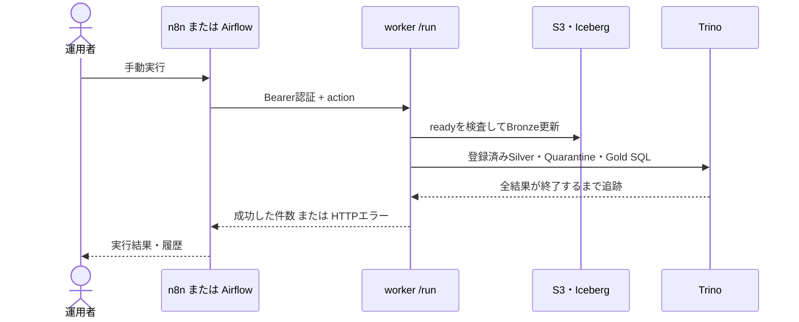

# n8n・Airflow・Grafanaを画面から使う

<!-- doc-purpose:start -->
> **役割:** n8n・Airflow・Grafanaで接続、認証、手動実行、履歴、保存を順に確かめる。
>
> **対象読者:** データ利用担当 / 運用担当
>
> **読むタイミング:** 対応profileを配置した後、同梱ジョブを画面から1回実行して確認するとき。
>
> **前提となる資料:** [初めて構築する人の一本道ガイド](<START-HERE.md>) / [MES・ERPデータをBronzeからGoldへ整える](<MEDALLION.md>)
>
> **次に読む資料:** [GrafanaのGUI編集と保存](<GRAFANA.md>) / [平時・更新・復旧の運用手順](<OPERATIONS.md>)
>
> **文書一覧:** [目的・読者から探す文書マニフェスト](<DOCUMENTATION-MANIFEST.md>)
<!-- doc-purpose:end -->

<!-- shell-usage:start -->
**コマンドのシェル:** 「Bash / Zsh共通」は同じ内容を使い、専用例は自分のシェルを選びます。[詳しい使い分け](SHELLS.md)。

Zshの対話端末では、コメント付きの例を貼る前に一度だけ次を実行します。Bashでは不要です。

**Zsh**

```zsh
setopt INTERACTIVE_COMMENTS
```
<!-- shell-usage:end -->

照合日: 2026-11-10。n8n **2.46.7**、Airflow **3.4.0**（standard provider 1.21.0 / HTTP provider 6.3.0）、Grafana **13.3.0**、Prometheus **3.16.0** が対象です。英語UIの表記を示します。接続→認証→1回の手動実行→履歴→保存の順で確認します。

この文書は、同梱設定を起動した後の画面操作を説明します。n8nとAirflowは登録済みのworkerジョブを呼び、Grafanaは実行状態を表示します。業務上の列変換・採用ルール・集計の正本は [medallion/](../medallion/) のSQLです。画面で任意のSQLをworkerへ送る機能はありません。

## 1. 画面と接続先を区別する

private envの `COMPOSE_PROFILES` へ、必要な機能を追加してから起動します。3機能すべてを使う例は `automation,monitoring,orchestration` です。既存の他プロファイルを使用中なら、その設定も保持します。

以下の `up` は**CLI管理の場合だけ**実行します。Dokploy管理ではComposeサービス自身のEnvironmentを保存し、9ファイルを使ってDeployします。起動方法を重ねません。[配置手順](DOKPLOY.md)

**Bash / Zsh共通**

```bash
export LAKEHOUSE_ENV_FILE="$HOME/.config/lakehouse-foundation/site.env"
./scripts/lakehouse.sh plan
./scripts/lakehouse.sh up
```

| 画面 | profile | サーバー自身から開く既定URL | private設定 |
| --- | --- | --- | --- |
| n8n | `automation` | `http://localhost:5678` | `N8N_PORT` |
| Airflow | `orchestration` | `http://localhost:8081` | `AIRFLOW_PORT` |
| Grafana | `monitoring` | `http://localhost:3000` | `GRAFANA_PORT` |
| Prometheus | `monitoring` | `http://localhost:9090` | `PROMETHEUS_PORT` |
| Trinoの実行状況 | core | `http://localhost:8080/ui/` | `TRINO_PORT` |

別端末のlocalhostは、その別端末自身です。別端末から使う場合は、導入先の限定アドレスまたはSSH転送等の経路を使います。ここには会社の実アドレスを記入しません。

一方、n8nやAirflowのコンテナからworkerを呼ぶURLは `http://worker:8000/run` です。コンテナ内部のlocalhostへ変えると、そのコンテナ自身を呼んでしまいます。標準構成ではworkerの8000番をホストへ公開せず、同じComposeネットワークのサービス名で接続します。



初回の素材は [DEMO-DATA.md](DEMO-DATA.md) に従って投入します。画面で実行しただけでは、会社DBの抽出や疑似データの生成が自動で始まるわけではありません。

### Dokployで配置したサイトから始める場合

1. [DOKPLOY.md](DOKPLOY.md) のGit配置で9本のComposeを結合し、サービス自身のEnvironmentへprivate設定を保存してDeployを完了します。
2. **Containers** 一覧でn8n、Airflow、Grafanaと各DBの状態を確認します。1つのContainers行のメニューにある **View Logs** / **Terminal** を使い、サイト全体の再Deployと区別します。
3. private envの各portへブラウザーで接続します。Dokployの画面から開いたTerminalが、そのままn8n等のWeb画面になるわけではありません。
4. GUIの初期値は管理者端末でprivate `site.env` をエディターで確認します。n8n ownerのログイン情報は、このファイルからは取得できません。

| 画面・接続 | 初回の値 | 設定を変えた後 |
| --- | --- | --- |
| n8n owner | 初回GUIで本人が作る | GUIのユーザー設定で管理 |
| n8n Header Auth | `WORKER_TOKEN` に `Bearer ` を付ける | Credentialを保存。workflowを再実行して確認 |
| Airflow login | state内の生成JSONのadmin password | 同じstateを維持。会社共有用IdPは別設計 |
| Airflow Connection | Passwordへ `WORKER_TOKEN` だけ | Save後の次のtask実行で読む |
| Grafana admin | `admin` / `GRAFANA_ADMIN_PASSWORD` | GUIで変更した場合private設定も合わせる |

private envを `source` して設定する必要はありません。秘密値を含むファイル全体の表示・共有を避け、必要な値を必要な入力欄へだけコピーします。

## 2. n8nの最初の管理者を作る

1. `automation` を有効にしてupを完了し、n8nのURLを開きます。
2. 新規DBの場合はownerの登録画面が出ます。運用する本人のメール、名前、パスワードを画面で設定します。
3. 作成したアカウントでログインし、ワークフローの編集画面を開きます。
4. 既にownerを作成済みの環境では、そのアカウントでログインします。再起動のたびに作り直しません。

このComposeはownerのログインパスワードを自動設定しません。SMTPも同梱設定で準備していないので、メールによるパスワード再設定が使える状態とは限りません。初回owner作成はn8nの標準セットアップです。[n8n User management](https://docs.n8n.io/hosting/configuration/user-management-self-hosted/)

混同しやすい値を分けて保管します。

| 値 | 用途 | どこで決めるか |
| --- | --- | --- |
| ownerのログイン情報 | 人がn8nへログイン | 初回GUI |
| `WORKER_TOKEN` | n8nからworkerへジョブを依頼 | private envの生成値 |
| `N8N_DB_PASSWORD` | n8nから専用PostgreSQLへ接続 | private envの生成値 |
| `N8N_ENCRYPTION_KEY` | 保存した資格情報を暗号化・復号 | private envの生成値を継続使用 |

ワークフロー・アカウント・資格情報はn8nのDB、関連する状態は専用volumeに保存します。同じDBと暗号鍵を維持することが、再起動後の利用の前提です。

## 3. n8nへworker用のHeader Authを登録する

同梱JSONには実トークンを保存していません。資格情報は画面で別に作ります。

1. n8nのCredentialsから新規作成するか、後述のHTTP Requestノードで新しい資格情報を作ります。
2. 種類は **Header Auth** を選びます。ワークフロー側の型は `httpHeaderAuth` です。
3. 分かりやすい管理名を付け、次の項目を入力して保存します。

| 資格情報の項目 | 入力 |
| --- | --- |
| Name | `Authorization` |
| Value | `Bearer ` の後ろに、private envの `WORKER_TOKEN` の実値 |

Bearerの後ろには半角空白が1つ必要です。ここでのValueは、環境変数名そのものや `${WORKER_TOKEN}` という式ではありません。private envをローカルで確認し、実値を資格情報欄へ入れます。ノードからの環境変数参照は標準設定で制限しているため、資格情報として登録します。

Header Authはヘッダー名と値をそのまま送ります。別のBearer Auth種類を選んだ場合とは入力方法が異なるので、同梱テンプレートではHeader Authのまま揃えます。[n8n HTTP Request credentials](https://docs.n8n.io/integrations/builtin/credentials/httprequest/)

## 4. 2つのワークフローをインポートする

ワークフロー編集画面のメニューから **Import from File** を選び、次の2ファイルをそれぞれ読み込みます。読み込み後は保存します。ファイル取り込みはn8n標準のJSON importです。[Export and import workflows](https://docs.n8n.io/workflows/export-import/)

| ファイル | 画面上の名前 | HTTPノード | 依頼する処理 |
| --- | --- | --- | --- |
| [workflow-ingest.json](../infra/automation/workflow-ingest.json) | `Lakehouse ingest` | `Run ingest` | 原本・Bronzeの取り込みだけ |
| [workflow-medallion.json](../infra/automation/workflow-medallion.json) | `Lakehouse medallion` | `Run medallion` | 取り込みを確認し、Silver→Quarantine→Goldまで更新 |

それぞれのHTTP Requestノードを開き、次を確認します。

| ノードの項目 | 設定 |
| --- | --- |
| Method | `POST` |
| URL | `http://worker:8000/run` |
| Authentication | `Generic Credential Type` |
| Generic Auth Type | `Header Auth` |
| Credential | 前の手順で作った資格情報を選択 |
| Send Body | 有効 |
| Bodyの形式 | JSON |
| ingest側の本文 | `{"action":"ingest"}` |
| medallion側の本文 | `{"action":"medallion"}` |
| Timeout | 同梱値は180000ミリ秒 |

資格情報名を選ぶ操作は**両方のワークフローで必要**です。JSONをimportしただけでトークンとの関連付けが済むわけではありません。追加のヘッダー欄へトークンを複製したり、JSON本文へパスワードを入れたりしません。

`medallion` は `ingest` を内包します。2つを順番に実行しなければ動かない構成ではありません。Bronzeまでの結果を切り分けたいときにingestを使い、業務表まで更新したいときにmedallionを使います。

## 5. 手動実行と結果の読み方

1. 対象のランディングに原本とreadyがあることを確認します。
2. `Lakehouse ingest` を開き、**Execute workflow** でManual runから実行します。
3. HTTPノードのOutputを開き、成功結果を確認します。
4. 続いて `Lakehouse medallion` を手動実行し、SQL文数まで確認します。

新しい6業務原本だけの例:

```json
{"imported": 6, "skipped": 0}
```

その直後に同じ入力でmedallionを実行した例:

```json
{"imported": 0, "skipped": 6, "sql_statements": 14}
```

画像等も置けばファイル数は変わります。0件importは、skipがあるなら「何も動かなかった」とは限りません。またHTTPノードのOutputだけで業務指標の正しさを判断せず、Goldの期待値も確認します。

保存したワークフローの **Executions** から実行を選び、成功・失敗、開始・終了、失敗したノード、HTTP statusを確認します。手動実行の保存はn8nの実行保存設定にも依存するため、履歴へ残らない場合はワークフローのSettingsで手動実行データの保存設定を確認します。実行データには応答が保存され得るので、業務データや秘密を不用意にOutputへ追加しません。

この2テンプレートは `active: false` で、Manual Triggerしか持ちません。Schedule Trigger、Webhook、失敗通知、自動retryは組み込んでいません。定期実行にする場合は開始条件・実行時間帯・重複時の扱いを設計して追加し、手動経路が成功してから有効にします。

n8n 2系では、エディターからの **Execute workflow** と、イベント・scheduleで自動実行する公開版を区別します。今回の手動実行に **Publish** は不要です。将来Schedule Triggerを追加する場合は、workflowのtimezoneと実行設定を確認して保存し、**Publish** した版で自動実行します。保存しただけでscheduleが開始すると解釈しません。[公式の実行種別](https://docs.n8n.io/workflows/executions/manual-partial-and-production-executions/)

### HTTP statusと次の確認

| 状態 | 現在のworkerの意味 | 操作 |
| --- | --- | --- |
| 200 | 依頼した処理が終了して結果を返した | 件数とGoldの期待値を確認 |
| 400 | 未知のaction、本文サイズ等の不正 | JSON設定と同梱テンプレートとの差を確認 |
| 401 | Bearer不一致・未設定 | Name、Value、private envの対象サイトを確認 |
| 404 | URLのパスが違う | `/run` まで含むか確認 |
| 409 / `WorkerBlockedError` | Trinoの中止を確認できず、workerが新規処理を停止している | 管理者がTrinoの実行終了を確認してからworkerを再起動 |
| 500 | 取り込み・SQL・期待値等の失敗。または別ジョブ実行中の拒否 | 原本契約、サービス状態、ログのエラー種別と位置を確認 |
| クライアント側Timeout | n8nが応答を待てなくなった | サーバー側も終了したとは限らない。Trinoとworker状態を確認してから再実行 |

同梱ノードにはエラーを無視して先へ進む設定を入れていないため、409や500等はノード・実行の失敗になります。通常の同時実行拒否は現実装ではHTTP500であり、409とは区別します。409の復旧は、前のクエリが終了・中止したことを管理者が確かめてから行います。単に画面で何度も再実行する操作では解除しません。

workerの `/health` は内部ネットワークから確認でき、blocked時は503です。Trinoの標準Web UIでは実行中クエリを確認できますが、このキットは標準Web UIをSQLエディターとして説明していません。

## 6. Airflow 3.4の接続をGUIで設定する

`orchestration` はLocalExecutorのstandalone構成です。DAGはコードとして同梱し、トークンは実行時にConnectionから読みます。DAG読み込み時や公開Pythonファイルへトークンを書き込みません。

1. `orchestration` を有効にしてupを完了し、AirflowのURLを開きます。
2. Simple Auth Managerの管理者でログインします。初回のパスワードはAirflowのstate領域に生成される `simple_auth_manager_passwords.json.generated` を、管理者が非公開の操作で確認します。生成ファイルや内容を公開ログへ貼りません。
3. **Admin → Connections → Add Connection** を開きます。
4. 次の項目を設定してSaveします。HTTP providerは同梱Dockerfileで導入しています。[Airflow 3.4 Connections](https://airflow.apache.org/docs/apache-airflow/3.4.0/howto/connection.html#creating-a-connection-with-the-ui)

初回passwordの確認は、Dokployの **airflow行 → Terminal** を管理者だけが開き、次を実行する方法があります。この出力はその管理者端末内で扱います。コンテナ名やhost上のvolume pathを推測する必要はありません。

**Bash / Zsh共通**

```sh
python -m json.tool /opt/airflow/simple_auth_manager_passwords.json.generated
```

`AIRFLOW_DB_PASSWORD` や `AIRFLOW_JWT_SECRET` はUIのログインpasswordではありません。生成ファイルがまだないときはstandaloneの初期化完了とコンテナ状態を確認し、空の新しいstateへ付け替えないでください。

| Connectionの項目 | 入力 |
| --- | --- |
| Connection Id | `lakehouse_worker` |
| Connection Type | `HTTP` |
| Description | worker用と分かる任意の説明 |
| Host | `worker` |
| Schema | `http` |
| Port | `8000` |
| Login | 空欄 |
| Password | private envの `WORKER_TOKEN` **実値だけ** |
| Extra | 空欄でよい |

**AirflowのPasswordには `Bearer ` を付けません。** 同梱DAGが実行時にその接頭辞を付けます。n8nのHeader Auth欄と同じ文字列をそのままコピーすると、二重にBearerを付けて401になるので区別します。

Hostにはパスや資格情報を含めず、`/run` は入力しません。DAGがHost・Schema・PortからURLを組み、最後に `/run` を付けます。ConnectionをGUIのDBへ保存する場合、Password等の暗号化にはprivate envの `AIRFLOW_FERNET_KEY` を継続して使います。DBだけを移して鍵をなくすと接続情報を復号できません。

HTTP providerの接続テストが表示されても、それだけで本DAGのBearer認証付きジョブ成功を確認したことにはしません。このDAGは保存された項目を読み、自分でAuthorizationヘッダーを構成します。次の手動DAG実行を確認に使います。

## 7. AirflowのDAGを手動実行し、ログを読む

同梱DAGは [lakehouse_medallion.py](../infra/orchestration/dags/lakehouse_medallion.py) です。

1. DAG一覧で `lakehouse_medallion` を探します。見つからなければDAGの読み込みエラーを確認します。
2. 初回はpausedなので、画面のスイッチでunpauseします。
3. **Trigger / Trigger DAG** から手動実行します。通常は追加のconfは不要です。
4. 実行のGridまたはGraphで `run_medallion` taskを選び、成功状態まで待ちます。
5. taskのLogsでHTTP status等のエラーを確認します。成功時はDAG run全体も成功になったことを確認します。

| 同梱設定 | 意味 |
| --- | --- |
| `schedule=None` | 時刻による定期実行をしない |
| `catchup=False` | 過去日分を自動でまとめて実行しない |
| `max_active_runs=1` | このDAGの同時runは1つ |
| `retries=0` | 失敗taskを自動retryしない |
| `execution_timeout=10分` | task実行の上限 |
| workerへのHTTP待ち時間300秒 | task上限とは別の通信待ち時間 |
| `do_xcom_push=False` | worker応答等をXComへ積まない |
| `show_return_value_in_logs=False` | 成功応答の詳細をログへ表示しない |

unpauseしても `schedule=None` は変わらないため、定期実行は始まりません。DAGの時刻設定を変える作業は、ワークフローの定義変更として別途行います。

Connectionがない、Passwordが空、HTTP401、409、500等はtask失敗です。UIがtaskを失敗と表示したときは、原因を修正した後、前のworker処理が終了していることを確認して再実行します。n8nと同時に実行した場合も、同じworkerの排他に従います。

このDAGはworkerのmedallionジョブを1taskで呼ぶものです。14個のSQLがAirflow画面で別taskになる構成ではなく、列のマッピングをAirflow画面で編集する機能もありません。

taskのLogsで `Worker rejected the request: HTTP 401` ならConnection、HTTP500なら原本・変換・重複実行を調べます。成功時の戻り値本文はXComやtask logへ積まない設定なので、応答JSONが表示されないこと自体は失敗ではありません。Data画面またはSupersetでGoldを確認してください。Airflow画面の過去runをClearすると再実行を起こすため、ログを見るだけの操作と区別します。[Airflow 3.4.0のDag Run状態](https://airflow.apache.org/docs/apache-airflow/3.4.0/core-concepts/dag-run.html)

## 8. Grafanaを初期化し、GUIの変更を保存する

`monitoring` を起動するとPrometheusがworkerの `/metrics` を15秒ごとに収集します。CLIのupは、初期ダッシュボードがないときだけテンプレートから作成します。DokployのGit配置等でupスクリプトを通さなかった場合は、起動後に実行します。

**Bash / Zsh共通**

```bash
./scripts/lakehouse.sh grafana-init
```

1. GrafanaのURLを開きます。標準の管理者は `admin`、初期パスワードはprivate envの `GRAFANA_ADMIN_PASSWORD` です。
2. Dashboardsから **Lakehouse Operations** を開きます。UIDは `lakehouse-operations` です。
3. パネルのメニューからEditへ進み、タイトル・PromQL・表示形式・配置等を編集します。
4. 編集を確定してダッシュボードをSaveします。表示上変わっただけでなく、保存を完了させます。
5. 画面を再読み込みして、保存した変更が残ることを確認します。

### 初期パネルの読み方

| パネル | 指標 | 読み方 |
| --- | --- | --- |
| Worker ready | `lakehouse_ready` | workerの初期化完了フラグ |
| Successful jobs | `lakehouse_successful_runs` | そのworkerプロセスで成功したジョブ数 |
| Failed jobs | `lakehouse_failed_runs` | 同プロセスで失敗したジョブ数 |
| Imported files | `lakehouse_imported_files` | そのプロセスで実際に取り込んだファイル数 |
| Seconds since last success | `time() - lakehouse_last_success` | 最後の成功からの秒数。最初の成功前は評価しない |

これらは工場の生産KPIではなくジョブ運用の指標です。worker再起動でプロセス内カウンターはリセットされます。verifyの処理もジョブ・取り込み数へ含まれるため、業務ファイルだけの累積件数ではありません。Prometheusの収集とGrafanaの更新間隔があるので、実行直後に画面が変わらない場合は次の更新を待ちます。

`lakehouse_ready` 単独はblockedも含めた総合ヘルス判定ではありません。必要ならGUIで `lakehouse_blocked` のStatパネルも追加し、workerのhealthと合わせて確認します。初期のGrafanaにはSQL Server、CPU/GPU、Goldの生産・出荷KPIのパネルは同梱していません。

### GUI保存とGitのテンプレートを分ける

| 対象 | 正本・保存先 |
| --- | --- |
| GUIで保存したダッシュボード | Grafana DB。名前付き `grafana` volumeで永続化 |
| 初回の見本 | `infra/monitoring/dashboards/foundation.json` |
| Prometheus datasource | `grafana-datasource.yml` によるprovision。GUIでは編集不可 |
| GUI内容のJSON控え | privateな外部ディレクトリへexport |

初期化は対象UIDが存在すれば保持して終了します。リポジトリのJSONを編集してupやgrafana-initを再実行しても、既存のGUI保存内容を自動上書きしません。同じvolumeを維持すれば再起動・再作成後も保存状態を引き継ぎます。

初期UIDの現在の内容を控えとして残す例:

**Bash / Zsh共通**

```bash
python3 scripts/grafana_setup.py \
  --env-file "$LAKEHOUSE_ENV_FILE" export \
  --output "$HOME/.config/lakehouse-foundation/grafana/dashboard-review.json"
```

export先はGit外の絶対パス、親0700、出力0600です。既存ファイルは上書きしません。JSONには実際のクエリや業務情報を含み得るので、公開する前に確認します。別UIDのダッシュボードはGrafana自身のJSON exportを使います。exportしたファイルは見本の更新材料であり、既存Grafanaへの自動同期機能ではありません。[詳しい保存・初期化・認証の説明](GRAFANA.md)

ダッシュボードJSONの控えはGrafana全体のバックアップではありません。利用者、権限、datasource資格情報、DBとvolumeの復元は別途設計します。

## 9. 画面でできる範囲と、追加製品の境界

| 操作 | 同梱の手段 |
| --- | --- |
| 既定の取り込み・変換を手動開始 | n8n、Airflow、CLI |
| 成否・HTTP失敗・taskログを見る | n8n Executions、Airflow task logs |
| ジョブ運用グラフを編集・保存 | Grafana |
| 型変換、主キー、参照条件、集計式を変更 | GitのSQL・JSON契約を編集してレビュー |
| ドラッグ操作で列変換や複雑な経路を新規作成 | Hop/NiFi等の追加検討が必要 |

Apache Hop、NiFi、Airbyte、dbt/Dagsterは [GUI-OPTIONS.md](GUI-OPTIONS.md) の比較対象です。この手順を完了しても、それらが自動導入・接続済みになるわけではありません。SQL定義の可視化と、列変換をGUIで設計することを区別して選びます。

## 10. PrometheusとTrinoで切り分ける

### Prometheus 3.16.0

`http://localhost:9090/targets` を開き、job `lakehouse` の `worker:8000` がUPかを確認します。Query画面で次を実行します。

```promql
up{job="lakehouse"}
```

値1はPrometheusがmetricsを収集できた状態です。別に `lakehouse_ready` と `lakehouse_blocked` を確認します。workerの成功件数が増えたのにGrafanaに反映しなければ、収集の15秒とDashboard refreshを待ち、Datasource `foundation-prometheus` を確認します。Prometheus自身は通知先付きAlertmanager、host/GPU exporterを同梱していません。

### Trino 484

`http://localhost:8080/ui/` のQuery一覧で、実行中・終了したSQLとQuery IDを確認します。社内基盤の実行時にはこのportを外部へ公開しません。coreは認証・ユーザー別認可を完成した構成ではなく、UIで入力するユーザー名は認証済み利用者の証明ではありません。

SQLを書く画面が必要な場合は [SupersetのSQL Lab](POC-TOOLS.md) を使います。HTTP POSTの受付やUIの一覧表示だけでメダリオン全体の成功とせず、n8n/Airflowの終了結果とGoldまで照合します。

## 今回照合した一次資料とコード

- n8n: [2.46.7 release tag](https://github.com/n8n-io/n8n/releases/tag/n8n@2.46.7)、[JSON Import](https://docs.n8n.io/workflows/export-import/)、[手動・自動実行](https://docs.n8n.io/workflows/executions/manual-partial-and-production-executions/)。同梱2 JSONのManual Trigger・Header Auth・timeoutと照合しました。n8nのWeb文書は版固定ではないため、採用tagとテンプレートの値も併記しています。
- Airflow: [3.4.0 Connections](https://airflow.apache.org/docs/apache-airflow/3.4.0/howto/connection.html)、[3.4.0 Dag Runs](https://airflow.apache.org/docs/apache-airflow/3.4.0/core-concepts/dag-run.html)、[3.4.0の初期password設定](https://airflow.apache.org/docs/apache-airflow/3.4.0/configurations-ref.html#simple-auth-manager-passwords-file)。同梱DAGの `BaseHook`、HTTP待機300秒、再試行0と照合しました。
- Grafana: [13.3.0 tagのDashboard APIコード](https://github.com/grafana/grafana/blob/v13.3.0/pkg/api/dashboard.go)、[公式Dashboard API](https://grafana.com/docs/grafana/latest/developer-resources/api-reference/http-api/dashboard/)。実装は `/apis/dashboard.grafana.app/v1/` を使用します。
- 保存と指標: `infra/monitoring/prometheus.yml`、`foundation.json`、`scripts/grafana_setup.py`、`scripts/admin.py` が本キットの正本です。一般の製品マニュアルにある自動通知等を、同梱済みと読み替えません。

## 入口を変えても、同じ処理を一度ずつ確かめる

GUI/API/CLI/n8n/Airflowは、同じworkerの登録済み処理へ至る別の入口です。入口ごとに同じ素材を作り直す必要はありません。合成データ専用環境で、次のように切り分けます。

| 段階 | 操作 | 確認する結果 |
| --- | --- | --- |
| 素材 | Streamlitで1batchを生成する | manifestとready、素材jobの完了。Goldはまだ更新しない |
| 取込 | n8nのingestを一度実行する | 完成した原本だけがimportされる |
| 変換 | n8nまたはAirflowのmedallionを一度実行する | 同じ原本はskipし、14SQLの終了とGoldを確認 |
| 再実行 | ほかの入口から同じmedallionを一度実行する | 追記二重計上がなく、意味のある同じ結果になる |
| 履歴 | 各製品の履歴を開く | それぞれの実行IDを、同じ対象素材・Git版へ対応付ける |

二つの入口を同時に押して性能を測る試験ではありません。workerは同時処理を拒否し、クライアントの失敗表示だけでは処理がどこまで進んだか判断できない場合があります。ファイル取込がskipでも、表置換では新しいsnapshotができることがあります。

### 三つの「保存」を混同しない

| 保存するもの | 保存先と意味 | 保存だけでは行わないこと |
| --- | --- | --- |
| credentials/Connection | n8nまたはAirflowのDBと暗号鍵 | 稼働workerのtoken変更、DBパスワードの変更 |
| workflow/DAG定義 | n8n DB、またはGitで配置するAirflow DAG | 同梱Manual Triggerを自動scheduleへ変えること |
| 実行結果/履歴 | 各製品のrun/task/ノード出力 | Goldの数値が正しいという業務照合 |
| ポータルのsite設定 | 外部private env | DokployサービスEnvironmentとの同期、再Deploy |

パスワードを変更したら、資格情報を使うノード/Connectionと実行先の両方を確認します。トークンをworkflow本文やDAGへ複製して直す方法は、保存と配布の境界を崩します。

### Timeout後の再実行を決める

1. まずworkerがbusy/blockedかを確認します。ブラウザーやHTTPノードが待ち切れなかっただけなら、処理は続いている可能性があります。
2. Trinoの実行状態と、対象のBronze/Goldが更新されたかを確認します。途中成功の表は自動で全体rollbackされません。
3. 結果が確認できるまで、n8nの再ExecuteとAirflowの再runを並行して起動しません。
4. 原因を直し、同じ入力・同じ環境で再実行します。別の素材を追加してからやり直すと、比較対象まで変わります。

定期運用へ進む場合は、実行担当をn8nかAirflowの一つに決めます。開始時刻、入力完成の判定、再試行上限、二重起動時の扱い、通知、成功後に利用者へ公開するタイミングを先に定義します。同梱の手動フロー/DAGに定期実行や通知が実装済みと説明しないでください。

## 固定SQL sourceからBIまでの操作

所有権付きSQLの準備・診断・固定投入は [固定SQL source](SQLSERVER-FIXED-DEMO.md) を使います。素材の投入後、処理・検証タブでSQL Serverフルスナップショットを明示実行します。SQL用Goldは `iceberg.sql_gold.factory_daily_production` です。通常Landingの `gold` と取り違えません。

Superset 6.1.0でSQL用GoldをDatasetへ登録したら、Charts → 新規chart → **Line Chart** を選びます。Data側で **X-axis** を `production_date`、**Metrics** を `AVG(yield_pct)`、**Dimensions** を `factory_id` とし、名前を「工場別 日次歩留まり率」として「製造実績ダッシュボード」へ保存します。日時・工場の各粒度が1行であることを先に確認します。複数日・工場の比率を総合評価するときは単純平均と全体比率を区別します。[指標の意味](POC-TOOLS.md)
