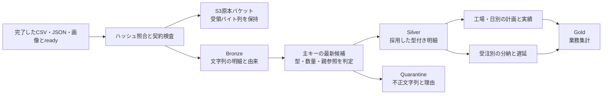

# MES・ERPデータをBronzeからGoldへ整える

この文書は、同梱の6ソースを使う**ファイル取り込みとメダリオン変換**の説明です。最初に1件の製造指図と受注を追い、その後で再投入・更新・不正行・失敗時の動きを確認します。確認日: 2026-11-10（JST）。初回導入は [START-HERE.md](START-HERE.md)、配置詳細は [DEPLOYMENT.md](DEPLOYMENT.md)、素材の生成は [DEMO-DATA.md](DEMO-DATA.md)、画面からの実行は [GUI-WALKTHROUGHS.md](GUI-WALKTHROUGHS.md) を参照してください。

## 1. それぞれの層で何を保存するか



| 保存先 | 内容 | 利用目的 |
| --- | --- | --- |
| S3原本バケット | CSV・JSON・画像の受領バイト列 | 元ファイルの確認、ハッシュ照合、再処理の材料 |
| `iceberg.bronze` | 業務6表、受領台帳 `files`、画像メタデータ `images` | 原本の値と由来を保ち、型の判断を後工程へ渡す |
| `iceberg.silver` | 型・主キー・参照関係を整えた6表 | 業務明細として結合・集計する |
| `iceberg.quarantine` | 最新候補の不正行をソース別に保持 | 問題を直す担当者が元の値と理由を調べる |
| `iceberg.gold` | 工場の日別生産集計、受注別出荷集計 | 歩留まり、計画達成率、未出荷残、納期後出荷を確認する |

Icebergの表はParquet等のデータとスナップショットをS3互換ストレージに置き、LakekeeperのRESTカタログで管理します。原本バケットのファイルは、それとは別の受領原本です。カタログDB、Icebergのデータ、原本は役割が異なります。

## 2. 6ソースの粒度・主キー・時刻

正本は [sources.json](../medallion/sources.json) です。CSVはヘッダー付き、JSONは1行1オブジェクトのJSON Linesを使います。契約列を揃え、投入時の数値・日付・時刻も文字列にします。Silverで数値や日付へ変換します。

| 表と基準ファイル | 1行が表すもの | 主キー | 親参照・主な値 |
| --- | --- | --- | --- |
| `erp_products` / `csv/erp_products.csv` | 製品マスターの1版 | `product_id` | 製品名、製品群、単位、標準サイクル秒 |
| `erp_work_orders` / `csv/erp_work_orders.csv` | 製造指図の1版 | `work_order_id` | `product_id`、工場、計画日、計画数量 |
| `erp_sales_orders` / `csv/erp_sales_orders.csv` | 受注の1版 | `sales_order_id` | `product_id`、工場、受注日、約束日、受注数量、単価 |
| `erp_shipments` / `csv/erp_shipments.csv` | 1回の出荷明細の1版 | `shipment_id` | `sales_order_id`、出荷時刻、出荷数量 |
| `mes_events` / `json/mes_events.jsonl` | 1回の製造実績の1版 | `event_id` | `work_order_id`、事象時刻、良品数、不良数 |
| `mes_downtime` / `json/mes_downtime.jsonl` | 1回の停止区間の1版 | `downtime_id` | `work_order_id`、開始・終了時刻、停止理由 |

「1版」としたのは、原本に同じ主キーの過去版・改訂版・完全重複が含まれ得るためです。Bronzeはそれをそのまま受け取り、Silverで1主キー1行にします。出荷の主キーは受注番号ではなく出荷番号です。これにより、1受注の分割出荷を別々の出荷として扱えます。

時刻には3つの用途があります。

| 項目 | 意味 | 処理での使い方 |
| --- | --- | --- |
| 業務列 `updated_at` | その業務キーの版が更新された時刻 | 同じ主キーから採用する版を決める |
| `event_time`、`shipped_at`、停止開始・終了 | 実際に事象が起きた時刻 | 生産日や納期後出荷を決める |
| 付加列 `_ingested_at` | この基盤が原本を取り込んだ時刻 | 由来の追跡、同順位候補の順序付け |

時刻はISO 8601、日付は `YYYY-MM-DD` を使います。Goldの事象日・出荷日はUTCで判定します。到着が翌週になっても、1月5日の実績を取り込み日の実績へ移すことはありません。

製造指図と受注の間には、この契約では直接の対応キーがありません。同じ製品・工場のデータでも、指図の生産物をどの受注へ引き当てたかは表現しません。引当・ロット追跡が必要なら、その対応表と業務ルールを追加します。

## 3. 同梱データの1件を実際に追う

以下は説明用に作り替えた値ではなく、`--seed 42 --orders 20 --days 7 --scenario edge` の抜粋です。

### 製品・製造指図・停止

| 項目 | 値 |
| --- | --- |
| 製品 | `P001`、`Demo component 1`、単位 `piece` |
| 製造指図 | `WO00001` |
| 工場・計画日 | `F01`、`2026-01-05` |
| 計画数量 | `94` |
| 停止 | `DT00001`、12:00〜12:06 UTC、`CHANGEOVER` |

製品の標準サイクルは25秒ですが、現在のGoldでは速度損失やOEEの計算に使っていません。停止は6分として計上します。

### MES実績の重複・改訂・遅延

この指図に関係する正常候補を抜粋すると、原本には次の5行があります。別に型不正や負数の行もあり、それらは後述のQuarantineへ回ります。

| `event_id` | 事象日時 UTC | 良品 | 不良 | `updated_at` UTC | 扱い |
| --- | --- | ---: | ---: | --- | --- |
| `EV00001-1` | 1月5日10:00 | 43 | 0 | 1月5日11:00 | 過去版 |
| `EV00001-2` | 1月5日11:00 | 43 | 0 | 1月5日12:00 | 別の実績として採用 |
| `EV00001-1` | 1月5日10:00 | 43 | 0 | 1月5日11:00 | 完全重複、過去版と同じキー |
| `EV00001-1` | 1月5日10:00 | 46 | 0 | 1月14日10:00 | 同じ実績の新しい改訂版として採用 |
| `EV-LATE` | 1月5日07:00 | 4 | 1 | 1月15日08:00 | 遅延到着した別実績として採用 |

Silverでは `EV00001-1` の43と46を加算せず、最新候補の46だけを採用します。したがって、この指図の採用後の実績は次のとおりです。

```text
良品 = 46 + 43 + 4 = 93
不良 =  0 +  0 + 1 =  1
生産 = 93 + 1 = 94
```

`EV-LATE` の更新は1月15日でも、Goldの事象日は1月5日です。

ただし `factory_daily_production` の粒度は指図単位ではなく**工場・日**です。`F01` の1月5日には計画98の `WO00015` もあります。そのため実際のGoldの1行は、指図1件分の計画94・良品93とは異なります。

| 工場・日 | 計画 | 良品 | 不良 | 生産 | 停止分 | 歩留まり | 計画達成率 |
| --- | ---: | ---: | ---: | ---: | ---: | ---: | ---: |
| `F01` / `2026-01-05` | 192 | 183 | 5 | 188 | 26 | 97.34% | 95.31% |

### 受注と分割出荷

同じ工場・製品の受注 `SO00001` は、受注数量55、単価46.57、約束日1月6日です。

| 出荷 | UTC出荷日 | 数量 | 約束日との比較 |
| --- | --- | ---: | --- |
| `SH00001-1` | 1月6日 | 27 | 約束日内 |
| `SH00001-2` | 1月7日 | 28 | 約束日後 |

`sales_fulfillment` の結果は、出荷55、未出荷残0、履行率100%、納期後出荷28、納期後出荷1件、`is_fully_shipped=true` です。**全量を出荷したことと、全量を期限内に出荷したことは別**だと分かります。

## 4. Bronzeの原本・台帳・スナップショット

取り込み側はファイルの相対パスと内容を記録します。業務列に加えて各Bronze行へ次の3列を付けます。

| 列 | 保存するもの |
| --- | --- |
| `_source_file` | ランディングからの相対パス |
| `_source_hash` | 原本バイト列のSHA-256 |
| `_ingested_at` | 取り込み時刻のUTC文字列 |

受領台帳 `bronze.files` は `path`、`sha256`、`s3_uri`、`mime`、`bytes` を保持します。`bytes` など台帳列も現在の実装では文字列です。画像は原本に加えて `bronze.images` に幅・高さ等を記録します。画像のOCR・分類・特徴量抽出はこの経路では行いません。

原本のオブジェクトキーは、通常の取り込みでは次の構成です。

```text
raw/<内容のSHA-256>/<相対パスのSHA-256>
```

内容が変わると別の原本キーになります。同じ名前のファイルを更新しても、過去の原本バイト列を同じキーで上書きする構成ではありません。一方、`bronze.files` は相対パスごとの現在の受領情報です。台帳自身が全世代を1行ずつ並べるイベントログなのではありません。

業務Bronze表は、そのファイルの `_source_file` に一致する行をIcebergのコミットで置き換えます。過去の表状態はIcebergスナップショットとして参照できます。スナップショット一覧の例は次のとおりです。Trino対応SQLクライアントで実行します。

```sql
SELECT snapshot_id, committed_at, operation
FROM iceberg.bronze."mes_events$snapshots"
ORDER BY committed_at DESC;
```

スナップショットと原本ハッシュは異なる識別子です。前者は表のある時点、後者は受領した1ファイルの内容を示します。Trinoは表の原子的な置換と過去スナップショット参照に対応します。[Trino Iceberg connector](https://github.com/trinodb/trino/blob/484/docs/src/main/sphinx/connector/iceberg.md)

現在のキットは通常運用のスナップショット失効・原本世代削除を自動化していません。保存期間と復旧方法は導入先で設計します。原本だけのコピーでは、カタログとIcebergの整合したバックアップにはなりません。

## 5. Silverは「最新候補を選ぶ→妥当性を判定する」

[01_silver.sql](../medallion/01_silver.sql) は6表を親から子の順に置き換えます。製品→製造指図・受注→出荷・製造実績・停止という参照関係を使います。

1. `TRY_CAST` と安全なISO時刻パースで型を揃えます。数値はBIGINTまたはDECIMAL、日付はDATE、時刻はオフセット付きの時刻へ変換します。
2. 主キーごとに `updated_at DESC NULLS LAST`、`_source_hash DESC`、`_ingested_at DESC`、元レコードのJSON文字列の降順で順位を付けます。
3. 1位の候補について、キー・数量・日時・親参照を検査します。
4. 検査を通った候補だけをSilverへ入れます。

同時刻の別ファイルがある場合、ハッシュ順は決定的な採用順を作るための規則です。業務上の版番号やDBのコミット順を表してはいません。厳密な版順が必要なソースでは、その列とルールを別途定義します。

最新候補が不正でも、過去の正常版を探して自動復活させません。たとえば同じ実績キーの旧版が良品43、新しい版が良品 `not-a-number` なら、最新候補はQuarantineとなり、そのキーは今回のSilverから外れます。修正して再投入することが必要です。

`updated_at` 自体が不正な値は時刻を比較できず、NULLとして後順位になります。したがって「更新時刻の読めない版も、現実の最新版として必ず検出する」保証はありません。到着順を更新順の代わりにしないための制約です。

## 6. Quarantineで元の値と理由を調べる

[02_quarantine.sql](../medallion/02_quarantine.sql) は同じ最新候補判定を行い、採用できなかったものをソース別の表へ置きます。完全重複や採用されなかった過去版を、異常件数として数えてはいません。

隔離表の主な列は業務主キー、パース後の `updated_at`、`raw_record_json`、由来の3列、`validation_reason` です。型変換でNULLになっても `raw_record_json` に元の文字列を残します。MES停止の業務上の理由 `reason_code` と、品質判定の `validation_reason` は別のものです。

| `validation_reason` | 主な対象・条件 | 具体例 |
| --- | --- | --- |
| `missing_key` | 表ごとのキー、製品名、工場等の検査対象が空 | 空の `event_id` |
| `invalid_type` | 数値へ変換できない | `EV-BAD-TYPE` の良品 `not-a-number`、`SO-BAD-PRICE` の単価 `invalid` |
| `invalid_timestamp` | 更新・事象・出荷・停止時刻を読めない | ISO時刻として解釈できない値 |
| `invalid_date` | 計画日、受注日、約束日を読めない | `planned_date` が日付ではない |
| `invalid_date_range` | 約束日が受注日より前 | 受注前の日を約束日に指定 |
| `negative_quantity` | 計画数量またはMES良品・不良が負 | `EV-NEGATIVE` の良品 `-7` |
| `invalid_quantity` | 受注・出荷が0以下、または単価が負 | `SH-NEGATIVE` の出荷 `-5` |
| `nonpositive_cycle` | 製品の標準サイクルが0以下 | 標準サイクル秒が `0` |
| `unknown_product` | 採用済み製品マスターにない | `WO-UNKNOWN-PRODUCT` の `P-UNKNOWN` |
| `unknown_sales_order` | 採用済み受注にない | `SH-UNKNOWN-SO` の `SO-UNKNOWN` |
| `unknown_work_order` | 採用済み製造指図にない | `EV-UNKNOWN-WO` の `WO-UNKNOWN` |
| `invalid_time_range` | 停止終了が開始より前 | `DT-REVERSED` の逆転時刻 |

1行に複数の問題がある場合はSQLのCASE順で最初の理由を1つ付けます。すべての異常を別々の行へ展開する仕組みではありません。また親が隔離されると、子は `unknown_*` になることがあります。子だけでなく親の隔離表も確認します。

```sql
SELECT event_id, validation_reason, raw_record_json, _source_file
FROM iceberg.quarantine.mes_events
ORDER BY event_id;
```

修正は元ソースまたは受領ファイルへ反映し、完成した内容でreadyを作り直して再投入します。隔離表を手で直しても、次の変換で再生成されます。

## 7. Goldの数式と、数量が増幅しない結合

### 工場・UTC日別 `factory_daily_production`

| 列 | 定義 |
| --- | --- |
| `planned_qty` | 工場・計画日ごとの製造指図の計画数量合計 |
| `good_qty` / `reject_qty` | 実績を製造指図へ結合し、工場・UTC事象日ごとに合計 |
| `total_qty` | 良品数 + 不良数 |
| `downtime_minutes` | 停止区間の秒数合計 ÷ 60。UTC開始日へ計上 |
| `yield_pct` | 良品数 ÷ 生産数 × 100、小数2桁 |
| `plan_adherence_pct` | 良品数 ÷ 計画数 × 100、小数2桁 |

分母0の割合はNULLです。存在しない側の数量は0として結合します。計画のみ・実績のみ・停止のみの日も、それぞれの日付キーから行を作ります。計画日と事象日は別なので、計画外の日の実績や100%を超える達成率も表現できます。

停止時間は開始日へまとめ、日跨ぎを日ごとに按分しません。重なった停止区間の重複控除も行いません。工場の勤務カレンダー、設備能力、稼働予定時間、速度損失が定義されていないため、OEEは計算していません。

### 受注別 `sales_fulfillment`

| 列 | 定義 |
| --- | --- |
| `shipped_qty` | 採用済み出荷明細を受注ごとに合計 |
| `open_qty` | `max(受注数量 - 出荷数量, 0)` |
| `fulfillment_pct` | 出荷数量 ÷ 受注数量 × 100、小数2桁 |
| `late_delivered_qty` | UTC出荷日が約束日を過ぎた明細の数量合計 |
| `late_shipment_count` | 上記に当たる出荷明細の件数 |
| `is_fully_shipped` | 出荷数量が受注数量以上か |
| `last_shipped_at` | その受注の最後の出荷時刻 |

過剰出荷では履行率は100%を超えます。まだ出荷していない受注が「本日時点で納期遅れか」を判定する列はありません。ここでの遅延は、実際に出荷された明細の日付と約束日の比較です。

### 多重JOINを避ける

1指図に実績2行と停止2行があると、明細同士を直接結合した結果は最大4行になります。そこで数量をSUMすると、実績数や停止時間が重複します。同じく受注1件に出荷2行があっても、受注数量を2回加算してはいけません。

[03_gold.sql](../medallion/03_gold.sql) では、計画・実績・停止をそれぞれ工場日へ集約した後に結合します。受注は出荷を受注単位へ集約してから結合します。MES実績と出荷明細を直接結合する処理はありません。

## 8. 完了マーカー、再投入、更新、削除

### 完成したファイルだけを公開する

Samba等のコピーでは、一時名でコピーを完了させ、契約に合う完成名へリネームしてから実行します。

```bash
python3 scripts/mark-ready.py /srv/lakehouse/landing/csv/erp_products.csv
```

この例のルートはprivate envの `LANDING_DIR` と一致させます。readyは `erp_products.csv.ready` です。中身は小文字16進のSHA-256が64文字と改行で、workerはLFまたはCRLFを受け付けます。改行のないハッシュ文字列、別の内容のハッシュ、コピー途中に変わったファイルは拒否します。原本またはready自体がシンボリックリンクの場合は取り込み対象にしません。

| 境界 | 現在の実装 |
| --- | --- |
| 原本のサイズ | 1ファイル16MiB以下 |
| 契約付きCSV/JSONの行数 | 1ファイル100000行以下。CSVヘッダーは件数に含まない |
| 列 | 契約の列名を揃える。欠けた列・余分な列は取り込みエラー |
| CSV文字コード | UTF-8、先頭BOM可 |
| JSON | UTF-8のJSON Lines、空行は無視、先頭BOM可 |
| 画像 | PNG/JPG/JPEG/WebPを検証し、原本と寸法等を保存 |
| 通常の起動 | CLI、n8n、Airflow等から明示。標準の自動監視・定期起動はない |

取り込み先はソース契約と相対パスの対応で決まります。任意のファイル名を置けば、その名前の業務表が自動的に増えるわけではありません。契約に対応しないファイルも原本と受領情報として保存されますが、6つの業務表へ自動変換されません。対応の正本は [admin.py](../scripts/admin.py) と [sources.json](../medallion/sources.json) です。

### 入力ごとの動き

| 操作 | 次の取り込み・変換で起きること |
| --- | --- |
| 同じ相対パス・同じハッシュを再投入 | 受領台帳を見てskip。業務行をもう一度足さない |
| 同じ相対パスの内容を更新し、readyを更新 | そのファイル由来のBronze行を置き換え、Silver/Goldを再計算 |
| 完了したCSVをヘッダーだけの0件ファイルにする | そのファイル由来の現在の業務行を空にする |
| ファイルまたはreadyを共有から削除するだけ | 取り込み済みBronzeの行を自動削除しない |
| 別パスのファイルとして追加する | 別の由来として扱う。採用先契約と主キーの重複判定を確認する |
| メダリオンだけを繰り返し実行 | 行数・集計値は同じでも、表置換の新しいスナップショットは作られ得る |

「全件ファイルの最新版から消えた行」と「DBのDELETEイベント」は別です。このファイル経路は前者を同一パスの置換で扱います。DBの削除イベントを自動追跡する経路ではありません。

## 9. 実行順と、失敗したときの見方

coreが起動済みで、private envの指定先と `LANDING_DIR` が合っていることを前提とします。

```bash
export LAKEHOUSE_ENV_FILE="$HOME/.config/lakehouse-foundation/site.env"

# 素材を作るだけ。workerは起動しない。
python3 scripts/generate-demo.py \
  --destination landing --output /srv/lakehouse/landing \
  --seed 42 --orders 20 --days 7 --scenario edge

# 原本とBronzeだけを取り込む。
./scripts/lakehouse.sh ingest

# 取り込みも確認してから、Silver→Quarantine→Goldを更新する。
./scripts/lakehouse.sh medallion
```

`medallion` は `ingest` を含むため、最初からそれだけを実行しても構いません。SQLファイルは名前順に読み、6つのSilver、6つのQuarantine、2つのGoldの計14文を実行します。完了例は6原本を初めて取り込む場合、`imported: 6`、`skipped: 0`、`sql_statements: 14` です。先にingestを済ませていれば、同じmedallion実行で `imported: 0`、`skipped: 6` になります。

同じworkerのCLI・n8n・Airflow起点のジョブは排他されます。ただし、そのロックは外部のファイルコピーや、別クライアントから直接実行するSQLまで止めるものではありません。入力の公開を完了させてから実行し、運用中の表へ別writerを並行接続しない前提です。

### 成功範囲は表ごとのコミット

- 原本アップロード、業務Bronze置換、受領台帳の更新は別操作です。台帳は最後に更新し、途中失敗を再実行できるようにします。
- Silver/Quarantine/Goldの `CREATE OR REPLACE TABLE AS` は1表ごとに原子的です。
- 14文全体、6ファイル全体、実行DAG全体をまとめるトランザクションはありません。

たとえばSilverの製品と製造指図が更新済みで、次の受注表の処理が失敗すると、前の2表は新しく、後ろの表は以前の状態のままです。途中結果を自動で全表ロールバックしません。原因を直した後、入力を変えずにmedallion全体を再実行し、最後の期待値まで照合します。利用側へ全表同時に切り替える実行世代の公開機構は、別途必要です。

TrinoのHTTP 200だけを成功とは扱わず、workerが最後の結果まで追跡します。クエリが失敗したら中止を確認し、中止が確認できなければworkerをblockedにして新しいジョブを拒否します。画面のエラー別の操作は [GUI-WALKTHROUGHS.md](GUI-WALKTHROUGHS.md) を参照してください。

## 10. 同梱の品質検証で何を確かめるか

```bash
./scripts/lakehouse.sh verify
```

verifyは通常の業務表を初期化する操作ではありません。実行ごとの `verify_<ランダム値>_bronze` 等のnamespaceと専用rawキーで疑似データを処理します。通常は検証後にその範囲を削除します。中止を確認できないクエリがある場合は、使用中のデータを消さずに保持し、管理者の確認を待ちます。

固定fixtureは [expected-demo.json](../medallion/expected-demo.json)、実際に実行する照合SQLは [checks/](../medallion/checks/) です。seed42・orders20・days7・edgeに対応し、別のパラメーターへ同じ期待値を流用しません。

| 表 | Bronze | Silver | Quarantine |
| --- | ---: | ---: | ---: |
| 製品 | 4 | 4 | 0 |
| 製造指図 | 21 | 20 | 1 |
| 受注 | 21 | 20 | 1 |
| 出荷 | 42 | 40 | 2 |
| 製造実績 | 46 | 41 | 3 |
| 停止 | 21 | 20 | 1 |
| 合計 | 155 | 145 | 8 |

残る2行は完全重複・過去版です。145 + 8が155に一致しないことを、データ欠落と即断しません。

検証は件数だけではなく、工場日別14行、受注別20行、改訂後の良品46、遅延到着の日付、不正文字列の保持も確かめます。主な合計は、計画2347、良品2154、不良62、生産2216、停止185分、受注1435、出荷1363、未出荷残72、納期後出荷132・4件です。

verifyはさらに画像1枚の原本バイト列とハッシュを照合します。したがって初回の取り込みファイル数は6業務原本 + 画像1枚の7件、同じ入力の再取り込みは0件取り込み・7件skipです。再変換後も10組のSQL期待値が変わらないことを確認します。これは短い固定データの機能検証であり、会社の全例外・長期耐久・CDC・障害復旧を網羅する試験ではありません。

## 採用版と業務ルールを分けて確認する

表置換・snapshot参照の根拠は [Trino 484 Iceberg connector](https://github.com/trinodb/trino/blob/484/docs/src/main/sphinx/connector/iceberg.md#replace-tables)、REST/FileIOは [PyIceberg 0.12.0設定](https://github.com/apache/iceberg-python/blob/pyiceberg-0.12.0/mkdocs/docs/configuration.md) です。初期化順は [Lakekeeper 0.14.3公式例](https://github.com/lakekeeper/lakekeeper/blob/v0.14.3/docker-compose/docker-compose.yaml) を照合しています。Silverの優先順位、隔離理由、Goldの業務式は本リポジトリ固有のSQLであり、これらの製品の標準メダリオン設定ではありません。

最初は [初回ガイド](START-HERE.md) のGUIでclean投入→変換→プレビューを確認します。固定期待値を照合する `verify` は **業務SQL10検査＋画像1検査の11項目**です。会社データの受入は別の期待値・同一範囲で行います。[全バージョンの根拠](REFERENCES.md)
