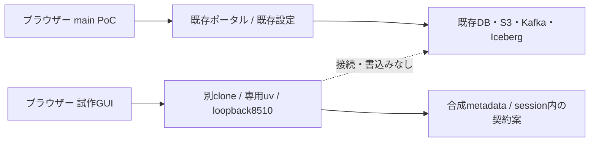

# mainのPoCと試作ブランチを並行して使う

<!-- doc-purpose:start -->
> **役割:** 既存mainを維持し、単独GUIと専用projectの全OSS・Labを段階配置する並行PoCの設定・入口・停止条件を示す。
>
> **対象読者:** 初めて使う人 / 基盤構築担当 / 開発・設計担当
>
> **読むタイミング:** mainのPoCを止めずにGUIを試すときや、監視・OpenObserve・Sailを別projectへ追加する前提と手順を確認するとき。
>
> **前提となる資料:** [テーブルと列をGUIで選ぶソース登録の下書き](<SOURCE-ONBOARDING.md>) / [BashとZshの両方で手順を実行する](<SHELLS.md>)
>
> **次に読む資料:** [導入・検証・停止](<DEPLOYMENT.md>) / [固定SQL sourceで疑似ERP・MESを検証する](<SQLSERVER-FIXED-DEMO.md>)
>
> **文書一覧:** [目的・読者から探す文書マニフェスト](<DOCUMENTATION-MANIFEST.md>)
<!-- doc-purpose:end -->

## まず選ぶ構成

現在のメタデータ駆動GUIは、**main側のLakehouseを稼働させたまま、別のcloneと
uv環境から単独プレビューを起動**して比較できます。main側のComposeやDokployを
更新する必要はありません。通常のPoCポータルと、新しい表・列選択GUIを
別々のブラウザータブで開きます。

監視やLabを含むLakehouse一式も比較する場合は、[専用projectの段階導入](#7-lakehouse一式を専用projectへ段階導入する)へ進みます。
単独GUIは引き続き独立して使えます。コンテナ用の設定生成、image build、
サービス起動、データ連携の受入は、それぞれ別の到達点として記録します。

| 比較対象 | main側のPoC | 試作ブランチ側 |
| --- | --- | --- |
| ソース | 既存のmainチェックアウト／既存配置commit | 別cloneの`codex/metadata-source-onboarding` |
| 起動方法 | 既存のDokployまたはCLI管理を継続 | 単独Streamlit previewだけを起動 |
| GUI入口 | 既存設定。ポータルの既定は8501 | 別のloopback port。例8510 |
| Python依存 | 既存のコンテナ・環境を保持 | 専用uv環境と同ブランチのlock |
| DB・S3・Kafka・volume | 既存のデータと状態を保持 | 接続せず、作成もしない |
| private設定 | 既存の`site.env`を保持 | 読み込まない。token／DBA資格情報も不要 |
| 試せる内容 | 素材投入、取込、CDC、BI等の既存機能 | 合成metadataから表・列・業務方針と契約案を編集 |
| 止め方 | 既存の管理方法 | previewを起動した端末のCtrl+Cだけ |

ブランチはソースの分岐であり、DBやコンテナを自動分離する仕組みではありません。
今のmainフォルダで`git switch`して二つを交互に動かす方法ではなく、
**実行フォルダも分けます**。試作に触るためにmainをこのブランチへmergeしません。



## 1. 試作用のフォルダを別に作る

この操作は、mainの稼働ホストでも別の開発ホストでも実行できます。
mainがある既存ディレクトリと、その配下を保存先に選びません。
下記の保存先は例です。既存のフォルダがあれば上書きせず、別名を選びます。

通常の利用者で実行します。

**Bash / Zsh共通**

```bash
ONBOARDING_POC_DIR="$HOME/poc-workspaces/lakehouse-onboarding"
git clone --single-branch --branch codex/metadata-source-onboarding \
  https://github.com/hiromura16/lakehouse-foundation.git \
  "$ONBOARDING_POC_DIR"
cd "$ONBOARDING_POC_DIR"
git status --short --branch
git rev-parse HEAD
```

`codex/metadata-source-onboarding`で、未コミット変更がないことを確認します。
レビュー対象commitは[PR #29](https://github.com/hiromura16/lakehouse-foundation/pull/29)
の現在のheadと照合します。実行前のcommitをprivateな検証記録へ残します。

同じホストにソースがある開発者は、代わりにGit worktreeも使えます。
worktreeはオブジェクトを共有しながら別フォルダを持つ仕組みです。
既にそのブランチを使うworktreeがある場合、同じブランチを重ねてcheckoutしないで
既存の試作用worktreeを使うか、上記の独立cloneを使います。
[Git公式worktree仕様](https://git-scm.com/docs/git-worktree)

## 2. 専用uv環境を用意する

mainのvenv、稼働中コンテナ内Python、共有の開発環境へ依存を追加しません。
次の場所は**この試作専用**として選びます。初回の準備例です。

**Bash / Zsh共通**

```bash
ONBOARDING_VENV="$HOME/.local/share/lakehouse-foundation/onboarding-preview/venv"
if [ ! -e "$ONBOARDING_VENV" ]; then
  uv venv --python 3.12 "$ONBOARDING_VENV"
fi
uv pip sync --python "$ONBOARDING_VENV/bin/python" \
  --require-hashes requirements-dev.lock
```

既にこの試作専用の環境がある場合、再作成せずその環境を使います。
依存更新が必要ならpreviewだけを停止して同じlockへ同期します。
mainのvenvを`ONBOARDING_VENV`へ指定しません。
社内proxyが必要な初回取得は、[proxyの手順](COMPANY-PROXY.md)で**uvを実行する
シェル**へ設定します。proxy値やCA実体をこのcloneへ保存しません。
previewの実行中はDB・外部API・インターネットへの接続は不要です。

## 3. 新しいGUIだけを起動する

mainの起動・停止コマンドやDokployのDeployは実行せず、試作用cloneで
次のコマンドだけを実行します。8510が既存アプリに使われていれば中止し、
このpreview用に別の空きportを選びます。既存アプリを止めて空けません。

試作用cloneのルートで実行します。

**Bash / Zsh共通**

```bash
ONBOARDING_PREVIEW_PORT=8510
"$ONBOARDING_VENV/bin/streamlit" run infra/demo/onboarding_preview.py \
  --server.address=127.0.0.1 --server.port="$ONBOARDING_PREVIEW_PORT" \
  --server.headless=true --browser.gatherUsageStats=false \
  --server.enableCORS=true --server.enableXsrfProtection=true \
  --server.enableAgentApi=false \
  --server.fileWatcherType=none --server.runOnSave=false \
  --secrets.files infra/demo/onboarding_preview_settings.toml
```

同梱の`onboarding_preview_settings.toml`はcommentだけで、秘密値を持ちません。
`--secrets.files`でこの空のファイルだけを選び、利用者のglobal/project用
Streamlit credentialsをpreviewへ読み込ませません。`site.env`をsourceしたり、
mainのtoken・DBA接続情報を新しいGUIへ渡したりしません。

loopback限定で起動し、CORS/XSRF保護を有効にします。Agent APIや外部公開を
この並行PoCのために有効化しません。ファイル編集に伴う自動rerunも無効です。
接続先・port・CORSのようなserver設定を変えるときは、このpreviewを停止して
起動し直します。[Streamlit公式の設定優先順位](https://docs.streamlit.io/develop/concepts/configuration/options)

この起動方法は端末で動く一時的なPoCです。再起動後の自動起動やsystemd登録を
設定するものではありません。端末を開いておき、ログはprivateに取り扱います。

## 4. ブラウザーで開く

### PoCホスト自身から

main側は既存のURLを継続し、試作側は次を開きます。

| 画面 | URL例 |
| --- | --- |
| main側ポータル | `http://localhost:8501/`（実際は既存の設定を使う） |
| 試作GUI | `http://localhost:8510/` |
| 試作GUIのhealth | `http://localhost:8510/_stcore/health` |

main側のその他の既定URLは以下です。実際の稼働やprofile有効化を示す一覧ではなく、
既存設定でportを変更していればその値を使います。接続できない画面のために
この手順からサービスを追加起動しません。

| コンポーネント | サーバー自身からの既定URL |
| --- | --- |
| 操作API / Swagger | http://localhost:8502/docs |
| Trino | http://localhost:8080/ui/ |
| Lakekeeper REST API（GUIではない） | http://localhost:8181/ |
| S3 API（GUIではない） | http://localhost:8333/ |
| Grafana | http://localhost:3000/ |
| Prometheus | http://localhost:9090/ |
| Superset | http://localhost:8088/ |
| n8n | http://localhost:5678/ |
| Airflow | http://localhost:8081/ |
| Spark Master | http://localhost:8082/ |
| Spark Worker | http://localhost:8085/ |
| Spark History | http://localhost:18080/ |
| Kafka UI | http://localhost:8084/ |
| JupyterLab | http://localhost:8888/ |
| Qdrant | http://localhost:6333/dashboard |
| Marquez lineage | http://localhost:3001/ |
| MCP（AIクライアント用） | http://localhost:8503/mcp |
| OpenObserve（任意Lab） | http://localhost:5080/ |

PostgreSQL・Redis・Kafka broker・workerや、Loki・Vector・host exporter等の内部入口は、
通常はhostへ公開しません。上のURLがないことを理由に新しい公開portを作らず、
対応するGUIや既存の認証付きAPIから確認します。

portを変えた場合はURLも合わせます。`localhost`はブラウザーを開いた端末自身を
意味します。会社VMのPoCと自宅ホストのpreviewは、それぞれ別の接続先です。

### 別PCから

既存のSSH接続を使い、**ブラウザーを使うPC側の端末**で転送します。
`poc-host`は説明用のSSH接続名です。自分が普段使う接続名に置き換えます。
firewall、public bind、Dockerのnetwork設定を変える手順ではありません。

利用端末で実行します。このsshコマンドはPowerShellからも使えます。

**Bash / Zsh共通**

```bash
ssh -N -o ExitOnForwardFailure=yes -L 127.0.0.1:8510:127.0.0.1:8510 poc-host
```

このSSH端末を開いたまま、PCのブラウザーで`http://localhost:8510/`を開きます。
`ExitOnForwardFailure=yes`は転送の待受設定に失敗したらSSHを終了させます。
転送先アプリが正常かどうかは、ブラウザーやhealthで別途確認します。
[OpenSSH公式の転送失敗時の動作](https://man.openbsd.org/ssh_config#ExitOnForwardFailure)
PC側の8510が使用中なら転送は開始せず、未使用portを選び、必要に応じて
previewのserver portもそろえます。確認のためにCORS/XSRFを無効にしません。
localhost転送にも利用者認証は追加されません。共有PC・共有ホストの利用範囲を
管理者と確認し、最初は合成metadataで操作します。

## 5. 同時に比較する

1. 既存のmain PoCを、いつものURLで開きます。
2. 別タブにpreviewを開き、**合成6表で試す**を押します。
3. 表・列・業務名・利用目的・必要鮮度・削除方針・情報区分を選びます。
4. 契約案とWARN/BLOCK、自己申告の確認メモ、非適用planを確認します。
5. 入力を変え、古い確認メモ・保存対象が無効になることを確かめます。
6. 必要なJSONはprivateな場所へ保存します。mainのlandingへ投入しません。

mainの既存PoCはデータ処理を評価し、previewはオンボーディングの操作性を
評価します。previewはmainのDBから候補表を読み取るものではありません。
実DB Discovery、正式承認receipt、承認済み共通runtime、SQL/CDC適用は
未実装です。[試作GUIの操作と制約](SOURCE-ONBOARDING.md)

## 6. 新しいGUIだけを停止・更新する

previewを起動した端末でCtrl+Cを押します。別PCからのSSH転送も、その転送を
開始したPCの端末でCtrl+Cを押します。mainのDokploy、Compose、DB、volumeへ
停止操作をしません。PIDの名前検索による一括停止も使いません。

更新は**previewを停止した後、試作用cloneだけ**で行います。

試作用cloneのルートで実行します。

**Bash / Zsh共通**

```bash
git status --short --branch
if [ "$(git branch --show-current)" != "codex/metadata-source-onboarding" ] || \
   [ -n "$(git status --porcelain)" ]; then
  printf 'Stop: use the clean onboarding checkout.\n'
else
  git fetch --prune origin && \
    git pull --ff-only origin codex/metadata-source-onboarding && \
    git rev-parse HEAD
fi
```

未コミット変更やbranchの違いがあれば更新を止めます。現在のbranchを確認せず
`git pull`を実行しません。現在のcommitとlockを確認したうえで、必要な依存同期と
上のpreview起動をやり直します。main側をこの手順へ巻き込みません。

## 7. Lakehouse一式を専用projectへ段階導入する

`parallel-lab` presetは、新しい試作用のprivate設定を生成する入口です。
既存mainのprivate設定はコピーせず、専用projectと新しい秘密値を使います。
このブランチには監視・Labを含む全41サービスの定義がありますが、生成直後に
すべてを起動する構成ではありません。接続や権限の前提を満たした段階だけを追加します。

本手順の全構成の実運転は**未確認**です。Docker APIの事前確認はアクセス拒否で
停止しており、image build・サービス起動・全構成のE2Eは実施していません。
単独GUIの確認や公開CIの成功を、その代わりの運転実績にはしません。
Docker操作を実行できる承認済み環境が用意されるまでは、設定と手順の確認で停止します。
この文書はdaemon・socket権限・hostセキュリティ設定を変更する手順を含みません。

### 7.1 分離境界を先に決める

mainのprivate envをそのまま複製して、別フォルダから起動するだけでは
データ分離になりません。既存mainは現在のmanagerを使い続けます。
新しいprojectもDokployかCLIの**どちらか一つ**で管理し、同じprojectを二重起動しません。

| 分離対象 | 二系統構成で確認すること |
| --- | --- |
| 管理主体 | Dokployなら別Composeアプリと別`appName`。CLIと二重管理しない |
| Compose project | private設定の`COMPOSE_PROJECT_NAME`を分ける。shell値の上書きを前提にしない |
| volume | 実際のvolume名を全件比較。`DATA_VOLUME_PREFIX`の使い回しは避ける |
| host公開port | active profileの全portを両環境間で比較。片方の設定内の重複検査だけでは不十分 |
| bind先 | `LANDING_DIR`、`NOTEBOOKS_DIR`、private設定、spool、状態保存先を分ける |
| secret | 新しい環境用に生成。mainのvolume・暗号鍵・管理者状態を上書きしない |
| S3／Iceberg | catalog DB、object store、warehouse・bucket/prefixを分離。外部store共有時は別途設計 |
| SQL Server | 専用の合成検証DB・ownershipを準備。会社DBやmainの固定6表を自動共有しない |
| CDC／Kafka | Kafka/Connect・consumer state/offset/historyを分離。固定名のまま共有clusterへ二重登録しない |
| 権限・同意 | 新しい接続先・対象・ownership・GUI同意を検証。readerをwriterへ昇格しない |
| 監視・資源 | project絞り込み、CPU/RAM/disk/portを確認。両スタック全profileを一度に起動しない |

project名やフォルダ名の変更だけで、外部SQL DB、Kafka topic、Iceberg表、
明示的なvolume名まで安全に分かれるとは扱いません。特に同一captureを
二つのConnectorで読む切替は、offsetと履歴の移行計画を先にレビューします。
SQL Serverのcapture上限も含め、DBAによる別の承認・受入が必要です。
[固定SQL source](SQLSERVER-FIXED-DEMO.md) / [CDC](CDC.md) / [構成と配置](DEPLOYMENT.md)

### 7.2 専用設定を新規生成する

試作用cloneのルートで、保存先とdata rootを自分で選びます。下記の
`<private-directory>`と`<absolute-external-data-root>`は置換するplaceholderです。
どちらも既存mainの領域やcheckout内を指定しません。data rootはまだ存在しない専用パスを
選び、通常の非root利用者で生成します。private設定をGitへ追加しません。

**Bash / Zsh共通**

```bash
PARALLEL_ENV_FILE='<private-directory>/site.env'
PARALLEL_DATA_ROOT='<absolute-external-data-root>'
python3 scripts/configure.py \
  --output "$PARALLEL_ENV_FILE" \
  --preset parallel-lab \
  --project-name lakehouse-onboarding-lab \
  --data-root "$PARALLEL_DATA_ROOT"
```

`--preset parallel-lab`は新規設定専用で、`--upgrade`と併用しません。
既存の出力fileがある場合は上書きせず停止します。設定保存先はprivateに準備されますが、
data root以下のlanding・notebooks・log-spoolを作成したり、その所有権やmodeを変更したりはしません。

| 設定 | presetが選ぶ値・境界 |
| --- | --- |
| `COMPOSE_PROJECT_NAME` | `--project-name`で明示した新しいproject |
| `DATA_VOLUME_PREFIX` | 空。新しいproject名でnamed volumeを分離 |
| `BIND_IP` | `127.0.0.1`。外部公開を追加しない |
| `COMPOSE_PROFILES` | 初回は`demo,monitoring,bi,automation` |
| host UI/API port | 公開既定portに20000を加算。使用中portがないかは別途確認 |
| `LANDING_DIR` / `NOTEBOOKS_DIR` / `MONITORING_LOG_DIR` | 指定data root以下の`landing` / `notebooks` / `log-spool` |
| private設定・secret | この環境用に生成。mainから持ち込まない |
| `SOURCE_SQLSERVER_*` / `DEMO_SQLSERVER_*` / `CDC_SQLSERVER_*` | 接続先・資格情報は空のまま。型・port・安全方針等の既定値は保持 |
| `OPENOBSERVE_INGEST_TOKEN_FILE` | 空。通常monitoringはLoki-onlyで開始 |

`core`はprofile名ではなく常に含まれる基盤です。`COMPOSE_PROFILES=core,...`とは書きません。
shellに古い`COMPOSE_PROJECT_NAME`を残すとCLIは矛盾として停止します。
選択したprivate設定を使い、shell値でprojectを切り替える運用をしません。

設定生成後も、landingと専用spoolは承認した所有者・権限で別途準備する必要があります。
`MONITORING_LOG_DIR`は`WORKER_UID:GID`所有、mode0700または0750、
安全に通過できる親directoryとsymlink不在を要求します。
notebooks追加前は、workspaceのmode02770と同じUID:GIDを確認します。
再帰的な権限修正や、mainの保存先の流用はしません。
[workspaceのplan/apply/probe](COMPUTE-VALIDATION.md) / [監視の配置前確認](OBSERVABILITY.md)

Docker APIを使える承認済み環境になった後、次の検査で停止条件を確認します。
`plan`は設定検査、`predeploy`はspoolと選択中workspaceのmetadataも確認します。
どちらも配置の成功や、対象UIDによる書込みの証明にはなりません。

**Bash / Zsh共通**

```bash
./scripts/lakehouse.sh --env-file "$PARALLEL_ENV_FILE" plan
./scripts/lakehouse.sh --env-file "$PARALLEL_ENV_FILE" predeploy
```

### 7.3 FoundationからLabまで段階を分ける

9つのComposeは標準CLIと[Dokployの手順](DOKPLOY.md)で同じprojectへ結合します。
段階を追加するときは選択private設定のprofileを更新し、同じmanagerから配置します。
既存mainへのDeployや別managerの`up`を混ぜません。

| 段階 | 選ぶprofile・主なサービス | 次へ進む条件 |
| --- | --- | --- |
| Foundation | 初回の`demo,monitoring,bi,automation`。core、Portal/API、Grafana/Prometheus/Loki/Vector、Superset、n8n | core bootstrap、素材投入、BI、GUI認証を実際に確認。新しいprojectとvolumeだけが対象であること |
| Tools | Foundationに`compute,orchestration,notebooks,vector,lineage,mcp`を追加。Spark、Airflow、Jupyter、Qdrant、Marquez、MCP | workspaceの準備とSparkのimage build順を確認。明示Spark smokeの結果を保存 |
| OpenObserve bootstrap | まだ`openobserve-lab`を恒常設定へ追加せず、同じmanagerでOpenObserveだけを明示bootstrap | 新しいroot管理者と専用data volumeの確認。別の取り込みtokenをprivate保存 |
| OpenObserve fanout | `monitoring`を維持して`openobserve-lab`を追加 | token fileのUID・0600・安全なpathを確認。Loki/OpenObserveの同じ秘匿済みeventを比較 |
| Sail Lab | `compute`を維持して`sail-lab`を追加 | image ABI・Connect protocol・REST/S3の実受入。合成namespaceへの明示同意後だけbenchmark |
| CDC | 接続・DBA準備が済んだ時だけ`cdc`を追加 | 承認した合成SQL source、固定6表/ownership/権限、private mappingまたはfixed-demo契約を検証 |
| Host監視 | `monitoring`に`monitoring-host`を別途追加 | host root/PID/Docker data root読取りの明示承認と、実指標・labelの受入 |

`vector` profileは**Qdrant**を有効にします。ログ収集のVectorは`monitoring`に含まれます。
Alloyや独自Rustサービスを追加する構成ではありません。

通常監視のVectorは専用spoolを読みます。現在のcaptureは、対象project・owner label・
service allowlistを確認した**明示的な有限capture**で、自動常駐collectorではありません。
captureしていない状態でログが空でも、Loki/Vectorの障害とは限りません。
Docker APIへのcapture操作自体も別に承認・実行可能である必要があります。
[Vectorの収集境界](VECTOR.md)

OpenObserveはroot passwordをVectorへ渡しません。通常monitoringにはLab tokenも
OpenObserveのDNS/healthも不要です。Labを有効化する前に
[bootstrap→token作成→fanout](OPENOBSERVE.md)を順に行います。
取り込みtoken fileはGit外の`WORKER_UID`所有0600とし、GUI設定から検証する場合は
選択private設定と同じdirectory直下へ置きます。Lab停止時はVectorをLoki-onlyへ戻し、
OpenObserveの専用volumeと検証記録は保持します。各sinkの512MiB bufferは満杯で
`drop_newest`となる損失を許す比較構成です。無期限の無損失やexactly-onceを保証しません。
個別sink停止・飽和・再起動・metricsの二重配送と24時間比較は未実施です。

Sail clientは既存Spark imageから派生します。cold buildでは
`spark-volumes-init`のimageを**先にbuild**してから`sail-benchmark`をbuildします。
そのほかの共通local imageもownerを先にbuildし、`pull_policy: never`のconsumerが
参照するtagを用意します。`depends_on`だけでcold時のimage解決順は保証しません。
公式base image・uv/JAR取得は別経路で、local tagのpull抑止はBuildKit認証障害の解決ではありません。
[computeのimage所有者](COMPUTE-VALIDATION.md) / [未解決BuildKit診断](BUILD-KIT-AUTH-DIAGNOSTIC.md)

Sail0.7.3とSpark4.1.4のprotocol、client元imageのCPython3.10 ABI、Lakekeeper/SeaweedFS/Trino連携は
実運転で確認します。TCP healthを互換性や性能の合格としません。
既存のSparkは保持し、`spark_lab`/`sail_lab`の合成データだけで明示比較します。
native datetime2(7)の受入とは異なることも含め、[Sailの制約と測定](SAIL-LAB.md)を確認します。

SQL接続は初回に空なので、**CDC全体の起動・受入はblocked**です。
接続がない場合、`cdc-register`は成功扱いでskipせず失敗し、consumerも登録成功を待ちます。
Kafka/Connect/UIだけが起動してもCDC連携完了とは報告しません。
会社DB・既存mainの固定表へ接続して穴埋めせず、合成検証DBの別計画を準備します。
DBA資格情報はprivate設定、Dokploy、API、worker、connectorへ渡しません。

`monitoring-host`はhost root/PIDの読取りを追加しますが、socket、host network、D-Busや
privileged containerを追加しません。host network/TCP/systemd指標は現在の構成の対象外です。
cAdvisorのCompose label、host metricの対応、healthcheckは配置先で検証し、欠測を0で補いません。

### 7.4 宣言した資源上限を照合する

以下は[公開Compose inventory](reports/COMPOSE-INVENTORY.json)のmemory limitを、重複serviceを
一度だけ数えて合算した値です。**RSS実測・必要容量・同時起動可能の保証ではありません。**
各段階は上の段階のprofileを保持した累積です。host監視を除く全構成は39サービス、
14個すべての任意profileを選ぶと41サービスです。

| 累積段階 | 定義数 | 常駐上限 | 起動時one-shot上限 | 明示job上限 |
| --- | ---: | ---: | ---: | ---: |
| coreのみ | 6 | 4.125GiB | 0.25GiB | 0 |
| Foundation | 18 | 11.1875GiB | 1.75GiB | 0 |
| Tools | 31 | 28.3125GiB | 1.875GiB | 2GiB |
| ＋OpenObserve | 32 | 30.3125GiB | 1.875GiB | 2GiB |
| ＋Sail | 34 | 32.3125GiB | 1.875GiB | 4GiB |
| ＋CDC | 39 | 35.5625GiB | 2.125GiB | 4GiB |
| ＋Host監視 | 41 | 35.9375GiB | 2.125GiB | 4GiB |

全41定義の常駐＋起動時jobは38.0625GiB、明示jobも加えると42.0625GiBです。
別途、OS/cache、main側の既存負荷、build、tmpfs、spool、各sinkのdisk bufferが必要です。
実測でMemAvailable3GiB未満、またはswapが継続増加したら次のLab追加を停止します。
他のサービスの制限を自動で緩めません。Loki7日保持、capture最大1GiB、bufferの容量も
実際の増加量と空きdiskを別々に測定します。短時間の観測を24時間試験とは記録しません。

`catalog-migrate`、`spark-volumes-init`、`superset-init`、`cdc-register`はone-shotで
終了0が正常です。`spark-check`と`sail-benchmark`はreplicas0の明示jobです。
通常Deployでこれらの合成表への書込みは実行しません。
Spark volume初期化だけは限定root/CHOWN/FOWNERで専用named volume rootを準備します。
host bindや既存mainのvolumeへ再帰chownする処理ではありません。

### 7.5 新projectのURL一覧

`parallel-lab` presetのportを変更しなかった場合の入口です。いずれも**配置後のURL候補**で、
現在の稼働を示しません。使用中portは別途確認し、競合すれば新project側の設定を変更します。
既存main側や単独previewの8510は変更しません。認証情報は選択private設定だけで管理します。

| 入口 | port設定key | 新projectのURL例 |
| --- | --- | --- |
| Portal | `DEMO_GUI_PORT` | http://localhost:28501/ |
| API / Swagger | `DEMO_API_PORT` | http://localhost:28502/docs |
| Trino | `TRINO_PORT` | http://localhost:28080/ui/ |
| Lakekeeper API | `CATALOG_PORT` | http://localhost:28181/ |
| S3 API | `S3_PORT` | http://localhost:28333/ |
| Grafana | `GRAFANA_PORT` | http://localhost:23000/ |
| Prometheus | `PROMETHEUS_PORT` | http://localhost:29090/ |
| Superset | `SUPERSET_PORT` | http://localhost:28088/ |
| n8n | `N8N_PORT` | http://localhost:25678/ |
| Airflow | `AIRFLOW_PORT` | http://localhost:28081/ |
| Spark Master | `SPARK_MASTER_UI_PORT` | http://localhost:28082/ |
| Spark Worker | `SPARK_WORKER_UI_PORT` | http://localhost:28085/ |
| Spark History | `SPARK_HISTORY_UI_PORT` | http://localhost:38080/ |
| Kafka Connect API | `CDC_CONNECT_PORT` | http://localhost:28083/ |
| Kafka UI | `CDC_UI_PORT` | http://localhost:28084/ |
| JupyterLab | `JUPYTER_PORT` | http://localhost:28888/ |
| Qdrant | `QDRANT_PORT` | http://localhost:26333/dashboard |
| Marquez API | `MARQUEZ_API_PORT` | http://localhost:25000/ |
| Marquez UI | `MARQUEZ_UI_PORT` | http://localhost:23001/ |
| MCP | `MCP_PORT` | http://localhost:28503/mcp |
| OpenObserve | `OPENOBSERVE_PORT` | http://localhost:25080/ |

28501は既存機能を操作するPortalです。表・列を組み立てる新しいメタデータ駆動GUIは
引き続き8510の単独previewで並行評価します。previewのcontract案をこの新projectへ
自動適用する機能や実DB Discoveryの完成を意味しません。

Sail RPC、Loki、Vector、exporter、DB、Kafka brokerにはhost向けURLを追加しません。
Sailの受入は明示benchmark、ログはGrafana Explore、DB状態は既存の認証付き操作面で確認します。
別PCから開く場合は[既存SSHによる転送](#別pcから)と同じ考え方で、必要な新portだけを選びます。
Dokploy自体の新規インストールや既存管理portの変更はこのpresetに含めません。

### 7.6 新projectだけを停止・戻す

変更前commit・private設定・選択project・実volume名をprivateに記録してから操作します。
停止や差戻しは新projectを所有するmanagerだけで行い、mainと単独GUIは保持します。
Lab追加で問題が出たら追加したLabだけを承認した手順で止め、前段の受入済み設定へ戻します。
OpenObserveを外すときはVectorもLoki-onlyへ戻します。

コード・image・Loki schemaの互換性とbackupを確認してから既知のcommitへ戻します。
notebooks、landing、DB/S3/Kafka、offset/history、GrafanaのGUI編集、各Lab・監視のvolumeと
検証記録は削除しません。`down -v`、prune、image cache削除、directory削除を通常のrollbackにしません。
所有権の復元が必要なら変更前metadataを照合し、別の承認を受けます。

## 8. 確認結果の残し方

コード・設定・UI・実運転の証拠を分け、privateな検証記録へ次を残します。

- mainの既存配置commitと管理方法、previewのbranch/commit・専用venv・選択port。
- previewのrootと`/_stcore/health`のHTTP結果。HTTP 200だけで操作全体を合格にしない。
- 合成6表、契約案、入力変更と確認メモ失効の画面操作結果。
- main側に停止・Deploy・DB/volume変更をしていないこと。
- 未実施の実ブラウザー、実DB Discovery、二系統Lakehouse E2Eを明記。
- 新projectの設定生成、image build、起動、bootstrap、各GUI、処理のE2Eを別々に記録。
- Docker APIへのアクセス拒否などの停止理由と、未実行のSpark/Sail・CDC・ログfanout・24時間比較。

公開する手順には、実ホスト名・IP・実パス・proxy・認証情報を転記しません。
公開CIの構文検査やAppTestの成功は、会社環境の二系統運転の受入とは別です。
