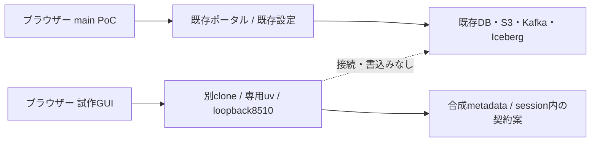

# mainのPoCと試作ブランチを並行して使う

<!-- doc-purpose:start -->
> **役割:** 既存mainのPoCを維持し、別clone・uv・loopback portで試作GUIを比較する手順と、将来の二系統基盤の分離条件を示す。
>
> **対象読者:** 初めて使う人 / 基盤構築担当 / 開発・設計担当
>
> **読むタイミング:** mainのPoCを止めずに試作GUIを触るときや、別PCからの接続・試作だけの停止と更新を確認するとき。
>
> **前提となる資料:** [テーブルと列をGUIで選ぶソース登録の下書き](<SOURCE-ONBOARDING.md>) / [BashとZshの両方で手順を実行する](<SHELLS.md>)
>
> **次に読む資料:** [導入・検証・停止](<DEPLOYMENT.md>) / [固定SQL sourceで疑似ERP・MESを検証する](<SQLSERVER-FIXED-DEMO.md>)
>
> **文書一覧:** [目的・読者から探す文書マニフェスト](<DOCUMENTATION-MANIFEST.md>)
<!-- doc-purpose:end -->

## まず選ぶ構成

現在のメタデータ駆動GUIは、**main側のLakehouseを稼働させたまま、別のcloneと
uv環境から単独プレビューを起動**して比較できます。main側のComposeやDokployを
更新する必要はありません。通常のPoCポータルと、新しい表・列選択GUIを
別々のブラウザータブで開きます。

| 比較対象 | main側のPoC | 試作ブランチ側 |
| --- | --- | --- |
| ソース | 既存のmainチェックアウト／既存配置commit | 別cloneの`codex/metadata-source-onboarding` |
| 起動方法 | 既存のDokployまたはCLI管理を継続 | 単独Streamlit previewだけを起動 |
| GUI入口 | 既存設定。ポータルの既定は8501 | 別のloopback port。例8510 |
| Python依存 | 既存のコンテナ・環境を保持 | 専用uv環境と同ブランチのlock |
| DB・S3・Kafka・volume | 既存のデータと状態を保持 | 接続せず、作成もしない |
| private設定 | 既存の`site.env`を保持 | 読み込まない。token／DBA資格情報も不要 |
| 試せる内容 | 素材投入、取込、CDC、BI等の既存機能 | 合成metadataから表・列・業務方針と契約案を編集 |
| 止め方 | 既存の管理方法 | previewを起動した端末のCtrl+Cだけ |

ブランチはソースの分岐であり、DBやコンテナを自動分離する仕組みではありません。
今のmainフォルダで`git switch`して二つを交互に動かす方法ではなく、
**実行フォルダも分けます**。試作に触るためにmainをこのブランチへmergeしません。



## 1. 試作用のフォルダを別に作る

この操作は、mainの稼働ホストでも別の開発ホストでも実行できます。
mainがある既存ディレクトリと、その配下を保存先に選びません。
下記の保存先は例です。既存のフォルダがあれば上書きせず、別名を選びます。

通常の利用者で実行します。

**Bash / Zsh共通**

```bash
ONBOARDING_POC_DIR="$HOME/poc-workspaces/lakehouse-onboarding"
git clone --single-branch --branch codex/metadata-source-onboarding \
  https://github.com/hiromura16/lakehouse-foundation.git \
  "$ONBOARDING_POC_DIR"
cd "$ONBOARDING_POC_DIR"
git status --short --branch
git rev-parse HEAD
```

`codex/metadata-source-onboarding`で、未コミット変更がないことを確認します。
レビュー対象commitは[PR #29](https://github.com/hiromura16/lakehouse-foundation/pull/29)
の現在のheadと照合します。実行前のcommitをprivateな検証記録へ残します。

同じホストにソースがある開発者は、代わりにGit worktreeも使えます。
worktreeはオブジェクトを共有しながら別フォルダを持つ仕組みです。
既にそのブランチを使うworktreeがある場合、同じブランチを重ねてcheckoutしないで
既存の試作用worktreeを使うか、上記の独立cloneを使います。
[Git公式worktree仕様](https://git-scm.com/docs/git-worktree)

## 2. 専用uv環境を用意する

mainのvenv、稼働中コンテナ内Python、共有の開発環境へ依存を追加しません。
次の場所は**この試作専用**として選びます。初回の準備例です。

**Bash / Zsh共通**

```bash
ONBOARDING_VENV="$HOME/.local/share/lakehouse-foundation/onboarding-preview/venv"
if [ ! -e "$ONBOARDING_VENV" ]; then
  uv venv --python 3.12 "$ONBOARDING_VENV"
fi
uv pip sync --python "$ONBOARDING_VENV/bin/python" \
  --require-hashes requirements-dev.lock
```

既にこの試作専用の環境がある場合、再作成せずその環境を使います。
依存更新が必要ならpreviewだけを停止して同じlockへ同期します。
mainのvenvを`ONBOARDING_VENV`へ指定しません。
社内proxyが必要な初回取得は、[proxyの手順](COMPANY-PROXY.md)で**uvを実行する
シェル**へ設定します。proxy値やCA実体をこのcloneへ保存しません。
previewの実行中はDB・外部API・インターネットへの接続は不要です。

## 3. 新しいGUIだけを起動する

mainの起動・停止コマンドやDokployのDeployは実行せず、試作用cloneで
次のコマンドだけを実行します。8510が既存アプリに使われていれば中止し、
このpreview用に別の空きportを選びます。既存アプリを止めて空けません。

試作用cloneのルートで実行します。

**Bash / Zsh共通**

```bash
ONBOARDING_PREVIEW_PORT=8510
"$ONBOARDING_VENV/bin/streamlit" run infra/demo/onboarding_preview.py \
  --server.address=127.0.0.1 --server.port="$ONBOARDING_PREVIEW_PORT" \
  --server.headless=true --browser.gatherUsageStats=false \
  --server.enableCORS=true --server.enableXsrfProtection=true \
  --server.enableAgentApi=false \
  --server.fileWatcherType=none --server.runOnSave=false \
  --secrets.files infra/demo/onboarding_preview_settings.toml
```

同梱の`onboarding_preview_settings.toml`はcommentだけで、秘密値を持ちません。
`--secrets.files`でこの空のファイルだけを選び、利用者のglobal/project用
Streamlit credentialsをpreviewへ読み込ませません。`site.env`をsourceしたり、
mainのtoken・DBA接続情報を新しいGUIへ渡したりしません。

loopback限定で起動し、CORS/XSRF保護を有効にします。Agent APIや外部公開を
この並行PoCのために有効化しません。ファイル編集に伴う自動rerunも無効です。
接続先・port・CORSのようなserver設定を変えるときは、このpreviewを停止して
起動し直します。[Streamlit公式の設定優先順位](https://docs.streamlit.io/develop/concepts/configuration/options)

この起動方法は端末で動く一時的なPoCです。再起動後の自動起動やsystemd登録を
設定するものではありません。端末を開いておき、ログはprivateに取り扱います。

## 4. ブラウザーで開く

### PoCホスト自身から

main側は既存のURLを継続し、試作側は次を開きます。

| 画面 | URL例 |
| --- | --- |
| main側ポータル | `http://localhost:8501/`（実際は既存の設定を使う） |
| 試作GUI | `http://localhost:8510/` |
| 試作GUIのhealth | `http://localhost:8510/_stcore/health` |

main側のその他の既定URLは以下です。実際の稼働やprofile有効化を示す一覧ではなく、
既存設定でportを変更していればその値を使います。接続できない画面のために
この手順からサービスを追加起動しません。

| コンポーネント | サーバー自身からの既定URL |
| --- | --- |
| 操作API / Swagger | http://localhost:8502/docs |
| Trino | http://localhost:8080/ui/ |
| Lakekeeper REST API（GUIではない） | http://localhost:8181/ |
| S3 API（GUIではない） | http://localhost:8333/ |
| Grafana | http://localhost:3000/ |
| Prometheus | http://localhost:9090/ |
| Superset | http://localhost:8088/ |
| n8n | http://localhost:5678/ |
| Airflow | http://localhost:8081/ |
| Spark Master | http://localhost:8082/ |
| Spark Worker | http://localhost:8085/ |
| Spark History | http://localhost:18080/ |
| Kafka UI | http://localhost:8084/ |
| JupyterLab | http://localhost:8888/ |
| Qdrant | http://localhost:6333/dashboard |
| Marquez lineage | http://localhost:3001/ |
| MCP（AIクライアント用） | http://localhost:8503/mcp |
| OpenObserve（任意Lab） | http://localhost:5080/ |

PostgreSQL・Redis・Kafka broker・workerや、Loki・Vector・host exporter等の内部入口は、
通常はhostへ公開しません。上のURLがないことを理由に新しい公開portを作らず、
対応するGUIや既存の認証付きAPIから確認します。

portを変えた場合はURLも合わせます。`localhost`はブラウザーを開いた端末自身を
意味します。会社VMのPoCと自宅ホストのpreviewは、それぞれ別の接続先です。

### 別PCから

既存のSSH接続を使い、**ブラウザーを使うPC側の端末**で転送します。
`poc-host`は説明用のSSH接続名です。自分が普段使う接続名に置き換えます。
firewall、public bind、Dockerのnetwork設定を変える手順ではありません。

利用端末で実行します。このsshコマンドはPowerShellからも使えます。

**Bash / Zsh共通**

```bash
ssh -N -o ExitOnForwardFailure=yes -L 127.0.0.1:8510:127.0.0.1:8510 poc-host
```

このSSH端末を開いたまま、PCのブラウザーで`http://localhost:8510/`を開きます。
`ExitOnForwardFailure=yes`は転送の待受設定に失敗したらSSHを終了させます。
転送先アプリが正常かどうかは、ブラウザーやhealthで別途確認します。
[OpenSSH公式の転送失敗時の動作](https://man.openbsd.org/ssh_config#ExitOnForwardFailure)
PC側の8510が使用中なら転送は開始せず、未使用portを選び、必要に応じて
previewのserver portもそろえます。確認のためにCORS/XSRFを無効にしません。
localhost転送にも利用者認証は追加されません。共有PC・共有ホストの利用範囲を
管理者と確認し、最初は合成metadataで操作します。

## 5. 同時に比較する

1. 既存のmain PoCを、いつものURLで開きます。
2. 別タブにpreviewを開き、**合成6表で試す**を押します。
3. 表・列・業務名・利用目的・必要鮮度・削除方針・情報区分を選びます。
4. 契約案とWARN/BLOCK、自己申告の確認メモ、非適用planを確認します。
5. 入力を変え、古い確認メモ・保存対象が無効になることを確かめます。
6. 必要なJSONはprivateな場所へ保存します。mainのlandingへ投入しません。

mainの既存PoCはデータ処理を評価し、previewはオンボーディングの操作性を
評価します。previewはmainのDBから候補表を読み取るものではありません。
実DB Discovery、正式承認receipt、承認済み共通runtime、SQL/CDC適用は
未実装です。[試作GUIの操作と制約](SOURCE-ONBOARDING.md)

## 6. 新しいGUIだけを停止・更新する

previewを起動した端末でCtrl+Cを押します。別PCからのSSH転送も、その転送を
開始したPCの端末でCtrl+Cを押します。mainのDokploy、Compose、DB、volumeへ
停止操作をしません。PIDの名前検索による一括停止も使いません。

更新は**previewを停止した後、試作用cloneだけ**で行います。

試作用cloneのルートで実行します。

**Bash / Zsh共通**

```bash
git status --short --branch
if [ "$(git branch --show-current)" != "codex/metadata-source-onboarding" ] || \
   [ -n "$(git status --porcelain)" ]; then
  printf 'Stop: use the clean onboarding checkout.\n'
else
  git fetch --prune origin && \
    git pull --ff-only origin codex/metadata-source-onboarding && \
    git rev-parse HEAD
fi
```

未コミット変更やbranchの違いがあれば更新を止めます。現在のbranchを確認せず
`git pull`を実行しません。現在のcommitとlockを確認したうえで、必要な依存同期と
上のpreview起動をやり直します。main側をこの手順へ巻き込みません。

## 7. Lakehouse一式を二系統にする場合

**現在の推奨手順は単独GUIの並行起動です。** 以下は、将来もう一つの
Lakehouse全体を起動するときの設計・事前確認事項であり、二系統構成を実装・
実運転受入済みという意味ではありません。mainのprivate envをそのまま複製して
別フォルダから起動するだけでは、データ分離になりません。

| 分離対象 | 二系統構成で確認すること |
| --- | --- |
| 管理主体 | Dokployなら別Composeアプリと別`appName`。CLIと二重管理しない |
| Compose project | private設定の`COMPOSE_PROJECT_NAME`を分ける。shell値の上書きを前提にしない |
| volume | 実際のvolume名を全件比較。`DATA_VOLUME_PREFIX`の使い回しは避ける |
| host公開port | active profileの全portを両環境間で比較。片方の設定内の重複検査だけでは不十分 |
| bind先 | `LANDING_DIR`、`NOTEBOOKS_DIR`、private設定、spool、状態保存先を分ける |
| secret | 新しい環境用に生成。mainのvolume・暗号鍵・管理者状態を上書きしない |
| S3／Iceberg | catalog DB、object store、warehouse・bucket/prefixを分離。外部store共有時は別途設計 |
| SQL Server | 専用の合成検証DB・ownershipを準備。会社DBやmainの固定6表を自動共有しない |
| CDC／Kafka | Kafka/Connect・consumer state/offset/historyを分離。固定名のまま共有clusterへ二重登録しない |
| 権限・同意 | 新しい接続先・対象・ownership・GUI同意を検証。readerをwriterへ昇格しない |
| 監視・資源 | project絞り込み、CPU/RAM/disk/portを確認。両スタック全profileを一度に起動しない |

project名やフォルダ名の変更だけで、外部SQL DB、Kafka topic、Iceberg表、
明示的なvolume名まで安全に分かれるとは扱いません。特に同一captureを
二つのConnectorで読む切替は、offsetと履歴の移行計画を先にレビューします。
SQL Serverのcapture上限も含め、DBAによる別の承認・受入が必要です。
[固定SQL source](SQLSERVER-FIXED-DEMO.md) / [CDC](CDC.md) / [構成と配置](DEPLOYMENT.md)

## 8. 確認結果の残し方

コード・設定・UI・実運転の証拠を分け、privateな検証記録へ次を残します。

- mainの既存配置commitと管理方法、previewのbranch/commit・専用venv・選択port。
- previewのrootと`/_stcore/health`のHTTP結果。HTTP 200だけで操作全体を合格にしない。
- 合成6表、契約案、入力変更と確認メモ失効の画面操作結果。
- main側に停止・Deploy・DB/volume変更をしていないこと。
- 未実施の実ブラウザー、実DB Discovery、二系統Lakehouse E2Eを明記。

公開する手順には、実ホスト名・IP・実パス・proxy・認証情報を転記しません。
公開CIの構文検査やAppTestの成功は、会社環境の二系統運転の受入とは別です。
