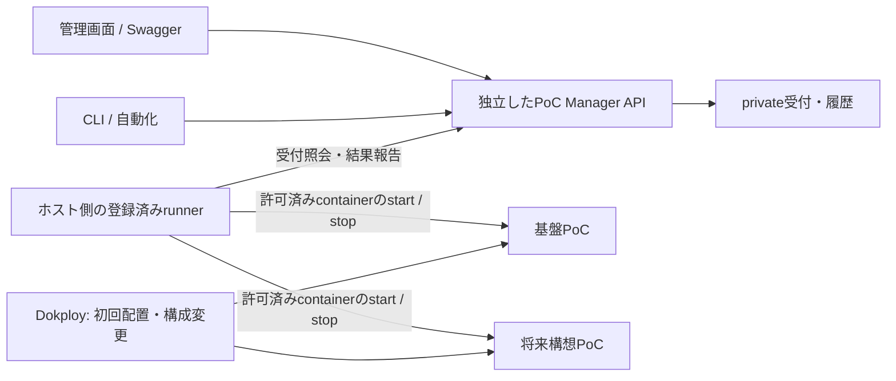

# 2つのPoCを独立して起動・停止する

<!-- doc-purpose:start -->
> **役割:** 独立した管理画面・API・CLIの配置、全体停止と再開、明示同意、排他と未確定からの回復を説明する。
>
> **対象読者:** 基盤構築担当 / 開発・設計担当
>
> **読むタイミング:** 基盤PoCと将来構想PoCを切り替えて負荷検証・運用するとき。
>
> **前提となる資料:** [平時・更新・復旧の運用手順](<OPERATIONS.md>) / [Dokploy 0.31.0でGitから配置する](<DOKPLOY.md>)
>
> **次に読む資料:** [GUI操作APIとSwagger](<API.md>) / [レビュー指摘を改善へ取り込む](<REVIEW-WORKFLOW.md>)
>
> **文書一覧:** [目的・読者から探す文書マニフェスト](<DOCUMENTATION-MANIFEST.md>)
<!-- doc-purpose:end -->

## できることと配置

基盤PoCと将来構想PoCを、管理画面・API・CLIから個別に起動、停止、再起動します。両方稼働、基盤だけ、将来構想だけ、両方停止を選べます。管理画面は独立したComposeプロジェクトに置き、どちらのPoCを停止しても残します。

この機能の「起動」は**初回配置済み・登録済みコンテナの再開**です。初回ビルド、新しいprofile、未配置サービス、環境変数の変更は、従来どおりDokployが担当します。管理APIはDocker socket、sudo、Dokploy管理API keyを持ちません。ホストに別途登録したrunnerが、限定された操作だけを実行します。



Dokploy、管理API、Cloudflareコネクター、共有SQL ServerはPoCの停止対象に含めません。SQL Serverは両方の接続先になり得ますが、取り込み先、Kafka topic/consumer group、Iceberg namespace、書込み用volume/bindは分離します。登録処理は、書込みmountのSourceが同じ場合と親子関係を拒否します。別名bind、symlink、別volumeからの同じNFS export等の物理的共有、外部DB内の論理分離は、この文字列検査では証明しません。オペレーターが実体と接続先を確認し、root-private登録の`independent_storage_verified=true`を明示する必要があります。未確認の例は`false`のまま登録を拒否します。

## 最初に管理者が行うこと

初回配置・ホスト権限の設定は、オペレーターが対象・差分をレビューしてから実行します。スクリプトはsudo権限、Docker group、socket mode、firewall、systemd unitを自動変更しません。

1. 両PoCを別のプロジェクト名、別の永続領域でDokployから配置します。初期化処理の正常完了と、各コンテナのownerラベルを確認します。再開操作の登録前に、実行中ジョブのない準備窓を確保します。
2. 管理用コードとuv仮想環境を、オペレーター管理の公開コード専用ディレクトリへ配置します。runnerはrootで動くため、コード・依存・登録定義を一般ユーザーやWebコンテナから書き換えられる場所へ置きません。
3. 管理API用state/secretsディレクトリを選びます。親は安全に探索できる所有権・mode、各leafはUID:GID `10001:10001`、mode `0700`とし、初期ファイルを`0600`で生成します。既存データへ再帰的なchown/chmodを実施しません。
4. `poc_manager.py init`をAPIの実行UIDで一度だけ実行します。既存ファイルがある場合は停止し、既存tokenを上書きしません。root runner用には`runner.token`だけを別のroot-private領域へオペレーターが安全に配置します。値を画面・履歴・MD・環境変数へ貼り付けません。
5. 下表の非秘密設定をprivate設定ファイルに保存し、独立した`infra/management/compose.yaml`を配置します。PoCの9ファイルに重ねず、専用の管理プロジェクトとして扱います。
6. root-private登録仕様を用意し、`enroll`で現在の正確なコンテナID・image ID・mount/runtimeのdigestを固定します。登録はメタデータ読取りだけで、サービスを起動しません。定義を保存した後に、ホストrunnerを明示的に起動します。

| 管理Composeの設定 | 既定 / 条件 |
| --- | --- |
| `MANAGER_PROJECT_NAME` | `lakehouse-manager`。両PoCと異なる固定名 |
| `MANAGER_PORT` | `8010`。hostは常に127.0.0.1。既存portとの衝突を確認 |
| `MANAGER_STATE_DIR` | 必須。Git外のAPI UID所有0700ディレクトリ |
| `MANAGER_SECRETS_DIR` | 必須。`api.token`と`runner.token`を置く0700ディレクトリ |
| `MANAGER_PUBLIC_ORIGIN` | `http://127.0.0.1:8010`。公開時はAccess保護済みの固定HTTPS origin |
| `MANAGER_AUTH_MODE` | `token` / `cloudflare-access`。後者は署名・issuer・audienceを検証 |
| `MANAGER_ACCESS_TEAM_DOMAIN` / `MANAGER_ACCESS_AUD` | Accessを使う場合だけ設定。ヘッダーのメール文字列だけで認証しない |
| `LAKEHOUSE_CA_FILE` | optionalな公開CAのbuild secret。秘密鍵は指定しない |

準備済みの管理用private設定を選び、まずComposeの構成だけを確認します。次の例は初回配置用で、PoC本体の起動・停止には使いません。

**Bash / Zsh共通**

```bash
MANAGER_CONFIG="/absolute/private/manager.env"
docker compose --env-file "$MANAGER_CONFIG" \
  -f infra/management/compose.yaml config --quiet
```

構成、専用project名、loopback port、privateディレクトリをレビューした後、同じComposeをDokployの独立アプリとして配置します。CLIがその独立アプリの唯一の配置担当である場合だけ、次を実行できます。DokployとCLIで同じmanagerを重複配置しません。

**Bash / Zsh共通**

```bash
docker compose --env-file "$MANAGER_CONFIG" \
  -f infra/management/compose.yaml up -d --build --wait
```

管理APIは384MiB/0.5CPUを初期上限とし、runnerは別のホスト処理です。これは実測使用量ではありません。PoCとLabを両方稼働させる試験では、MemAvailable、swapの増加、OOM、各コンポーネントの実測値を記録します。メモリ上限の合計だけを必要RAMと見なしません。

管理Composeはloopback公開のみです。外部利用する場合は、既存のCloudflare Access等で管理用originを保護し、設定したoriginとHostを一致させます。公開DNSやTunnelの作成は、このComposeの実行には含まれません。`MANAGER_AUTH_MODE=cloudflare-access`ではトークン入力へフォールバックしません。

社内でAccessの公開署名鍵取得にHTTPS proxyが必要な場合は、[任意の管理用proxy overlay](../infra/management/compose.proxy.yaml.example)を管理Composeだけへ重ねます。`HTTP_PROXY`/`HTTPS_PROXY`と既存の正規化済み`LAKEHOUSE_NO_PROXY`をprivate設定で指定し、大文字・小文字の6項目を一致させます。値をGitやログへ保存しません。企業CAは既存build secretでimageへ反映します。loopbackのhealthとhost runnerの内部API要求は環境proxyを使用しません。標準Composeはruntime proxyを受け取らず、collectorへproxyを広げる変更も行いません。

## UIでの操作

1. 管理用URLを開き、Accessまたは管理接続トークンで接続します。PoC側のワークスペース接続トークンとは別です。
2. 基盤PoC・将来構想PoCのカードで、ホスト接続、サービス数、観測日時を確認します。未接続や未確定を「停止中」や「正常」と読み替えません。
3. 「起動」「停止」「再起動」を選択すると、実行順序と対象を表示します。この時点ではコンテナを変更しません。
4. 内容を確認して実行します。起動は依存順、停止は逆順です。期限切れ・構成変更・前操作未確定の場合は実行を拒否します。
5. 受付済みと実行成功は別です。操作履歴で完了、失敗、結果未確定を確認します。ブラウザーの応答が途切れた場合は「受付結果だけを確認」を使い、同じ操作を繰り返し送らないでください。

### 負荷検証中に止めたいとき

稼働中コンテナがhealthyであることは、全ジョブがアイドルである証明ではありません。Spark、Notebook、n8n、外部クライアント等まで完全なdrainを保証する仕組みではありません。

登録仕様の`allow_interruption`は既定`false`です。オペレーターが自宅の検証環境について`true`を承認した場合だけ、UIで**処理中断の可能性を明示確認**して停止・再起動できます。Dockerの通常のgrace period後には処理が終了させられる可能性があります。業務トランザクションの完了、アプリの自動rollback、データ損失ゼロを保証しません。強制kill、DB削除、volume削除のAPIはありません。

Demo APIの新規変更要求とworkerについては、専用のメンテナンス予約で新規受付を抑止します。この予約は再起動や時間経過だけで解除せず、同じ登録済みrunnerが確認して解除します。各PoCの`.whole-maintenance/runner.token`は専用private領域へ配置し、CONTROL API tokenやDB管理者資格情報を再利用しません。通常のportal gatewayからこの管理専用経路へは転送しません。

## APIとCLI

Swaggerは同じ管理URLの`/docs`です。ブラウザーの管理sessionが必要で、JS/CSSは同じimage内の固定版を使用します。公開CDNや、停止するPoC側APIに依存しません。

| API | 目的 |
| --- | --- |
| `GET /api/session` / `POST /api/session` / `DELETE /api/session` | 接続方式の確認、ログイン、切断 |
| `GET /api/pocs` | 2つのPoCの観測・実行可否 |
| `POST /api/pocs/{foundation\|vision}/plans` | `start` / `stop` / `restart`の計画 |
| `POST /api/operations` | 短期plan・確認値・idempotency key・必要な中断同意を使って受付 |
| `GET /api/operations?limit=10` | 操作履歴（最大30件） |
| `GET /api/operations/{id}` | 個別操作の状態 |
| `GET /api/operations/by-key/{key}` | 応答喪失後の同じ利用者による受付照会。変更要求を再送しない |

`/health`は管理APIプロセスの応答確認だけです。runner接続・Docker・PoCの稼働成功を保証しません。`/internal/runner/*`は専用runner tokenを使う非公開経路で、利用者のSwaggerから除外しています。

既に準備したprivateファイルとuv環境を選びます。

**Bash / Zsh共通**

```bash
MANAGER_PYTHON="/absolute/operator-venv/bin/python"
MANAGER_CODE="/absolute/approved-checkout"
MANAGER_ORIGIN="http://127.0.0.1:8010"
MANAGER_KEY_FILE="/absolute/private/api.token"
MANAGER_PLAN="/absolute/private/foundation-stop.json"

"$MANAGER_PYTHON" "$MANAGER_CODE/scripts/poc_manager.py" \
  --origin "$MANAGER_ORIGIN" --token-file "$MANAGER_KEY_FILE" status

"$MANAGER_PYTHON" "$MANAGER_CODE/scripts/poc_manager.py" \
  --origin "$MANAGER_ORIGIN" --token-file "$MANAGER_KEY_FILE" \
  plan foundation stop --output "$MANAGER_PLAN"
```

上の例はローカルoriginのAPI用です。管理APIへ公開SSO originを設定した場合は、**利用者CLIにも**`--public-origin`が必要です。`status`、`plan`、`apply`、`history`、`operation`、`by-key`のいずれでも、サブコマンドの前へ同じ引数を追加します。例えば次の形です。通信先はloopbackのままです。

**Bash / Zsh共通**

```bash
"$MANAGER_PYTHON" "$MANAGER_CODE/scripts/poc_manager.py" \
  --origin "$MANAGER_ORIGIN" \
  --public-origin https://manager.example.invalid \
  --token-file "$MANAGER_KEY_FILE" status
```

計画ファイルは新規0600で作り、既存ファイルへ上書きしません。計画の内容を確認してから、次を実行します。中断を許可する場合だけ`--interruption-ack`を追加します。

**Bash / Zsh共通**

```bash
"$MANAGER_PYTHON" "$MANAGER_CODE/scripts/poc_manager.py" \
  --origin "$MANAGER_ORIGIN" --token-file "$MANAGER_KEY_FILE" \
  apply "$MANAGER_PLAN"
```

`foundation`を`vision`、`stop`を`start`または`restart`へ変更してもう一方を操作します。token値をCLI引数へ直接指定する機能はありません。応答が失われた場合、同じplanのキーは`cli-<plan_id>`です。`by-key`で受付を照会し、自動再送せず管理者へ確認します。

## 登録、再配置、未確定からの回復

登録仕様はroot-private JSONです。[合成登録例](../infra/management/enrollment.example.json)、`scripts/poc_manager.py --help`、`enroll --help`と`infra/management/runner.py`の`enroll`を確認し、固定の`foundation`と`vision`それぞれについて実際のproject名、常駐サービスと依存関係、正常完了した初期化処理、メンテナンス用network/token参照を指定します。例は最小構成で、実際に配置したLab・監視・分析等の全常駐サービスを含めてレビューします。コンテナ名の部分一致や、その場で発見した全コンテナを承認する仕組みではありません。runnerは全project inventory、owner、full ID、image、runtime/mountを再検査します。

ホストrunnerの接続先はloopback HTTPとし、公開Access URLへroot tokenを送信しません。公開SSO originを設定した場合は`--public-origin`で同じHTTPS originを明示します。通信先はloopbackのまま、固定HostだけをAPI設定へ一致させます。ローカル利用のみなら、この引数を省略します。

rootオペレーターが、準備・レビュー済みの固定パスを使います。

**Bash / Zsh共通**

```bash
RUNNER_PYTHON="/absolute/operator-venv/bin/python"
RUNNER_CODE="/absolute/root-owned-code"
RUNNER_SPEC="/absolute/root-private/enrollment.json"
RUNNER_MANIFEST="/absolute/root-private/enrolled.json"
RUNNER_TOKEN="/absolute/root-private/runner.token"
RUNNER_INTENTS="/absolute/root-private/runner-intent"

sudo -- "$RUNNER_PYTHON" "$RUNNER_CODE/scripts/poc_manager.py" \
  enroll --spec "$RUNNER_SPEC" --output "$RUNNER_MANIFEST"
```

登録後、runnerを明示起動します。この実行は対象Dockerメタデータを読み、認証済みの利用者が確認した受付に対して登録済みコンテナを操作します。

**Bash / Zsh共通**

```bash
sudo -- "$RUNNER_PYTHON" "$RUNNER_CODE/scripts/poc_manager.py" \
  --origin http://127.0.0.1:8010 \
  --public-origin https://manager.example.invalid \
  --token-file "$RUNNER_TOKEN" \
  serve --manifest "$RUNNER_MANIFEST" --intent-dir "$RUNNER_INTENTS" \
  --poll-seconds 2
```

常駐化には[systemd unitの例](../infra/management/poc-manager-runner.service.example)をレビューして使えます。例のコード・uv環境・privateファイル・公開originを自分の環境へ置き換え、root intentディレクトリを事前準備します。unitは自動導入しません。Docker daemonを新規起動する依存を持たず、runnerがエラー・拒否・結果未確定で終了したら`Restart=no`で止まります。問題を調査して明示的に再開するまで、拒否されたDocker操作を繰り返しません。

Dokployで再配置してID・image・mount・構成が変わった場合は、古い登録で操作せず停止します。進行中ジョブを確認した上で、新しい登録定義を別ファイルへ生成し、オペレーターが差分をレビューしてrunnerを切り替えます。古いmanifest、intent、API履歴は保全します。

負荷検証の停止中にDokployの通常Deployを実行すると、構成上のサービスが再び起動する場合があります。全体管理操作とDeployを同時実行せず、検証窓の担当を一人にします。停止したPoCの状態をDokployへ恒久的なdesired stateとして書き戻す機能ではありません。ホストrunnerを操作中に終了すると結果未確定になり得るため、その場合も記録を保全して確認します。

各操作はAPI側の排他に加え、root側にも排他・実行intent・未確定ラッチを持ちます。API履歴の消失や偽のqueueだけで、root側が不明な操作を再実行しません。途中失敗、権限拒否、応答喪失では自動rollbackを行わず、既に完了したstepと未確定stepを区別して保全します。`reconcile`はオペレーターが実状態を調べた後の明示操作で、失敗したDocker操作を自動再送するものではありません。

初版のAPI台帳は最大128操作、JSONは512KiBまでです。上限では`STATE_CAPACITY`等で受付を停止し、古い記録を勝手に削除しません。長期間の検証では、未確定操作とroot側ラッチがないことを確認した保守窓で、既存台帳をprivateに保全し、新しいstate領域への切り替えをレビューします。容量不足を理由に未確定記録やroot intentを消さないでください。

## 検証とロールバック

source-only試験では、合成metadata・ASGI・private一時ファイル・React描画・HTTP mockを使います。実Docker、両PoCの停止/再開、16GiB同時負荷、Cloudflare経由の認証、再起動後のデータ整合性の受入れとは区別します。実受入れは、外部writerも停止した検証窓で、基盤だけ→将来構想だけ→両方→両方停止→再開を順に確認します。Grafana GUI変更、n8n/カタログの暗号鍵、Iceberg、Notebook、SQLデータを合わせて検査します。

管理機能を戻す場合は、受付を止めて実行中操作を確認し、独立manager/runnerだけをオペレーターが停止します。PoC、private設定、manifest、journal、intent、データvolumeは削除しません。従来のDokploy管理へ戻しますが、未確定操作やメンテナンス予約を消して見かけ上復旧させないでください。
