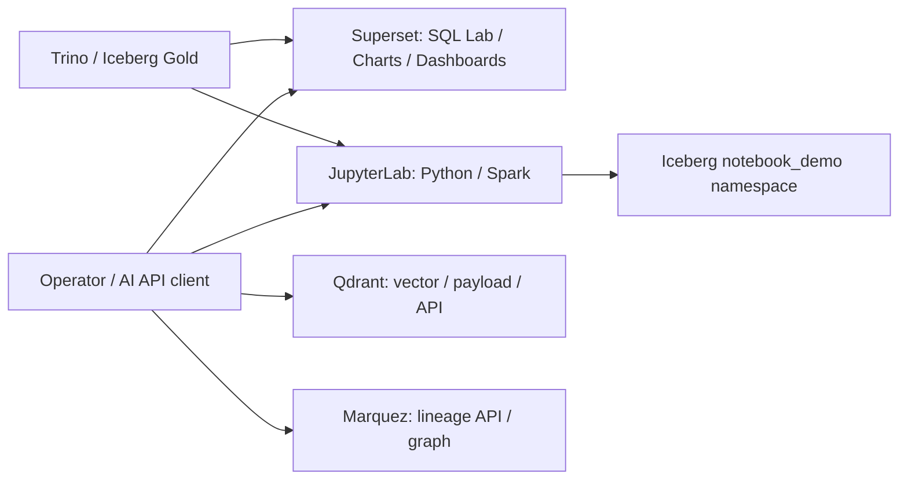
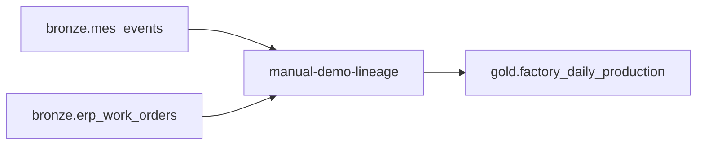

# BI・Notebook・ベクトル検索・データ系統を追加する

データを入れるだけでなく、GUI で調べ、SQL を試し、Notebook で加工し、API から
操作するための追加ツールです。4 つの profile は独立しているので、必要なものだけ
起動できます。通常の Bronze / Silver / Gold と CDC の役割は変えません。

| profile | ツール | GUI の入口 | 主な API / 接続先 | メモリ上限の目安 |
| --- | --- | --- | --- | --- |
| `bi` | Apache Superset | `http://localhost:8088` | `/api/v1/`、SQL Lab、Trino | 本体 2 GiB + init 1.5 GiB + DB/cache |
| `notebooks` | JupyterLab + Spark | `http://localhost:8888/lab` | `/api/contents`、`/api/kernels`、kernel WebSocket | driver 4 GiB、executor は compute Worker |
| `vector` | Qdrant | `http://localhost:6333/dashboard/` | `/collections`、`/points/query`、OpenAPI | 1 GiB |
| `lineage` | Marquez | `http://localhost:3001` | `http://localhost:5000/api/v1/` | API 1 GiB + Web/DB |

いずれも host の loopback に bind します。表の値は service に設定した上限で、
常時消費する量ではありません。これらは信頼する operator 向けの PoC です。
特に Notebook は Python・shell・Spark を実行し、catalog と S3 に書き込めます。
複数の会社利用者へ公開するときは、認証付き ingress、権限分離、JupyterHub 等の
利用者分離を別途設計してください。共有 token のまま一般公開する構成ではありません。



Qdrant への埋め込み生成や、実際のジョブからの OpenLineage 自動送信は、この profile
だけで有効になりません。下記の小さな seed と、業務データを処理する連携を区別します。

## 1. private 設定と起動

[導入手順](DEPLOYMENT.md) で生成した外部 `site.env` に、必要な profile を追加します。
全部を試す場合は `COMPOSE_PROFILES` に `bi,notebooks,vector,lineage` を含めます。
既存の `automation,monitoring` などを使っている場合はそれらも残してください。

| 設定 | 内容 |
| --- | --- |
| `SUPERSET_PORT` | 既定 8088 |
| `SUPERSET_DB_PASSWORD` | Superset 専用 PostgreSQL の password |
| `SUPERSET_SECRET_KEY` | 32 文字以上の固定 secret。metadata DB と一緒に保管する |
| `SUPERSET_ADMIN_USERNAME/PASSWORD/EMAIL` | 初期 admin。password は 16 文字以上 |
| `SUPERSET_REDIS_PASSWORD` | Superset cache 用 Redis の password |
| `JUPYTER_PORT` / `JUPYTER_TOKEN` | 既定 8888、32 文字以上の固定 token |
| `NOTEBOOKS_DIR` | checkout 外に作成する、保存用 workspace directory |
| `WORKER_UID/GID` | landing と notebook workspace を使う host ユーザーの UID/GID |
| `QDRANT_PORT` | 既定 6333。REST / dashboard の共通入口 |
| `QDRANT_API_KEY` | 管理・書込用 key |
| `QDRANT_READ_ONLY_API_KEY` | 別の key。検索・参照用 |
| `MARQUEZ_API_PORT` / `MARQUEZ_UI_PORT` | 既定 5000 / 3001 |
| `MARQUEZ_DB_PASSWORD` | Marquez 専用 PostgreSQL の password |

秘密値は生成した private 設定にだけ保存します。説明用の文字列を実際の password に
しないでください。Notebook の workspace は起動前に用意し、`WORKER_UID/GID` が
読み書きできるようにします。Compose が勝手に別所有者の directory を作らないよう、
`create_host_path: false` にしています。

```sh
export LAKEHOUSE_ENV_FILE="$HOME/.config/lakehouse-foundation/site.env"
python3 scripts/control.py plan
python3 scripts/control.py up
```

profile が無効なときは、追加ツールの未設定値が core-only の plan を止めません。
有効なツールに必要な secret が空の場合は、DB または app の起動時に拒否します。
Jupyter・Superset の Python 依存は uv 0.13.7 と hash lock で image 作成時に確定し、
通常起動で package をダウンロードしません。

企業 proxy は build/runtime の `HTTP_PROXY/HTTPS_PROXY/NO_PROXY` と小文字の 6 変数を
引き継ぎます。内部 service 名を NO_PROXY へ追加してください。独自 CA は
`CORPORATE_CA_FILE` の BuildKit secret で OS trust に追加し、Notebook の Java trust
にも追加します。既存の信頼済み root は削除しません。秘密鍵や proxy の password を
image に COPY しないでください。具体的な社内設定は
[COMPANY-PROXY.md](COMPANY-PROXY.md) と [PROXY.md](PROXY.md) を参照してください。

## 2. Superset で Gold を可視化する

### 初期化とログイン

`bi` profile は専用 PostgreSQL、認証付き Redis、`superset-init`、Superset 本体を起動します。
init は migration と role 初期化の後、未作成の admin と `Lakehouse Trino` 接続を登録します。
既存 admin の password や、GUI で編集した接続・dataset を再初期化で上書きしません。
Superset のユーザー、chart、dashboard、SQL Lab 履歴は metadata DB に保存されます。
Redis は cache で、catalog や業務データの保存先ではありません。

1. `http://localhost:8088` を開く。
2. private 設定の `SUPERSET_ADMIN_USERNAME/PASSWORD` でログインする。
3. **Settings → Database Connections** で `Lakehouse Trino` を確認する。
4. **SQL → SQL Lab** で接続と `iceberg` catalog / `gold` schema を選ぶ。
5. 例えば次の SELECT を実行する。

```sql
SELECT factory_id, production_date, planned_qty, good_qty, reject_qty,
       yield_pct, plan_adherence_pct, downtime_minutes
FROM iceberg.gold.factory_daily_production
ORDER BY production_date, factory_id
LIMIT 100;
```

初期接続は `trino://superset@trino:8080/iceberg/gold` です。CTAS/CVAS と DML は
Superset の接続設定で無効にしています。ただし PoC 内部の Trino 自体にユーザー別
権限を実装したものではありません。企業でのアクセス制御は catalog/schema の権限と
認証を組み合わせて設定してください。

### dataset と chart を作る

init 時に Gold が存在すれば、次の 2 dataset を登録します。

| dataset | 1 行の粒度 | 最初に作る可視化の例 |
| --- | --- | --- |
| `factory_daily_production` | 工場 × UTC 日 | 日別良品数、計画数量、歩留まり、停止時間 |
| `sales_fulfillment` | 受注 1 件 | 出荷済数量、残数、履行率、遅延出荷数量 |

新しい warehouse では、最初のメダリオン実行まで Gold table がありません。
その場合 init は `pending: 2` として GUI を起動します。素材を取り込みメダリオンが
成功した後、**Data → Datasets** の追加操作で `Lakehouse Trino` / `gold` から
2 表を選べます。dataset の列情報を変更した場合も GUI の metadata refresh を使います。

Charts の作成では、dataset を選び、日付・工場等の軸と指標を設定し、結果を確認して
保存します。Dashboard を作って chart を追加すると、GUI の編集結果が DB に残ります。
初期設定は chart の完成品を自動生成しません。会社の KPI と粒度を確認して作成できます。

歩留まりを複数の日や工場でまとめる場合、`yield_pct` を単純平均せず、
`100 * SUM(good_qty) / NULLIF(SUM(total_qty), 0)` としてください。計画達成率も
`100 * SUM(good_qty) / NULLIF(SUM(planned_qty), 0)` で計算します。
詳細な式と制約は [MEDALLION.md](MEDALLION.md) にあります。OEE は未実装です。

### API から操作する

Superset は JWT login、CSRF、接続・dataset・chart・dashboard・SQL Lab の API を持ちます。
`POST /api/v1/security/login` へ native admin の資格情報を送り、取得した access token を
`Authorization: Bearer ...` で送ります。書込操作には
`GET /api/v1/security/csrf_token/` で得た値も `X-CSRFToken` に設定します。
API token や login body を notebook output・公開 log に保存しないでください。

| API | 用途 |
| --- | --- |
| `GET /api/v1/database/` | 接続一覧 |
| `GET /api/v1/dataset/` | Gold dataset 等の一覧 |
| `POST /api/v1/sqllab/execute/` | SQL Lab のクエリ実行 |
| `GET /api/v1/chart/` / `/dashboard/` | GUI 作成物の一覧 |

SQL Lab API の `client_id` は短い識別子を使います。metadata の列幅は 11 文字なので、
例えば 10 文字以下にします。native GUI が作る ID と、長い独自ジョブ ID を混同しないで
ください。AI クライアントにもクエリの上限と許可範囲を設けてください。

## 3. JupyterLab で Spark と Iceberg を操作する

### 開く・実行する・保存する

1. `http://localhost:8888/lab` を開き、private `JUPYTER_TOKEN` でログインする。
2. File Browser にある `01-lakehouse-tour.ipynb` を開く。
3. Gold の参照 cell を上から実行する。結果は Pandas の表で表示する。
4. Spark の cell を実行する。compute 有効時は常駐 Master/Worker、無効時は local[2] と表示する。
5. `notebook_demo.notes` の作成・MERGE・SELECT を実行し、小さな Iceberg 読書きを確認する。
6. notebook を保存し、利用後は kernel を shutdown する。

初期 notebook は workspace に同名ファイルがない場合だけコピーします。再起動で GUI の
編集や保存内容を初期化しません。kernel の変数は一時状態で、notebook と作成した Iceberg
表の保存先は別です。最後の `spark.stop()` で JVM を終了できます。

```python
from lakehouse_session import read_gold, session_info, spark_session

columns, rows = read_gold("sales_fulfillment", limit=20)
spark = spark_session()
print(session_info(spark))
spark.sql("SHOW NAMESPACES IN lakehouse").show()
spark.stop()
```

`read_gold` は宣言した 2 Gold table と 1～10,000 行の上限だけを受け付けます。
SparkSession は同じ REST catalog と S3 を使います。初期例の書込先は
`notebook_demo` です。通常の Bronze/Silver/Gold を書き換えるコードにはしていません。
ただし notebook 自体を sandbox 化したわけではなく、operator はコードを変更できます。
受け取った notebook は中身を読み、信頼できるものだけ実行してください。

### 常駐 cluster と local の選び方

| 有効な profile | `spark_session()` の実行先 | 表示・保存 |
| --- | --- | --- |
| `notebooks,compute` | `spark://spark-master:7077` の常駐 Master/Worker | 実 master、application ID、Master/Worker/application/History へのリンク |
| `notebooks`、compute 無効 | Jupyter 内の `local[2]` | local であることを明示。event log は保存する |

実際の選択は container が受け取る `COMPOSE_PROFILES` に基づきます。
remote 時の接続先は `SPARK_MASTER_URL` です。Master 停止、Worker 不在、Python の不整合は
失敗として確認し、黙って local へ切り替えません。すでに別 master の SparkSession が
kernel にあれば、再利用して成功したことにせずエラーにします。切替前に notebook を
保存し、`spark.stop()` と kernel shutdown を行い、設定変更・再配置後に新しい kernel を
使ってください。

`02-spark-cluster.ipynb` が cluster 用の追加例です。既存の `01-lakehouse-tour.ipynb`
を編集していても上書きせず、02 を新しいファイルとして追加します。例では 2 partition の
Python task が実際の executor hostname・Python/Pandas/Arrow/NumPy 版を返します。
`mapInPandas` による Arrow 処理と、専用 `notebook_demo.cluster_roundtrip` table への
小さな Iceberg MERGE/SELECT も実行できます。

Notebook は client mode の driver です。Worker が driver へ戻れるよう、内部名
`jupyter`、bind `0.0.0.0`、driver RPC 39000 / block manager 39001 を指定します。
これらの host port は公開しません。driver UI も 4040 を内部だけで使用し、実行中の
application は Master の reverse proxy を通して開きます。

| UI | 既定の入口 | 主な用途 |
| --- | --- | --- |
| Master | `http://localhost:8082` | Worker、実行中/完了 application、driver UI の proxy |
| Worker | `http://localhost:8085` | executor、CPU/memory、作業状態 |
| History | `http://localhost:18080` | 終了後の job/stage/task 履歴 |

port は `SPARK_MASTER_UI_PORT` / `SPARK_WORKER_UI_PORT` / `SPARK_HISTORY_UI_PORT` で
変えられます。Jupyter の表示リンクも同じ値を使います。localhost の入口は server 上、
またはその port を forward したブラウザーから利用します。

`spark-events` named volume を driver と History が `/opt/spark/events` に共有し、
`file:///opt/spark/events` へ event log を書きます。`spark-volumes-init` は compute と
notebooks の両 profile から使え、local-only の実行時も UID/GID を揃えます。
local-only で保存した履歴は、後から compute/History を起動して閲覧できます。
History の一覧には終了後数秒で反映されます。通常の停止で event volume を削除しないで
ください。Notebook 自体の保存先である `NOTEBOOKS_DIR` とは別の保存物です。

### Python と Spark の組合せ

compute profile と同じ Spark 4.1.4 / Scala 2.13 / Java 21 image、同じ Iceberg 1.12.0 の
2 JAR と SHA-512 を使います。Spark の標準 image は Ubuntu 22.04 / Python 3.10 です。
その Python に対応する JupyterLab 4.6.6、ipykernel 7.3.0、Pandas 2.3.3、Arrow 25.0.0 を
固定しました。ipykernel 7.4 や Arrow 26 は Python 3.11 以上を要求するため混在させません。
Spark executor は `/opt/spark-venv/bin/python`、Jupyter driver は
`/opt/notebook-venv/bin/python` を使います。両方で Python 3.10 と Pandas 2.3.3 / Arrow
25.0.0 / NumPy 2.2.6、および共有する 7 依存の版を hash lock で揃えています。
worker 側だけ別の Python を起動して失敗しないよう、`PYSPARK_PYTHON` と Spark 設定の
両方を切り替えます。driver/worker は同じ Iceberg JAR を持ち、同じ catalog/S3 を使います。

`/api/contents` は workspace の一覧・保存、`/api/kernels` は kernel の生成・停止、
`/api/kernels/<id>/channels` は WebSocket の実行プロトコルです。
認証は `Authorization: token ...` です。token を URL に含めて共有しないでください。
この API は実コードを実行するため、AI に無条件で渡す汎用ツールにはせず、信頼する
operator の操作として扱ってください。

## 4. Qdrant でベクトルと payload を扱う

`http://localhost:6333/dashboard/` を開きます。管理・投入時は `QDRANT_API_KEY`、
通常の検索・確認は `QDRANT_READ_ONLY_API_KEY` を使います。2 つに同じ値を設定すると
起動時に拒否します。固定 key は外部 private env に保管します。

GUI では collection、vector の次元・距離、point ID、payload を確認できます。
Console から native REST API も操作できます。PoC の小例は 4 次元 / Cosine の
`lh_demo_numeric_vectors` です。3 点の合成数値ベクトルを使い、検索 `[1,0,0,0]` の
上位が ID 1、2 となることを確認しています。これは検索エンジンの動作確認で、
文章から semantic embedding を作るモデルは含みません。

```json
{
  "query": [1.0, 0.0, 0.0, 0.0],
  "limit": 2,
  "with_payload": true
}
```

上は `POST /collections/lh_demo_numeric_vectors/points/query` の body です。
header は `api-key: <private key>`。read-only key でも検索できますが、collection 作成や
point の更新は HTTP 403 になります。GRPC の host port は公開していません。

`infra/poc/seed_tools.py` の `seed_vector(values)` は、小さな 3 点のデモを API 経由で
作る関数です。同名 collection がすでにある場合は上書きしません。通常起動時の
自動 seed にはしていないため、会社データをいつの間にか投入する処理にはなりません。
RAG に進むときは、対象文書、embedding model、更新・削除、権限、検索の評価を決めてから
接続します。画像・CSV 等が自動でベクトル化されるわけではありません。

## 5. Marquez で系統を確認する

`http://localhost:3001` が GUI、`http://localhost:5000/api/v1/` が API です。
Marquez 自体のユーザー認証は設定していないため、loopback の管理者向けに限定します。
共有時は認証付き ingress を用意してください。Web は内部の `marquez:5000` を使うため、
利用者のブラウザーから Docker の service 名を解決する必要はありません。

小さな系統デモは次の関係です。



`seed_lineage()` が native `POST /api/v1/lineage` に OpenLineage COMPLETE event を送ります。
namespace は `lakehouse-poc`、job 名は `manual-demo-lineage`、run ID は固定です。
GUI の job/dataset と系統表示を試すための手動 seed であり、実メダリオンが動いたと
報告する event ではありません。`GET /api/v1/namespaces/lakehouse-poc/jobs` からも
確認できます。業務パイプラインへ組み込む場合は、実 run ID、START/COMPLETE/FAIL、
入力・出力、実行時刻を実際のジョブに合わせて送信してください。

OpenSearch を追加する高度な検索は無効です。通常の系統/API/GUI と、専用 PostgreSQL の
metadata 保存を使います。公式 latest の Marquez 0.50.0 は 2024 年の release で、image は
x86-64 向けです。この profile は Linux x86-64 と PostgreSQL 18.6 で migration / health /
小さな lineage event を検証しました。ARM 向けの image 再梱包や emulation は行いません。

## 6. 保存・再起動・停止時の注意

| 保存物 | 保存先 | 維持する設定 |
| --- | --- | --- |
| Superset user/chart/dashboard/SQL Lab | `superset-db` named volume | DB password と `SUPERSET_SECRET_KEY` |
| Notebook と `.ipynb_checkpoints` | 外部 `NOTEBOOKS_DIR` bind | 同じ path と UID/GID |
| Spark の event log | `spark-events` named volume | driver と History の共通 UID/GID、保存先 |
| Qdrant collection/vector/payload | `qdrant` named volume | API keys、volume |
| Marquez lineage/job/run | `marquez-db` named volume | DB password、volume |

named volume は既存の `DATA_VOLUME_PREFIX` または project 名で区別します。
metadata DB を消すと GUI で作ったものも失われます。通常停止には volume 削除を伴う
`down -v` を使わないでください。profile を外して plan を見直すだけでは、既に動いている
container の停止・削除を保証するわけではありません。停止は現在の Compose project と
対象 service を確認して実施します。

Superset init が失敗したときは `/tmp/superset-setup-error.log` に owner-private な詳細を
残し、通常 log は error type だけにします。詳細には接続情報が含まれる可能性があるため、
公開 issue や screenshot へそのまま貼らないでください。Superset の init をやり直しても
既存 GUI 編集を初期化しませんが、metadata DB の backup を取ってから作業してください。

## 7. 検証した範囲と固定版

| 項目 | 実機で確認する内容 |
| --- | --- |
| Superset | native login/JWT/CSRF、Trino 接続、Gold 2 dataset、SQL Lab で受注 20 件を集計 |
| Jupyter / Spark | token API、実 kernel、Trino Gold 参照、常駐 Worker の Python / Arrow 処理、Iceberg と Trino の 3 行照合 |
| Qdrant | native dashboard、3 点 seed、近傍 ID 1/2、read-only 検索と書込拒否 |
| Marquez | PG migration/health、native GUI/API、2 input / 1 output のデモ系統 |

初回の独立 PoC 検証に加え、主基盤の常駐 Spark でも次を確認しています。

- Python の 2 partition が driver とは別の `spark-worker` で実行される。
- driver/executor が同じ Python 3.10.12、Pandas 2.3.3 / Arrow 25.0.0 / NumPy 2.2.6 を使う。
- `mapInPandas` の 6 行処理と、専用 notebook_demo table の Iceberg 3 行 / Trino 3 行が一致する。
- 実行中の Master reverse proxy から application UI が開き、終了後に History の completed application / 9 jobs が読める。
- History のみ再起動しても同じ application/job が残り、Master/Worker の起動時刻は変わらない。
- 別 kernel で local[2] を明示選択した 2 行処理も成功し、共有 History へ完了履歴が残る。

これらは小規模な機能・再起動試験です。大規模性能、複数利用者の分離、長期 backup
復旧、本物の会社 proxy/CA の接続を実証したものではありません。

[images.lock.json](../infra/poc/images.lock.json) に公式 registry の digest と CPU 対応を
記録しています。Superset 6.1.0、Redis 8.10.3、JupyterLab 4.6.6、Qdrant 1.20.0、
Marquez 0.50.0 を使います。Superset は upstream の SQLAlchemy 1.4.54 を維持して
Trino driver 0.340.0 を追加し、既存アプリの依存一式を uv sync で消さない方法にしています。

- [Superset documentation](https://superset.apache.org/docs/intro): BI/SQL Lab/API。
- [Superset releases](https://github.com/apache/superset/releases): 本体の対応版。
- [JupyterLab changelog](https://jupyterlab.readthedocs.io/en/stable/getting_started/changelog.html): GUI と Python 対応。
- [Qdrant API](https://api.qdrant.tech/api-reference): vector/payload/search の API。
- [Marquez documentation](https://marquezproject.ai/docs/introduction): lineage API/GUI。
- [OpenLineage specification](https://openlineage.io/docs/spec/): 実ジョブから送る event の契約。
