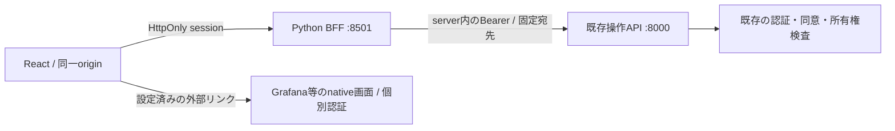

# React版 Lakehouse Studioを利用する

<!-- doc-purpose:start -->
> **役割:** React画面の起動・接続・操作範囲と、private設定・外部公開・従来画面への戻し方を確認する。
>
> **対象読者:** 初めて使う人 / データ利用担当 / 基盤構築担当 / 開発・設計担当
>
> **読むタイミング:** 新しいPoCでReact版を選ぶとき、外部入口を揃えるとき、画面を変更・検証するとき。
>
> **前提となる資料:** [PoC操作ポータル](<POC-PORTAL.md>) / [サイト設定リファレンス](<CONFIGURATION.md>)
>
> **次に読む資料:** [テーブルと列をGUIで選ぶソース登録の下書き](<SOURCE-ONBOARDING.md>) / [Cloudflareを使う場所と社内に残す場所](<CLOUDFLARE.md>) / [mainのPoCと試作ブランチを並行して使う](<PARALLEL-POC.md>)
>
> **文書一覧:** [目的・読者から探す文書マニフェスト](<DOCUMENTATION-MANIFEST.md>)
<!-- doc-purpose:end -->

サービス画面の起動・再起動・停止は、[サービス操作](SERVICE-CONTROL.md)を参照します。
profile設定と実コンテナの観測を分け、host runnerが未接続なら実行しません。

Lakehouse Studioは、React・TypeScriptによる新しいPoC操作画面です。
サービス入口、データカタログ、ソース登録の下書き、基本的な素材生成・ジョブ、
設定を同じ画面から扱います。既存Streamlit版は保持し、設定で選択できます。
既存機能の全移植や、メタデータからの自動配置が完了したという意味ではありません。

## 1. どちらの画面を使うか

| 選択 | 設定・用途 |
| --- | --- |
| 既存Streamlit | `PORTAL_UI_MODE=streamlit`。通常の新規生成・既存設定のupgradeの既定値。既存の詳細操作を継続 |
| React Studio | `PORTAL_UI_MODE=react`。新規`parallel-lab` presetはこちらを選択。新しい操作導線を比較 |

両方とも同じ`demo`コンテナ・内部8501・選択した`DEMO_GUI_PORT`を使い、
同時に別のserverを起動しません。専用並行PoCの既定入口は
`http://localhost:28501/`、通常構成は`http://localhost:8501/`です。
現在の配置がどちらを選んでいるかと、実際のportを先に確認します。
[並行PoC](PARALLEL-POC.md) / [設定](CONFIGURATION.md)

## 2. 最初のログインと操作

1. 管理者が選択projectのimageと設定を同じmanagerで反映し、画面を開きます。
2. Access方式では入口の認証後に**Cloudflareでログイン**を選びます。
   接続キー方式では、そのPoCの**ワークスペース接続キー**を入力します。
   新規環境は`PORTAL_LOGIN_TOKEN`を使い、旧環境の初回だけ既存の
   `CONTROL_API_TOKEN`をbootstrapに使います。SQL/DBA資格情報は入力しません。
3. **ワークスペース**でprofileと内部サービス状態を確認します。緑表示は内部healthで、
   外部接続・製品認証・業務データの正しさの証明ではありません。
4. **サービス**から、設定済みの各製品のnative画面を開きます。
5. **データカタログ**でSilver6表とGold2種の公開契約を確認します。
6. **データ連携を組む**で表・列・業務方針を選び、下書きの警告と確認事項を読みます。
   保存・planは正式承認、実DB Discovery、DDL、CDC登録を行いません。
7. **運用・ジョブ**で基本的なLanding素材生成や既存の処理を明示実行し、結果を確認します。
   受付と完了は別です。timeout時にPOSTを繰り返さず、先にジョブの状態を調べます。
8. **設定**で必要な項目を編集します。保存だけではコンテナへ適用されません。
   「反映待ち」の差分を確認し、承認した再配置を同じmanagerで行います。

ログイン欄は送信後にclearし、root tokenをbundleやbrowser storageへ保存しません。
ブラウザーには不透明なHttpOnly・SameSite=Strictのsession cookieを渡します。
有効期限は8時間で、gateway再起動でもログアウトします。projectごとにcookie名を分け、
Domainを指定せず、Pathは`/api`です。publicモードではSecureも有効です。
失敗したログインはglobalの有界な回数制限があります。Access方式は署名された本人情報を
毎回検証しますが、個人別role・正式な権限委譲は未実装です。許可された利用者は既存APIと
同じPoC所有者用の操作権限を持ちます。共有キーを公開文書へ転記しません。

### Cloudflareのログインを使う

operatorが既存Accessアプリのteam domainと、その**Portal用**application AUDを確認し、
選択private設定へ次を記入します。APIや別製品のAUDを流用しません。以下は架空の例です。

```dotenv
PORTAL_UI_MODE=react
PORTAL_LINK_MODE=public
DEMO_GUI_PUBLIC_URL=https://portal.example.invalid
PORTAL_AUTH_MODE=cloudflare-access
PORTAL_ACCESS_TEAM_DOMAIN=example-team.cloudflareaccess.com
PORTAL_ACCESS_AUD=aaaaaaaaaaaaaaaaaaaaaaaaaaaaaaaaaaaaaaaaaaaaaaaaaaaaaaaaaaaaaaaa
```

同じmanagerでAPI/Portalを反映してから、許可した利用者のログイン、許可外の拒否、
JWTなし/不正な直接要求の拒否、ログアウトを確認します。Access policy・DNS・Tunnelを
この設定から作成・緩和しません。AccessでGoogle等のIdPを選ぶ設定と、このPortalで
Access認証を再利用する設定は別です。メールOTPの場合はその既存方式を維持します。

gatewayは`Cf-Access-Jwt-Assertion`のRS256署名、固定issuer/AUD、期限と本人subjectを
検査し、その本人と短期cookieを結び付けます。メールheaderだけでは認証しません。
Access方式でJWTがない場合、接続キーへfallbackしません。署名鍵の取得先は設定したteamの
`/cdn-cgi/access/certs`だけで、redirectやJWT内の任意key URLは使いません。
取得のbyte/時間上限とcache期限を設け、期限後の鍵取得失敗では拒否します。
company proxyは明示した大小文字HTTPS_PROXYとNO_PROXYを使い、内部APIはproxyを使いません。
image内のCA trustを使用し、TLS検証を外しません。
[公式JWT検証](https://developers.cloudflare.com/cloudflare-one/access-controls/applications/http-apps/authorization-cookie/validating-json/)

SSOのログアウトはPortal sessionを終了後、固定の同origin
`/cdn-cgi/access/logout`へ進みます。Cloudflare公式ではこの操作は他のAccessアプリの
sessionにも影響します。JWTのローカル署名検証は失効確認APIではなく、盗難tokenの即時失効を
保証しません。実Accessのcookie削除・失効反映も確認します。
[公式session管理](https://developers.cloudflare.com/cloudflare-one/access-controls/access-settings/session-management/)

### ワークスペース接続キーを変更する

接続キー方式では**設定 → ログインと接続キー**から現在キー・新キー・再入力を指定し、
全session終了に同意して変更します。24〜128文字の空白なしASCIIを受け付けます。
password manager等で生成した高エントロピーの値を使います。長さだけで強度は保証しません。
入力は送信直後に消去し、成功後は全ブラウザーで再ログインが必要です。
応答を失った場合は自動再送せず、新旧どちらが有効か確認します。

保存先はAPIの既存private dir内の`.portal-auth/credential.json`です。親0700/file0600、
salt付きscrypt（N=32768/r=8/p=3）のhashとrevisionだけをatomicに保存します。
これは[OWASPの32MiB設定](https://cheatsheetseries.owasp.org/cheatsheets/Password_Storage_Cheat_Sheet.html)
に基づきます。新しい生キーは保存せず、`site.env`・CONTROL_API_TOKEN・DB・MCP・runnerの
資格情報を変更しません。revisionは認証済み要求ごとにAPIへ照会し、変更後の要求を失効させます。
すでに許可して処理中の要求を取り消す仕組みではありません。

private設定のbackup/restoreには`.portal-auth`も含め、公開Git/Issueへ添付しません。
設定とhashを整合した組として復元します。古いbackupは失効済みキーを復活させ得るため、
復旧時もownerが認証を再確認します。破損、symlink、途中作成、権限不一致は拒否し、
bootstrapへ戻しません。忘れたキーの自動resetやdirectory削除による解除は提供しません。
operatorが原状・backup・本人性を確認して別途復旧を承認します。
SSO方式では接続キー入力と変更を無効化し、利用者の許可はAccess側で管理します。

### 追加コンポーネントを画面で準備する

**セットアップ**でSpark/Jupyter/OpenObserve/Sail等を選び、**準備を始める**から
不足設定、依存profile、設定前後のprofile、初期化・検証・外部入口の手順を確認します。
公開可能な固定名と手順だけをJSONへ保存でき、秘密値・host path・コマンドを含めません。
「設定は準備済み」は起動成功ではありません。planは設定保存やbuild/起動をせず、
operatorが既存managerで初回導入し、その後対応groupを管理runnerへ追加・再承認します。
設定・source更新で古いrunnerの承認が失効するため、新しい空のauthority先を使います。
進行中操作・結果未確認を消すために旧authorityや履歴を削除しません。
[初回導入とGUI管理の境界](SERVICE-CONTROL.md)

## 3. 外部ブラウザーから開く

Reactは同一originの`/api`を使います。ブラウザーから内部の`demo-api`へ直接接続せず、
Python gatewayが固定内部APIへ認証付きで中継します。任意URLをproxyする機能はありません。



| 設定 | 指定・反映先 |
| --- | --- |
| `PORTAL_LINK_MODE=local` | localhost/SSH転送用。gatewayはlocalhostまたは127.0.0.1のHostだけを許可 |
| `PORTAL_LINK_MODE=public` | 外部HTTPS用。Portalの公開originが必須 |
| `DEMO_GUI_PUBLIC_URL` | PortalのHTTPS origin。例`https://portal.example.invalid`。path・query・credentialは入れない |
| 各サービスの`*_PUBLIC_URL` | 許可した各製品のHTTPS origin。未設定ならリンクを無効化し、localhostへ戻さない |
| `PORTAL_PUBLIC_ORIGIN` | Composeが`DEMO_GUI_PUBLIC_URL`からgatewayへ渡す環境変数。別のsite設定体系を作らない |
| `PORTAL_PROJECT_NAME` | Composeが選択project名から渡すcookie識別用の値 |

publicではHostとOriginが選択したoriginと一致する必要があります。
同一originの変更要求には独自headerも必要で、CORS・CSRF検査を無効化しません。
不一致による403は、許可したhostnameと設定の対応を確認して解決します。
proxyのheader偽装許可や、TLS検証を外す方法へ置き換えません。

Portalの公開リンク設定は、DNS・Tunnel・Access applicationを作りません。
各製品のroute、Accessの利用者制限、製品自身のbase URL・redirect・cookie・WebSocketは
別に設定・受入します。Portalへログインしても、Grafanaやn8n等へ自動ログインはしません。
既存APIの認証・SQL ownership・read-only・明示同意の検査も保持します。
[外部入口と受入](CLOUDFLARE.md) / [リンク設定](POC-PORTAL.md#外部のブラウザーから各サービスを開く)

## 4. 移植した範囲と既存画面との違い

| 操作 | React版の現在の範囲 |
| --- | --- |
| サービス・カタログ・設定 | 既存認証付きAPIを使う。保存と適用、内部healthと外部URLを区別 |
| セットアップ | 固定10機能の必要設定と依存・導入手順を案内。初回導入の自動実行はしない |
| ソース登録 | 合成metadataと未承認の下書き・plan。実DBへ接続・適用しない |
| 素材・ジョブ | 基本的なLanding素材生成と固定操作。実行条件・結果を明示 |
| 高度な異常生成・有限microbatch | Reactへ未移植。既存Streamlitの詳細操作を使用 |
| SQL Server投入・CDC・snapshot/watermark | 詳細操作画面はReactへ未移植。既存手順・APIの安全検査を維持 |
| network診断・AI詳細 | Reactへ未移植。既存Streamlitと同梱文書を使用 |

外部DB未接続の新規PoCで、SQL/CDC機能が使えるとは扱いません。
画面のボタンがあること、APIへ受付できること、実データ連携の成功を分けます。
[Streamlitの操作](POC-PORTAL.md) / [下書きの境界](SOURCE-ONBOARDING.md)

## 5. build・切替・戻し方

NodeはTypeScript検査とfrontendのbuild段階だけで使います。生成したdistを
Python imageへコピーし、runtimeはFastAPI/uvicornです。Node serverや開発用Vite serverを
常駐させません。ブラウザー向けbundleへprivate envやtokenを埋め込みません。
dist未生成・危険なsymlink等はreadyにせず、SPAをdirectory listingへfallbackしません。
`/health`はliveness、既存probe互換の`/_stcore/health`はdist準備を確認します。
これだけでbackendやSQLの受入成功を示しません。

既存環境で切り替えるときは、選択private設定を衝突しないbackupへ保存し、
必要な場合だけ`configure.py --upgrade`で欠落keyを追加します。secretは生成し直しません。
`PORTAL_UI_MODE=react`と適切な公開/ローカル設定を保存し、同じproject・volume prefixの
まま所有managerでimageと環境を反映します。Dokployではサービス側Environmentも一致させます。

戻すときは`PORTAL_AUTH_MODE=token`と`PORTAL_UI_MODE=streamlit`へ変更し、
同じmanagerから`demo`を再配置します。`.portal-auth`は保持します。
backend API、main、DB、Iceberg、notebooks、Grafana GUI編集、各volumeを削除しません。
必要なimage差戻しは、互換性を確認した既知のcommitへ戻します。`down -v`やpruneは使いません。

## 6. 確認できた範囲

認証・セットアップ追加時の検査ではfrontendの型検査・buildと合成通信/SSR54テストが
成功しました。Pythonは1178件中1177成功・既存1skipです。gatewayの同origin・cookie・
有界stream、合成RSA署名、実APIとBFFを組み合わせたキー変更と複数sessionの失効を
合成ASGI/MockTransportで確認しています。実ネットワークの結果ではありません。
生成済みHTML・JS・CSSを実際のgatewayから配信し、認証後に固定backendを呼ぶ結合検査も
合成ASGIで実行しています。描画やJavaScriptのブラウザー実行とは分けた検査です。

browser用の合成3specは準備・型検査までで、sandboxでbrowserを起動できず**NOT_RUN**です。
実ブラウザー、Docker image/runtime、公開TLS/Tunnel/Access、各製品ログイン、
実DB・CDCの受入はこの変更で未実施です。先行環境のHTTP確認を、React配置済みの結果へ
読み替えません。公開検査結果と、配置先で後日行う受入を別々に記録してください。

## 7. 画面を変更する人の検査

ローカル開発には固定版Node 24.22.3を使います。通常のコンテナ配置ではbuild用imageが
取得するため、配置hostへNodeをインストールする必要はありません。Pythonの検査環境は
[CONTRIBUTING](../CONTRIBUTING.md)の専用uv環境を使います。

**Bash / Zsh共通**

```bash
cd frontend
npm ci --ignore-scripts --no-audit --no-fund
npm run format:check
npm run check
npm test
npm run build
cd ..
python3 scripts/check_react_build.py
```

`npm test`はブラウザー不要の通信20件・React render14件・lifecycle20件です。
`check_react_build.py`は直前の生成物を使い、実サービスへ接続しません。
任意のブラウザー検査は、公式Playwrightとその対応browserを利用できる検査環境で
`npm run test:e2e`を明示実行します。検査用Vite previewはloopbackの4173だけを使用し、
既存serverを流用しません。sandbox無効化で検査成功に置き換えないでください。
このbrowser fixtureは合成APIのみであり、実gateway・Tunnel・各製品の受入は別です。
