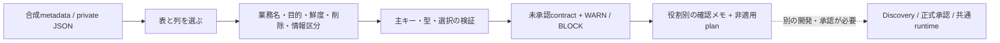

# テーブルと列をGUIで選ぶソース登録の下書き

<!-- doc-purpose:start -->
> **役割:** YAMLを書かずに表・列・業務方針から未承認contract案を作り、GUI/API試作と将来の実適用を区別する。
>
> **対象読者:** データ利用担当 / 開発・設計担当 / 基盤構築担当
>
> **読むタイミング:** メタデータ駆動の取込対象選択を合成データで試し、現場・DBAの確認事項と後続開発を整理するとき。
>
> **前提となる資料:** [PoC操作ポータル](<POC-PORTAL.md>) / [固定SQL sourceで疑似ERP・MESを検証する](<SQLSERVER-FIXED-DEMO.md>)
>
> **次に読む資料:** [GUI操作APIとSwagger](<API.md>) / [ソース・指標・API・計算基盤を拡張する](<CUSTOMIZATION.md>)
>
> **文書一覧:** [目的・読者から探す文書マニフェスト](<DOCUMENTATION-MANIFEST.md>)
<!-- doc-purpose:end -->

## この試作でできること

現場の利用者はYAMLやSQLを書かずに、取り込みたい表・列、業務上の名前、
利用目的、必要な鮮度、削除方針、列の情報区分を画面で選択します。
基盤は選択結果から、未承認のsource contract案と確認計画を生成します。

これはメタデータ駆動オンボーディングの最初の試作です。現在は**合成6表の
metadata、または許可されたmetadata JSONの取込み**が入口です。実DBの
自動Discovery、DBAの本人確認、承認receipt、承認済みcontractのruntime適用は
まだありません。画面からSQL Server、CDC、Connectorを変更しません。

| 項目 | 現在の動作 |
| --- | --- |
| 表・列・主キー | 合成metadataまたは取込JSONを表示し、選択を検査 |
| 業務ルール | 日本語のフォームで確認し、下書きへ記録 |
| 契約案 | 型・列・主キー・分類・未決事項を検証してJSONを生成 |
| レビュー | 下書きの確認メモ。担当者の本人確認・正式承認ではない |
| 計画 | 必要な後続工程とWARN/BLOCKを表示。実行できるSQLは含まない |
| 適用・DB作成・CDC登録 | 提供しない。`can_apply`は常に`false` |

現在の固定SQL source、snapshot、水位増分、CDC consumerは変更しません。
新しい下書きを作っても既存Connector、topic、offset、Raw/Current Stateへは
影響しません。[固定SQL source](SQLSERVER-FIXED-DEMO.md)



## 1. GUIを開く

### 配置済みPoCポータルから使う

このブランチのdemo imageを管理者が配置した環境では、既存ポータルの
**ソース登録の下書き**タブを開きます。従来の`demo` profileと認証付き操作APIを
利用し、新しいサービス・公開ポート・DBA資格情報は追加しません。
通常のタブ表示だけではmetadataを読み込みません。

この文書の実装・検証作業ではサービスを配置していません。
稼働中の旧imageへブランチを作っただけでタブが現れるわけではありません。
既存サイトの更新は管理者が既存の管理方法で別途判断します。
[ポータルの入口](POC-PORTAL.md) / [配置と管理の区別](DOKPLOY.md)

### 基盤を起動せず単独プレビューで使う

開発者は、DBもprivate設定も用意せず同じ画面を試せます。
以下は**利用者が手元で明示的に起動する場合**のコマンドであり、初期配置の
自動処理には含めません。ブラウザーはサーバー自身から使います。
他の端末から広く公開する設定には変更しません。

**Bash / Zsh共通**

```bash
ONBOARDING_VENV="$HOME/.local/share/lakehouse-foundation/onboarding-venv"
uv venv --python 3.12 "$ONBOARDING_VENV"
uv pip sync --python "$ONBOARDING_VENV/bin/python" \
  --require-hashes requirements-dev.lock
"$ONBOARDING_VENV/bin/streamlit" run infra/demo/onboarding_preview.py \
  --server.address=127.0.0.1 --server.port=8510 \
  --server.headless=true --browser.gatherUsageStats=false
```

`http://localhost:8510/`を開きます。8510が使用中なら空いているloopback用portを
選びます。単独プレビューにはログイン機能がないため、共有サーバーで他利用者の
機密metadataを扱う用途には使いません。終了は起動した端末でCtrl+Cです。
Docker、Dokploy、SQL Server、既存のサービスは起動・停止しません。

## 2. 現場担当者が下書きを組み立てる

1. **合成6表で試す**を押します。これはDBへ問い合わせた結果ではありません。
2. 取り込みたいテーブルを選びます。最初は1表で流れを確かめます。
3. 表ごとの列一覧でSQL型・NULL・主キー候補を見て、取り込む列を選択します。
4. **業務上の名前**と**このデータを使う目的**を入力します。技術名を改名したり、
   元DBに表を新規作成したりする操作ではありません。
5. 必要な鮮度を分で入力します。業務要望の記録で、実際の遅延保証ではありません。
6. 削除の扱い、主キー候補の安定性、各取込列の情報区分を確認します。
7. 契約案を生成し、表示されたBLOCKとWARNを担当者と確認します。
8. 役割別の確認メモと計画を作り、必要ならJSONをprivateな場所へ保存します。

主キーは検出metadataの情報を使います。主キーのない表に便宜的なキーを自動で
付けたり、利用者が適当な列を選ぶだけで正当な物理主キーと扱ったりしません。
複合主キーも全列が必要です。主キー列を外すとBLOCKになります。

機密候補の列名は警告の補助情報です。名称だけで機密でないと判定しません。
`original_values`のようなJSON列には多様な業務情報が入る可能性があるため、
必要性を確認し、不要なら取込列から外します。情報区分を「対象外」にした列を
取込対象へ残すとBLOCKになります。

## 3. 警告と確認メモを読む

| 表示 | 意味と次の操作 |
| --- | --- |
| `MISSING_PRIMARY_KEY` | システム担当が物理主キーを調査。自動採番で代用しない |
| `PRIMARY_KEY_EXCLUDED` | 取込列へ主キーを含めるか、選択の目的を見直す |
| `COLUMN_CLASSIFICATION_REQUIRED` | 未確認または対象外の取込列を担当者と見直す |
| `COLUMN_COMPATIBILITY_REVIEW` | 計算列・型等に別のCDC互換性確認が必要 |
| `DELETE_POLICY_UNREVIEWED` | 削除を保持するか伝播するか業務判断が必要 |
| `STALE_REVIEW` | metadataや選択が変わったため、確認メモを取り直す |
| `APPROVAL_NOT_VERIFIED` | チェック欄は本人確認された正式承認ではない |
| `METADATA_UNVERIFIED` | 実DBとの一致・権限・CDC稼働を未確認 |
| `CAPTURE_NAME_COLLISION` | 別の選択表とcapture候補名が重複。DBAの別設計が必要 |

contract hashはmetadataと選択・業務方針へ結び付きます。表・列・目的・鮮度等を
編集した場合、古い結果と確認メモ・ダウンロードを再利用せず再生成します。
4役割すべてにチェックを付けても、正式承認や実DB受入の成功にはなりません。
出力の`approvals_verified`、`database_checked`、`can_apply`は常に`false`です。

計画の`runtime: not_implemented`や`acceptance: not_run`は不足を隠す表示ではなく、
この試作が保証する範囲を示します。画面に「適用」ボタンはありません。

## 4. metadataの取込みと機密情報

通常の現場操作ではJSONの編集も不要です。将来Discoveryが生成する成果物を
システム担当が準備するための取込口として、256KiB以下のUTF-8 JSONに対応します。
**行データ・値のサンプル・接続先・password・tokenを含めません。**
テーブル名と列名そのものも社内情報になり得るため、実metadataを扱う前に、
利用する環境・参加者・保管先の許可を確認します。

入力は`/onboarding/schema`の`discovery_schema`で定義されます。
schema/table/列の技術識別子はこの試作では英数字とunderscoreに限定し、
日本語は業務名・目的へ入力できます。空白・日本語・特殊文字を含む物理識別子は
将来Discovery/引用規則を設計するまで対象外です。

未定義field、重複したJSON key、表・列・主キーの重複、NaN/Infinity、深い構造、
上限を超える入力は拒否します。metadataは最大50表、各128列、全体512列、
主キー16列です。GUIで同時に組み立てる対象は最大6表に限定します。
SQL型の基本形式と範囲を調べますが、全てのSQL Server型のCDC互換性を実証した
検査ではありません。DBの照合順序・有効権限・captureの実在も未検証です。
capture候補は100文字以内と選択表間の完全一致の重複を検査します。
DB全体の既存名や照合順序による同一視は、実Discovery/DBA確認が必要です。
[SQL Serverのcapture名仕様](https://learn.microsoft.com/en-us/sql/relational-databases/system-stored-procedures/sys-sp-cdc-enable-table-transact-sql/)

入力内容・下書きはAPIのログやserver側の履歴ファイルへ保存しません。
GUIのsessionと応答に保持し、downloadは利用者のブラウザー側で行います。
ブラウザーの保管先はアプリが権限0600を保証できないため、privateな保管場所・
共有設定を利用者が管理します。取得したJSONを公開Gitへ追加しません。
再読み込みやsession終了で下書きが失われる場合があります。共有の承認台帳は
未実装であり、下書きの保存を正式な承認receiptとは扱いません。

ローカルの非公開資料用`docs/private/`は、共有`.gitignore`と`.dockerignore`で
除外します。Gitへ追加されないことと、Dockerの`COPY docs`に入らないことは
別の境界です。除外規則はアクセス制御・暗号化の代わりではありません。

## 5. APIとSwagger

既存の`CONTROL_API_TOKEN`で認証します。source readerやDBAの認証情報は
受け取りません。既存`/docs`の**ソース登録の下書き（DB変更なし）**から操作でき、
SwaggerのJS/CSSは既存image内の配信を継続します。

| Method | Path | 入出力 |
| --- | --- | --- |
| GET | `/onboarding/example` | 公開固定6表を模した合成metadata |
| GET | `/onboarding/schema` | Discovery/ProposalRequestの厳密なJSON Schema |
| POST | `/onboarding/validate-discovery` | metadataの形式検証とhash |
| POST | `/onboarding/propose` | 表・列・業務方針からcontract案と確認事項 |
| POST | `/onboarding/plan` | 同じ入力から再計算した非適用plan |

POSTでもDB・host・server履歴を変更しない純粋な計算です。
`/capabilities`では`access: read`と表示します。APIは256KiBのstream上限と
読取時間上限を適用し、validation errorに入力値や生例外を反射しません。
`POST /onboarding/apply`は存在しません。

## 6. ソースと試験の読み方

| ファイル | 役割 |
| --- | --- |
| [onboarding_contract.py](../infra/demo/onboarding_contract.py) | 厳密なモデル、合成6表、契約hash、WARN/BLOCK、非適用plan |
| [onboarding_ui.py](../infra/demo/onboarding_ui.py) | YAMLを要求しない表・列・業務方針の編集 |
| [onboarding_preview.py](../infra/demo/onboarding_preview.py) | 同じGUI/engineをHTTP・DBなしで使う単独入口 |
| [onboarding_api.py](../infra/demo/onboarding_api.py) | 既存Bearer認証と上限付きJSON入力による下書きAPI |

標準のuv環境から以下を実行します。GUI試験はStreamlitの実widgetをAppTestで
動かします。API試験はASGIをin-processで動かし、HTTP listenerは作りません。
SQL Server、Docker、会社接続先は使いません。

**Bash / Zsh共通**

```bash
"$ONBOARDING_VENV/bin/python" -m unittest discover -s tests \
  -p 'test_onboarding_*.py'
```

単体/GUI/API試験の成功を、実DB Discovery・正式承認・CDC登録・snapshot/CDC E2Eや
会社受入の成功へ読み替えません。新しいブラウザー画面の実配置と利用者受入も
別の検証です。[品質検査の全手順](../CONTRIBUTING.md)

公式仕様を確認した参照先:
[Streamlit 1.67 data editor](https://docs.streamlit.io/develop/api-reference/data/st.data_editor)、
[file uploader](https://docs.streamlit.io/develop/api-reference/widgets/st.file_uploader)、
[AppTest](https://docs.streamlit.io/develop/api-reference/app-testing/st.testing.v1.apptest)、
[FastAPI routerと依存関係](https://fastapi.tiangolo.com/tutorial/bigger-applications/)。
この変更では依存・image版を増やしていません。

## 7. 後続の開発と戻し方

次の実装候補はread-only Discovery、契約の厳格schema、golden fixtureに基づく
共通runtimeと正式承認receiptです。現場レビューUIと本人確認された承認は別に
設計し、runtime readerへDBAの包括権限を渡しません。
同一captureに二つのConnectorを自動登録せず、既存offset/historyを保持する
移行計画とsnapshot・I/U/D・再起動の受入を別PRで実装します。

この試作を使わない場合は新しいタブを使わず、元の固定デモを継続できます。
コードを元の承認済みcommitへ戻す場合も、既存の管理方法で行います。
新規DB/volume/Connectorを作っていないため、削除SQL、`down -v`、offsetの消去、
Notebookや既存Grafana状態の削除は不要です。
