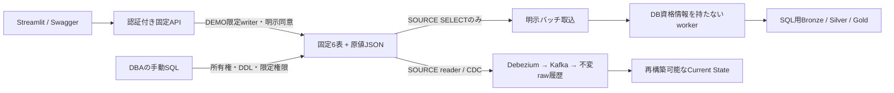
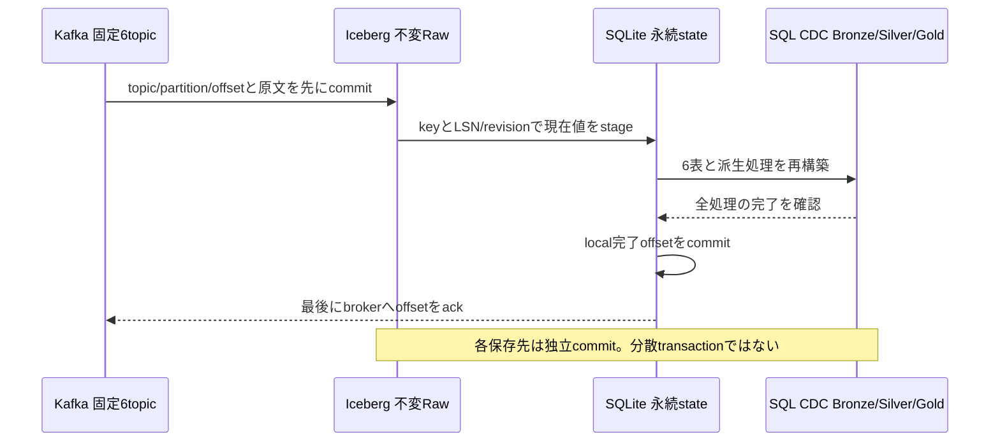

# 固定SQL sourceで疑似ERP・MESを検証する

<!-- doc-purpose:start -->
> **役割:** 所有権付き固定SQL表への合成データ投入と、読取専用バッチ・CDCの段階的な受入を行う。
>
> **対象読者:** 基盤構築担当 / データ利用担当 / 開発・設計担当
>
> **読むタイミング:** 同じ開発DBの固定6表で投入・snapshot・増分・CDCを比較するとき。
>
> **前提となる資料:** [GUIからダミーデータを投入する](<DEMO-GUI.md>) / [既存SQL Serverからランディングへ抽出する](<SOURCE-SQLSERVER.md>)
>
> **次に読む資料:** [SQL Server の変更を Iceberg へ反映する](<CDC.md>) / [症状から確認する](<TROUBLESHOOTING.md>)
>
> **文書一覧:** [目的・読者から探す文書マニフェスト](<DOCUMENTATION-MANIFEST.md>)
<!-- doc-purpose:end -->

既存の開発用SQL Serverに専用の合成データ領域を設け、同じ6表をsnapshot・増分・CDCで比較するための手順です。Landing投入とランダム検証schema方式も引き続き使えます。既存の業務表、過去PoCの表・capture instance・ログインは操作対象にしません。

**検証の区別:** Pythonの単体テストは模擬driver、SQLは静的契約検査です。これらの成功だけでは、会社SQL Serverとの実接続やCDCの往復が成功したとは判断できません。導入先の承認済み開発DBで段階ごとに受け入れます。

## データと権限の境界



| 契約ID | 固定source表 | 安定した主キー |
| --- | --- | --- |
| `erp_products` | `lh_demo_erp.products` | `product_id` |
| `erp_work_orders` | `lh_demo_erp.work_orders` | `work_order_id` |
| `erp_sales_orders` | `lh_demo_erp.sales_orders` | `sales_order_id` |
| `erp_shipments` | `lh_demo_erp.shipments` | `shipment_id` |
| `mes_events` | `lh_demo_mes.events` | `event_id` |
| `mes_downtime` | `lh_demo_mes.downtime` | `downtime_id` |

`lh_demo_ctl.installation` はinstallation ID・所有権tokenのSHA-256・schema versionを保持します。`demo_runs` は投入履歴、`batch_watermarks` は別の狭いcontrol writerが更新するcheckpointです。DB owner資格情報はアプリへ渡しません。所有権hashを知っているだけでも書込みを許可しません。

### 同一DBの許可条件

既定は拒否です。privateの `DEMO_SQLSERVER_ALLOW_SHARED_SOURCE_DATABASE=true`、DEMO/SOURCEのhost・port・database完全一致、固定3schema、installation ID・所有権hash・version・実接続先DBの一致、限定権限、要求ごとの明示同意を必要とします。固定方式だけの例外であり、既存のランダムschema方式へ許可を広げません。

任意schema・table・SQLをHTTP入力にせず、`dbo`、DROP DATABASE、既存schema削除を提供しません。過去PoCの権限を持つwriterがそのまま合格するとは限りません。対象外の書込み権限、DB/serverの広い権限、installationを書き換えられる制御schema権限は拒否します。既存ロールは自動REVOKEしません。DBAが影響を評価し、用途を分けた既存principalを選ぶか、既存権限を明示的に狭めます。

## 1. private設定を生成・upgradeする

既存環境ではパスワード・鍵・所有権tokenを保持するためupgradeします。初回だけ `--upgrade` を外します。全コマンドはcloneしたリポジトリのルートから実行します。

**Bash / Zsh共通**

```bash
ENV_FILE="$HOME/.config/lakehouse-foundation/site.env"
python3 scripts/configure.py --output "$ENV_FILE" --upgrade
chmod 600 "$ENV_FILE"
```

既存backupとの衝突は [会社VM更新](COMPANY-UPDATE.md) を参照します。接続先・認証・CAはprivateファイルだけで設定し、shellからsourceしません。

| キー | 生成時の既定 | 方針 |
| --- | --- | --- |
| `DEMO_SQLSERVER_ALLOW_SHARED_SOURCE_DATABASE` | `false` | shared sourceを既定拒否 |
| `DEMO_SQLSERVER_ERP_SCHEMA` / `MES_SCHEMA` / `CONTROL_SCHEMA` | 固定3schema | 任意schemaへの変更を拒否 |
| `DEMO_SQLSERVER_INSTALLATION_ID` | 32桁hexを生成 | 導入後は保持 |
| `DEMO_SQLSERVER_OWNERSHIP_TOKEN` | 64桁hexを生成 | 秘密値。DBへSHA-256だけ登録 |
| `DEMO_SQLSERVER_ENCRYPT` / `SOURCE_SQLSERVER_ENCRYPT` | `true` | 非暗号化を拒否 |
| `DEMO_SQLSERVER_TRUST_SERVER_CERTIFICATE` / `SOURCE_SQLSERVER_TRUST_SERVER_CERTIFICATE` | `false` | 自己署名のPoCだけ明示的に`true` |

証明書検証を省略しても通信暗号化は維持します。ただしCA chainと接続先名の検証は省略されます。実データ・本番利用へ進む前に `false` と正式CAへ戻し、なりすまし対策を受け入れます。PoC設定を会社全体のTLS方針として流用しません。

## 2. DBAがDDLを手動で適用する

`infra/sqlserver` のSQLはSQLCMD変数と実接続DBの一致を検査します。変数の実値はGit外のprivate SQLCMD入力で管理します。SSMSはSQLCMD Mode、CLIは承認されたsqlcmdとDBA認証を使い、パスワードを引数へ書きません。

適用順は [001_demo_schemas.sql](../infra/sqlserver/001_demo_schemas.sql) → [002_demo_tables.sql](../infra/sqlserver/002_demo_tables.sql) → [003_demo_permissions.sql](../infra/sqlserver/003_demo_permissions.sql) → [006_demo_validation.sql](../infra/sqlserver/006_demo_validation.sql) です。各SQLの冒頭に必要な変数と前後の検査があります。CDCは後段の別手順です。

必要なSQLCMD変数は `TargetDatabase`、`InstallationId`、`OwnershipHash`、`RepositoryVersion`、`DemoWriterUser`、`SourceReaderUser`、`ControlWriterUser` です。最後の3名は異なる既存DBユーザーとします。control writerの認証はSOURCE readerとは別の `SOURCE_SQLSERVER_CONTROL_USER/PASSWORD` に保存し、空欄のままreaderを昇格させません。

代入文字列のSQL注入を避けるため、private設定を編集した後に変数ファイルを生成します。このコマンドはDBに接続せず、識別子を検査してtokenのSHA-256だけを0600ファイルへ保存します。

**Bash / Zsh共通**

```bash
python3 scripts/prepare-sqlserver.py \
  --env-file "$ENV_FILE" \
  --output "$HOME/.config/lakehouse-foundation/dba-variables.sql"
```

DBAはSSMSで承認済み開発DBへ接続し、Query → SQLCMD Modeを有効にします。生成したprivate変数ファイルを先頭へ読み込み、その後に上の4ファイルの内容を順に開いて実行します。各実行で同じ変数が有効であることと、接続先DBを確認します。エラーなら次のSQLへ進みません。ファイルや変数の内容を公開Issue/PR/スクリーンショットへ添付しません。アプリ側からこのSQLを実行するAPIはありません。

初回ownership設定は空状態・既存オブジェクト・versionを確認してから行います。既存データを消して作り直す初期化はありません。別用途の同名オブジェクトがあれば停止し、強制上書きしません。新しいログインやパスワードを作らず、既存DB principalへ業務6表と必要な制御表だけの権限を付与します。`db_owner`、`db_datawriter`、schema全体のCONTROLをruntimeへ渡しません。

### Runtime metadata safety checker

The DBA permission script installs the fixed, no-argument
`lh_demo_ctl.check_write_safety_v1` procedure with `EXECUTE AS 'dbo'`.
It reads metadata only and returns one safety bit. The dbo context can see
legacy child tables and inbound cascading foreign keys that a restricted
writer cannot see. Runtime writers receive EXECUTE and VIEW DEFINITION only
on this checker, not database-wide metadata privileges or new data access.
The SOURCE reader receives neither permission.

The [canonical checker definition](../scripts/sqlserver_safety.sql) is pinned
by both the installation script and runtime. A missing or changed definition,
wrong owner/execution identity, hidden definition, unsafe result, or execution
failure blocks mutations. Existing same-name procedures are never overwritten.
The DBA must apply the updated permission script before writes resume; there
is no fallback to incomplete caller-visible metadata.

Effective column SELECT/UPDATE permissions are also checked, including grants
inherited through roles and column grants overriding object DENYs.
Installation ownership columns remain read-only. Legacy column access outside
the role's allowlist is refused; the SOURCE reader may retain SELECT only.

The metadata check runs within the same connection and transaction as the
mutation. This does not fully prevent concurrent DDL after the check. Stop
runtime writers during DBA schema, trigger, FK, or permission changes, then
rerun diagnostics before resuming. Do not modify the checker to bypass a
failed diagnostic.

These regressions are mock-driver and static SQL checks, not live SQL Server
acceptance. In an approved disposable database, verify an inherited column
UPDATE on installation.ownership_hash, legacy column SELECT/UPDATE, a hidden
legacy child with ON DELETE CASCADE, and a missing/altered checker. Each unsafe
writer must be refused before DML.

## 3. GUIで診断して素材を投入する

1. private設定とDokploy側を整合させ、承認済み手順でアプリへ反映します。GUIのSaveだけでは稼働設定は変わりません。
2. **素材の投入 → 固定SQL sourceの初期化・状態・CDC用DML → 固定schema・所有権・限定権限を診断** で、所有権・version・6表を確認します。診断は読取りだけです。
3. 投入先を **固定疑似ERP/MES SQL Server** または **ランディング + 固定SQL source** とし、最初はclean、seed 42、20件、7日、1batchにします。
4. 書込み許可と固定領域への追加同意を両方選びます。run IDは空欄で自動生成、または12桁の小文字hexを指定します。
5. jobの完了を照会します。202受付や素材成功をLakehouse取込成功と取り違えません。

有限マイクロバッチは指定した回数と間隔で終了し、batchごとに業務キーを分けます。外部ERPの無限streamを再現する機能ではありません。

### SQLの型と原値を分ける

業務列は `nvarchar`、`bigint`、`decimal(18,3)`／`decimal(18,2)`、`date`、`datetime2(7)` です。SQLの`created_at`と`updated_at`はserver UTCで、後者を増分位置に使います。生成元の歴史的な`updated_at`は `original_values` JSONに保持します。

SQL型へ入らない異常は、型付き列をNULLとし、JSONに元の値を残します。NULLと空文字も区別します。後段のメダリオンは原値JSONを使って異常を隔離します。主キー欠落・長さ超過など安定キーを作れない入力は拒否します。同じPKの重複・改訂は最新版を決定的に選ぶため、Landing原始行数と固定SQL件数は一致するとは限りません。

## 4. CDC用の試験レコードを操作する

同じexpanderで試験run ID・同意を選び、INSERT → UPDATE → DELETEを順に実行します。対象はそのrunに属する固定productだけで、任意キーの既存行を操作できません。操作・run IDを後段のrawイベント・現在値へ追跡します。DELETE本体とKafka tombstoneは別イベントです。DML成功だけではCDC到着を保証しません。

## 切り戻しと受入

旧アプリへ戻してもSQL表・installation・CDC・watermarkを自動削除しません。所有権tokenを再生成して戻そうとせず、private設定とデータを保持します。CDC停止やDDL変更はDBAが別途評価します。

cleanで件数、日本語、decimal、NULL/空文字、UTCと第7小数桁を確認し、その後edge、増分再実行、部分失敗、DELETE、再起動・raw replayへ進みます。単体・静的契約・実DB統合のどれを実施したか、報告書で区別します。

## 5. フルスナップショットを取り込む

素材の投入とは別に **処理・検証 → SQL Serverフルスナップショット** を選び、置換への同意を確認して開始します。Swaggerでは `POST /sql-source/batches/snapshot` に `{"confirm": true}` を送ります。任意SQL・接続先・file pathを要求へ入れません。

SOURCE readerは所有権と読取り専用権限を検査し、SERIALIZABLE transactionと6表への共有lockで小規模PoCの一貫した読取りを行います。lock待ちは5秒、各SQLのtimeoutも設定します。アプリからDBのisolation設定を変更することはありません。業務writerを待たせ得るため、大規模な本番source用の抽出方式とは分けます。

原値JSONを正本とし、SQLの実PKと一致を確認します。型付き列だけを手動UPDATEしてJSONを同期しない操作は、この固定sourceの契約外です。合成データ・I/U/Dは固定APIを使います。実ERPの通常の型付き表を読む場合は、別の汎用extract/mapping設計を使います。

単一原値は128 KiB、各表10万行、全JSONは16 MiBに制限します。日本語・decimal文字列・NULL・空文字・UTCの7桁時刻を保持します。生成されたASCIIの安定PKを対象にし、任意のUnicodeキーを正規化して同じキーへ丸めません。大きすぎる入力は公開前に拒否します。

全6表を読めた後だけ、共有Landingの `sql-batches/<内容SHA-256>.json` とready markerを公開します。DB資格情報を持たないworkerへ、内容IDとSQL serverの観測時刻を送ります。workerは原本をS3へ保管してから `sql_bronze` の6表を更新し、既存の業務SQLを `sql_silver` / `sql_quarantine` / `sql_gold` へ適用します。通常の `bronze/silver/gold` とCDC用の表を置き換えません。

Source件数とBronze件数・PK重複を照合し、全6表と派生処理が成功した後にだけ `sql_control.batches` へ完了記録を書きます。Silverと隔離にはsource由来を引き継ぎ、Goldは業務の集計粒度を保ちます。

### 再実行・削除・途中失敗

内容IDと、観測時刻を含む処理IDを分けます。同じ処理のreplayはskipし、直前と同じ内容の再観測も不要な置換を避けます。ただしデータがA→B→Aへ戻った新しいsnapshotは再適用するため、物理DELETEも全件照合で反映できます。古い観測を新しい現在値へ上書きする操作は拒否します。

途中失敗では、表ごとのcommitによって世代が混ざることがあります。`sql_control.progress` の適用中記録を完了まで保持し、不完全な世代がある間は「同じ内容だからskip」と判定しません。全6表を再構築して収束を確認します。複数のIceberg表、Trino、S3を一括transactionで更新する機構ではありません。単一worker・単一sourceとして運用します。

HTTP timeoutはworker停止を意味しません。結果不明なら完了扱いにせず、workerのbusy/blockedとjob結果を確認してから明示的に再試行します。原本・source ID・完了台帳を削除して再開を強行しません。別sourceへ同じSQL分析領域を使い回す操作も拒否します。

### 由来を調べる

SQL BronzeとSilver/隔離に `_source_system`、`_source_database`、`_source_schema`、`_source_table`、`_source_pk`、`_source_updated_at`、`_ingested_at`、`_batch_id`、`_run_id` を保持します。DB名や原本はprivateな実行データです。公開報告へそのまま添付しません。Goldの集計行に個々のsource PKを無理に付けず、対応するSilverとbatch記録へ戻って追跡します。

## 権限診断の範囲

runtimeは有効なobject権限、広いrole、固定対象のmetadata・trigger・FKを検査します。ただしSQL Serverのmetadata visibilityで隠れた他schemaの子FKまでは、固定親tableのVIEW DEFINITIONだけで全件証明できません。DBAが初回の全体検査を行い、固定表へ外部FKやtriggerを後付けしない契約を維持します。診断のためにruntimeへDB全体のCONTROLや広い書込み権限を与えません。

## 6. watermark増分バッチ

private設定の `SOURCE_SQLSERVER_CONTROL_USER/PASSWORD` に、DBAが用意した別の限定principalを指定します。接続先・TLSはSOURCE設定を共有しますが、SOURCE readerの認証を流用しません。DEMO writerの名前も比較用に必要です。3つのidentityは異なるものとし、DEMOのパスワードをバッチへ渡しません。

| 設定 | 既定 | 制限・用途 |
| --- | --- | --- |
| `SOURCE_SQLSERVER_BATCH_OVERLAP_SECONDS` | `300` | 1〜86400秒。前回位置より過去を重ねて読む |
| `SOURCE_SQLSERVER_BATCH_SAFETY_LAG_SECONDS` | `5` | 0〜3600秒。現在より少し前を上限にする |
| `SOURCE_SQLSERVER_CONTROL_USER/PASSWORD` | 空 | `batch_watermarks`だけのSELECT/INSERT/UPDATE。readerへ書込み権限を追加しない |

最初にcontrol設定を反映した状態でフルsnapshotを実行し、結果の **checkpointed=true** を確認します。control両項目が空でもsnapshot自体は使えますが、checkpointed=falseで増分のbaselineを作りません。片方だけの設定やreader/adminの流用は拒否します。

その後、素材の投入で有限microbatchを選び、例えば3回・5秒間隔で投入します。最後の投入から安全遅延の時間を置き、処理・検証の **Watermark増分バッチ** を選んで同意します。Swaggerは `POST /sql-source/batches/incremental` に `{"confirm": true}` を送ります。任意table・SQL・watermark値をAPIから指定しません。

### 読取りと確定の順番

1. 限定control writerが所有権・有効権限を検査し、専用checkpointの6行をtransaction内の更新lockで保持します。他のバッチは短いlock timeoutで拒否されます。
2. 別connectionのSOURCE readerが6表を読みます。`updated_at`と固定BIN2主キーの組合せを使い、過去の重なり窓から安全遅延の上限までを抽出します。UTCの7桁をfloatやPythonのmicrosecondへ丸めません。
3. SOURCEの共有lockを解放した後にworkerへ依頼します。workerはSQL用現在値をPKとSQL更新時刻でupsertし、6表・派生SQL・件数を検査します。
4. 完了batch ID・観測・全件数が一致したACKを受けてから、control writerが6表分の位置を比較付きで更新して一度にcommitします。途中失敗やworker結果不明ではこの更新へ進みません。

`counts` は重ね読みを含む抽出窓の行数です。`changed_counts` は今回の実行で新規・更新された行、`current_counts` は反映後の現在値件数です。同じ行を再読しても、PK upsertで行数を増やしません。増分でもPoC用の現在表を読み込んでArrowで置き換えるため、大規模な分散MERGE方式ではありません。現在値の直列化は全体64 MiB、各表10万行までに制限します。

### 捕捉の限界と復旧

`updated_at`はcommit LSNではありません。安全遅延と重ね読みだけでは、窓より古いtimestampを持つ遅いcommitや物理DELETEを完全には捕捉できません。外部から更新時刻を巻き戻す操作も保証しません。定期的なフルsnapshot照合、またはCDCで補います。truncate/reloadを通常の増分として扱いません。

原本・Iceberg各表・完了台帳・SQL checkpointは別々のcommitです。worker timeoutの間も処理が継続することがあります。SQL commit応答の喪失も「結果不明」であり、rollback呼出しだけから未commitを断定できません。workerの状態、`sql_control`の世代とSQL checkpointを再読して照合します。世代が一致しない場合や未完の全件置換がある場合は、control付きfull snapshotで再照合します。表やwatermarkを削除して再開を強行しません。

### 日時精度の正本

7桁を完全保持する正本は、raw/original JSONと `_source_updated_at` 等の文字列です。既存Silverの業務日時は `FROM_ISO8601_TIMESTAMP` による `TIMESTAMP(3) WITH TIME ZONE` で、ミリ秒の解析型です。全層の型付き日時で7桁を保つとは説明しません。7桁での時系列比較が必要な業務は、原本文字列を利用するか、Iceberg/Trinoの型・format互換性を実機検証した別のschema変更として扱います。[採用Trino 481の日時関数](https://github.com/trinodb/trino/blob/481/docs/src/main/sphinx/functions/datetime.md)


## 7. 固定6表のCDC準備とRaw履歴

このモードは `CDC_SOURCE_MODE=fixed-demo` です。既定の `generic` は従来の外部mappingを使い、変更しません。fixed-demoは `SOURCE_SQLSERVER_*` のread-only接続を再利用し、DEMO writerやcontrol writerの資格情報をDebeziumへ渡しません。runtime readerに管理者権限を付けません。

| 設定 | 既定 | fixed-demoでの意味 |
| --- | --- | --- |
| `CDC_SOURCE_MODE` | `generic` | 固定sourceでは `fixed-demo` を明示 |
| `CDC_STATE_VOLUME_NAME` | 空 | 空なら既存のCompose volume名。既存genericのstateと分ける場合だけ新しい専用volume名を指定 |
| `SOURCE_SQLSERVER_CA_FILE` | 既存値を維持 | fixed-demoのOS標準CAは空欄。旧sentinelの `system` はこのモードでは拒否 |
| `SOURCE_SQLSERVER_TRUST_SERVER_CERTIFICATE` | `false` | 承認済み合成PoCのみ `true`。暗号化は維持するが証明書検証を省略する |

### DBAが適用する順序

1. 001→002→003→006で固定sourceの所有権・型・限定権限を確認します。
2. DB単位CDC、SQL Server Agent、既存の独立captureとcapture/cleanup jobが既に正常であることをDBAが確認します。今回のSQLはDB全体のCDCを有効化せず、jobや保持期間を変更しません。
3. private SQLCMD入力と [004_demo_cdc_enable.sql](../infra/sqlserver/004_demo_cdc_enable.sql) を同じ専用DBA sessionで実行します。接続先DBはクライアント側でも明示し、`sqlcmd -b` 相当でエラー時に停止します。
4. 出力の6 captureと固定reader roleを確認し、006の診断も再実行します。旧capture instanceが残っていること、Agentの処理が進むことはDBAが別途観測します。

004は固定6表だけを対象とし、capture名を `<schema>_<table>_v1`、gating roleを `lh_demo_cdc_reader`、net changesを無効に固定します。既存の同名captureは列・型・PK・role・optionを比較し、一致すれば保持、違えば停止します。readerの既存roleやパスワードを変更しません。既存DB principalへ、この6 captureと必要metadataの読取だけを追加します。

Microsoftの手続きは、最初の表の有効化や最後の表の無効化でDB共通jobのライフサイクルへ影響する場合があります。このDDLは独立した既存capture/jobが残ることを要求します。新しい空のCDC DBにはそのまま適用せず、DBAがjobライフサイクルを別に準備します。role/grantの検査後、CDC手続きは表単位のautocommitです。途中失敗を全6表rollback済みとは扱わず、metadataを確認して同じ004を再実行します。

無効化は通常更新に含めません。[005_demo_cdc_disable.sql](../infra/sqlserver/005_demo_cdc_disable.sql) は同じ所有権・capture定義を再確認し、別途 `ConfirmDisableCdc=1` の明示を要求します。生成するSQLCMD入力の既定は `0` です。005は固定6captureだけを無効化し、DB全体、旧capture、schema、業務表、ユーザー、roleを削除しません。無効化で失われるcapture履歴を先に保全し、保持中の独立capture/jobをDBAが確認します。

### Kafka・Icebergを分離する

SQL Server AgentがDBAの画面で動いていても、Debezium既定の状態queryをreaderが実行できるとは限りません。`VIEW DATABASE STATE` だけでは不足する環境があります。採用Debezium 3.7とSQL Server版の必要な参照権限をDBAが確認します。アプリがserver権限を追加する処理はありません。汎用CDCで案内する署名付きscalar UDFも、固定readerの任意EXECUTE拒否と衝突する場合があり、無条件に利用できるとは扱いません。6captureのpreflight成功だけでAgent queryやconnectorの実稼働を受入済みにしません。

Deploy前に `CDC_CONFIG_DIR` のcheckout外privateディレクトリを用意し、`WORKER_UID/GID` が読める所有権を確認します。[CDC共通のprivateディレクトリ手順](CDC.md#4-外部-private-設定を用意する) を使います。fixed-demoでは `table-map.json` は不要ですが、共通Composeのread-only directory bindは残るため、ディレクトリ自体は必要です。別の配置先の実pathを公開Composeへ固定しません。

connector名とdata prefixは `lakehouse-demo-sqlserver`、consumer groupは `lakehouse-demo-sqlserver-consumer` に固定します。6表のdata topicとschema-history topicを従来のgeneric sourceから分けます。Kafka Connect worker自体のconfig/offset/status topicは既存基盤を共有し、これらを新しく分離したとは説明しません。既存connectorの設定差分は自動PUTせず、登録を拒否します。既存offset/history/stateを削除してやり直す操作を提供しません。

登録前とconsumer起動前に、SOURCE readerで所有権、read-only有効権限、固定6captureと列・datetime2(7)をSELECT診断します。初回snapshotはfixed-demoのみ `exclusive` isolationとし、線形なsnapshot/stream履歴を得る代わりに固定sourceの更新を一時的に待たせます。投入を停止したメンテナンス窓で開始します。DBのsnapshot isolation設定を変更しません。日時はadaptive、decimalは文字列、transaction metadataを有効にします。NanoTimestampの表現範囲外などの変換失敗は停止して調査し、欠損を成功として扱いません。[Debezium 3.7 SQL Server仕様](https://debezium.io/documentation/reference/3.7/connectors/sqlserver.html)

Rawは `iceberg.sqlcdc_events.events` です。Kafkaのtopic/partition/offsetをevent IDにし、key/envelope原文、before/after、op、tombstone、LSN、transaction ID、source時刻、run IDを追記します。同じ配送位置の同一内容は再追記せず、内容が変われば拒否します。source identityを表propertyに固定し、別sourceの履歴へ自動相乗りしません。Rawは不変履歴、現在値は別の再構築可能な派生物です。Raw保持だけでCurrent StateやKafka offsetの処理完了を示しません。

現行のfixed consumerは常駐し、Raw保存→Current Stateのstage→Icebergへの派生状態反映→local完了offset記録→Kafka同期commitの順に処理します。途中失敗ではmaintenanceへ入り、通常の取込・ackを止めて明示rebuildと再照合を待ちます。Current State・replay・GUI監視は§8のとおり実装済みですが、会社環境でのSQL Server→Kafka→Iceberg連携受入は未実施です。実装済みの機能と、実機で確認できた範囲を分けて判断してください。

### CAと配置を混同しない

Python登録器/consumerのPEMと、Java Connectのtruststoreは別です。標準CAだけなら `SOURCE_SQLSERVER_CA_FILE` を空にします。custom PEMでは、公開Composeの0byte placeholderをprivate Compose overrideで `/run/source-certs/source-ca.pem` のread-only bindへ置き換えます。対象は `cdc-register` と `cdc-consumer` の2サービスです。host path、実CAはcheckout外に置き、Dokployのprivate File Mountsでoverrideを作り、Run Commandへその `-f` を加えます。placeholderのままcustom CAを選ぶとpreflightが拒否します。Java側は従来の `CDC_SQLSERVER_TRUSTSTORE_FILE` と `CDC_SQLSERVER_TRUSTSTORE` を使います。custom SOURCE PEMで証明書検証を行う場合、Java truststoreも明示しない設定はplanで拒否します。runtimeの再診断はcapture列・日時精度を含みますが、全scalar型・PKの検査はDBAの004と、その後にDDLを変更しない運用が前提です。認証情報やCAを公開Composeへ書きません。

profile追加は実装のテスト成功だけで判断せず、会社側でsnapshot・増分の受入完了後に行います。`demo,monitoring,bi,cdc` のメモリ・Swap・保持期間を計測し、connector RUNNING、Raw、Current、Gold、offsetを順番に確認します。ローカルunit/static試験だけからSQL Server Agentや実CDCが正常とは報告しません。

## 8. Current State・replay・GUI監視

状態画面の固定SQL欄で、バッチ状態、CDC状態、SQL watermarkをそれぞれ明示的に照会します。画面を開いただけでSQL Serverへ接続したり、DDLやrebuildを実行したりしません。SQL watermark照会は別control資格情報でSELECTだけを行い、初期行の作成・位置更新・update lockを取りません。部分baselineや混在したbatch IDは正常扱いしません。

| 見る場所 | 確認できること | 確認できないこと |
| --- | --- | --- |
| 固定source診断 | 接続・所有権・限定権限、固定6表件数/最終更新/capture | SQL Server Agent全体の健康を保証しない。権限不足で見えない情報はDBAが確認 |
| バッチ状態 | SQL用Bronze件数と完了台帳・適用途中の記録 | Iceberg完了記録だけからSQL checkpointのcommitを断定しない |
| SQL watermark照会 | 実control表の時刻＋PK＋完了batch ID | timestampより古い遅延commitや物理DELETEを保証しない |
| CDC状態 | connector/task、観測できたpartitionのoffset/lag、Raw/Current件数、rebuild進捗 | 未観測のlagを0にせず、未到達を成功にしない。LSN遅延とKafka lagは別 |
| SQL用Gold preview | batch/CDC別の固定2datasetをsnapshot固定・上限付きで参照 | 全件集計の完全な証拠や複数表の同時snapshotではない |

### Rawと現在値の境界

`sqlcdc_events.events` は受信したr/c/u/d/tombstoneの不変原本です。Kafka nullはArrow/SQL NULLとして、空バイト列は空文字として別々に保存します。壊れた空payloadもtombstoneへ書き換えません。解釈に失敗してもRawが残る場合があり、その件数だけから処理完了を判定しません。

`sqlcdc_bronze` はSQLiteのPK別最新LSN/revisionから作る現在値です。UPDATE後は最新だけを保持し、DELETEでは業務行を除去します。SQLiteには削除版を残し、古いUPDATEで復活しないようにします。tombstoneは削除本体とは別の配送記録です。元のbefore/afterをRawへ残し、Currentは原値JSONを業務値の正本にします。SQL ServerのLOB列はUPDATEのbeforeでNULLになる場合があるため、更新前LOBの存在を現在値反映の必須条件にしません。



固定sourceのdatetime2(7)はDebeziumの整数nanosecondsから7桁文字列へ変換し、floatを使いません。NULL・空文字・日本語・decimal原値はJSON側へ保持します。Silverの既存型付き業務日時はミリ秒であり、Rawの精度と区別します。

### 明示的に再構築する

GUIのrebuild同意を選ぶと、固定Current Stateの再構築要求を送ります。Swaggerでは `POST /sql-source/cdc/rebuild` に `{"confirm": true}` を送ります。202は `request_id` を付けたqueue受付で、`completed=false` のままです。CDC状態を再照会し、同じIDが `succeeded`・`completed=true` になったことを確認します。通常のJobManagerの成功件数へ受付だけを加算しません。

consumerの単一実行threadがKafka読取りを止め、RawのIceberg snapshotを固定し、source identityと履歴の連続性を検査して別のSQLiteへ再生します。Rawの欠落・途中からの履歴・gap・既存checkpointを覆えない履歴は拒否します。これは小規模PoCの保守的な再生条件で、任意の途中snapshotと残存ログから復旧する汎用ツールではありません。空のtable/topicで履歴の開始点を証明できない場合も、自動的に完全とみなしません。

検証・materialization・新SQLite保存が成功する前は旧SQLiteを保持します。派生表の更新開始前に永続pendingを残すため、途中停止後に旧stateだけを見てreadyへ戻りません。成功したSQLiteの公開後にbroker ACKだけ失敗した場合、有効な新local checkpointは保持して停止します。結果不明を避けるために有効stateを巻き戻すことはありません。Iceberg複数表・SQLite・Kafkaを一括commitしたとの保証はありません。

再構築中や失敗後は各表の世代が混ざる場合があり、利用者はGoldを完成データとして扱いません。Raw、Kafka、stateを保全し、表示された安全なerror codeと私有の観測記録を照合します。queryの取消が未確定なblockedはrebuildで自動解除しません。失敗したイベントを飛ばしてoffsetを進めたり、offset/historyを削除して成功に見せたりする操作はありません。

### AIから参照する

固定Gold previewは `origin=batch|cdc`、`dataset=production|sales`、上限1〜100行だけを受け付けます。任意SQL・table・URLは渡せません。CLIのAI contextも既定Landingを維持し、明示originでSQL用/CDC用Goldへ切り替えられます。各datasetをsnapshotへ固定し、decimalは文字列、日付はISOで出力します。応答のtable/snapshotを根拠として引用し、LLMへDB資格情報やSQL実行権限を渡しません。API入口は [API.md](API.md)、既存AI連携は [AI-READINESS.md](AI-READINESS.md) を参照します。

### PoCの容量と待ち時間の上限

| 処理 | 実装の上限・前提 |
| --- | --- |
| SQL batch原本 | 全体16 MiB、各表10万行、1原値JSON 128 KiB。大きい原値をfetch前にも確認 |
| SQL batch現在値 | 全6表の直列化64 MiB。分散MERGEの性能試験ではない |
| CDC現在値 | 現在payload全体64 MiB、削除版を含め各表10万key。各batchで6表と派生SQLを再構築 |
| Raw rebuild | 全6表のoffset 0から連続した最大10万イベント、payload合計128 MiB、1配送16 MiB。partition=0の固定PoC topic契約 |
| 監視のTrino HTTP | 1page 64 KiBと行数上限、queryごとの期限とpoll URL allowlist。期限は処理中にも検査し、進行中の1回のI/O timeout分だけ超過し得る |
| Gold preview | 固定projection・1〜100行・個別snapshot。CLI AI exportは別のDBAPI経路で行数とrequest timeoutを制限し、GUI監視と同じtransport上限とは説明しない |

この上限を超える業務sourceや、複数partition・長期履歴・並列writerへ広げる場合は、別の設計・負荷試験・復旧試験を行います。値を大きく変更するだけで本番向けになるとは扱いません。


## 9. 混在collation・003の残存checker・Windowsからの再開

catalogと対象DB/table variableでcollationが異なる場合、003/004/005の異種文字列比較を両辺`Latin1_General_100_BIN2`へ揃えます。DB/server collation変更や安全gateの解除はしません。006とcanonical checkerは同型の競合候補がないことを監査し、本体を変更していません。

003の失敗を全変更rollback済みとは扱いません。新しい専用DBA sessionで[読取り専用preflight](../infra/sqlserver/diagnostics/003_permissions_preflight.sql)を実行し、installation・checkerの完全定義/owner/EXECUTE AS/ANSI flagsと限定role/permissionを確認します。51019でも自動DROP/ALTERや空白削除による照合緩和はしません。既に003と3用途のrole割当を確認できた場合は006から進み、不要な003再実行を避けます。004は承認済み修正版だけを使い、その後006で確認します。005は通常導入では実行しません。

VS Code MSSQLからSQL loginでDBA作業も可能です。DBA passwordはruntime/site.env/Dokployへ保存しません。Windows Go/ODBC sqlcmdの版、空白入りpath、`:r`とPowerShellの引用の違い、残存objectの保全条件は[DDL診断・回復手順](SQLSERVER-DDL-RECOVERY.md)を参照してください。実SQL Server/Windowsでの受入はsourceテストと別です。
