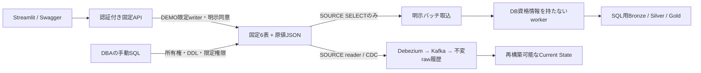

# 固定SQL sourceで疑似ERP・MESを検証する

<!-- doc-purpose:start -->
> **役割:** 所有権付き固定SQL表への合成データ投入と、読取専用バッチ・CDCの段階的な受入を行う。
>
> **対象読者:** 基盤構築担当 / データ利用担当 / 開発・設計担当
>
> **読むタイミング:** 同じ開発DBの固定6表で投入・snapshot・増分・CDCを比較するとき。
>
> **前提となる資料:** [GUIからダミーデータを投入する](<DEMO-GUI.md>) / [既存SQL Serverからランディングへ抽出する](<SOURCE-SQLSERVER.md>)
>
> **次に読む資料:** [SQL Server の変更を Iceberg へ反映する](<CDC.md>) / [症状から確認する](<TROUBLESHOOTING.md>)
>
> **文書一覧:** [目的・読者から探す文書マニフェスト](<DOCUMENTATION-MANIFEST.md>)
<!-- doc-purpose:end -->

既存の開発用SQL Serverに専用の合成データ領域を設け、同じ6表をsnapshot・増分・CDCで比較するための手順です。Landing投入とランダム検証schema方式も引き続き使えます。既存の業務表、過去PoCの表・capture instance・ログインは操作対象にしません。

**検証の区別:** Pythonの単体テストは模擬driver、SQLは静的契約検査です。これらの成功だけでは、会社SQL Serverとの実接続やCDCの往復が成功したとは判断できません。導入先の承認済み開発DBで段階ごとに受け入れます。

## データと権限の境界



| 契約ID | 固定source表 | 安定した主キー |
| --- | --- | --- |
| `erp_products` | `lh_demo_erp.products` | `product_id` |
| `erp_work_orders` | `lh_demo_erp.work_orders` | `work_order_id` |
| `erp_sales_orders` | `lh_demo_erp.sales_orders` | `sales_order_id` |
| `erp_shipments` | `lh_demo_erp.shipments` | `shipment_id` |
| `mes_events` | `lh_demo_mes.events` | `event_id` |
| `mes_downtime` | `lh_demo_mes.downtime` | `downtime_id` |

`lh_demo_ctl.installation` はinstallation ID・所有権tokenのSHA-256・schema versionを保持します。`demo_runs` は投入履歴、`batch_watermarks` は別の狭いcontrol writerが更新するcheckpointです。DB owner資格情報はアプリへ渡しません。所有権hashを知っているだけでも書込みを許可しません。

### 同一DBの許可条件

既定は拒否です。privateの `DEMO_SQLSERVER_ALLOW_SHARED_SOURCE_DATABASE=true`、DEMO/SOURCEのhost・port・database完全一致、固定3schema、installation ID・所有権hash・version・実接続先DBの一致、限定権限、要求ごとの明示同意を必要とします。固定方式だけの例外であり、既存のランダムschema方式へ許可を広げません。

任意schema・table・SQLをHTTP入力にせず、`dbo`、DROP DATABASE、既存schema削除を提供しません。過去PoCの権限を持つwriterがそのまま合格するとは限りません。対象外の書込み権限、DB/serverの広い権限、installationを書き換えられる制御schema権限は拒否します。既存ロールは自動REVOKEしません。DBAが影響を評価し、用途を分けた既存principalを選ぶか、既存権限を明示的に狭めます。

## 1. private設定を生成・upgradeする

既存環境ではパスワード・鍵・所有権tokenを保持するためupgradeします。初回だけ `--upgrade` を外します。全コマンドはcloneしたリポジトリのルートから実行します。

**Bash / Zsh共通**

```bash
ENV_FILE="$HOME/.config/lakehouse-foundation/site.env"
python3 scripts/configure.py --output "$ENV_FILE" --upgrade
chmod 600 "$ENV_FILE"
```

既存backupとの衝突は [会社VM更新](COMPANY-UPDATE.md) を参照します。接続先・認証・CAはprivateファイルだけで設定し、shellからsourceしません。

| キー | 生成時の既定 | 方針 |
| --- | --- | --- |
| `DEMO_SQLSERVER_ALLOW_SHARED_SOURCE_DATABASE` | `false` | shared sourceを既定拒否 |
| `DEMO_SQLSERVER_ERP_SCHEMA` / `MES_SCHEMA` / `CONTROL_SCHEMA` | 固定3schema | 任意schemaへの変更を拒否 |
| `DEMO_SQLSERVER_INSTALLATION_ID` | 32桁hexを生成 | 導入後は保持 |
| `DEMO_SQLSERVER_OWNERSHIP_TOKEN` | 64桁hexを生成 | 秘密値。DBへSHA-256だけ登録 |
| `DEMO_SQLSERVER_ENCRYPT` / `SOURCE_SQLSERVER_ENCRYPT` | `true` | 非暗号化を拒否 |
| `DEMO_SQLSERVER_TRUST_SERVER_CERTIFICATE` / `SOURCE_SQLSERVER_TRUST_SERVER_CERTIFICATE` | `false` | 自己署名のPoCだけ明示的に`true` |

証明書検証を省略しても通信暗号化は維持します。ただしCA chainと接続先名の検証は省略されます。実データ・本番利用へ進む前に `false` と正式CAへ戻し、なりすまし対策を受け入れます。PoC設定を会社全体のTLS方針として流用しません。

## 2. DBAがDDLを手動で適用する

`infra/sqlserver` のSQLはSQLCMD変数と実接続DBの一致を検査します。変数の実値はGit外のprivate SQLCMD入力で管理します。SSMSはSQLCMD Mode、CLIは承認されたsqlcmdとDBA認証を使い、パスワードを引数へ書きません。

適用順は [001_demo_schemas.sql](../infra/sqlserver/001_demo_schemas.sql) → [002_demo_tables.sql](../infra/sqlserver/002_demo_tables.sql) → [003_demo_permissions.sql](../infra/sqlserver/003_demo_permissions.sql) → [006_demo_validation.sql](../infra/sqlserver/006_demo_validation.sql) です。各SQLの冒頭に必要な変数と前後の検査があります。CDCは後段の別手順です。

必要なSQLCMD変数は `TargetDatabase`、`InstallationId`、`OwnershipHash`、`RepositoryVersion`、`DemoWriterUser`、`SourceReaderUser`、`ControlWriterUser` です。最後の3名は異なる既存DBユーザーとします。control writerの認証はSOURCE readerとは別の `SOURCE_SQLSERVER_CONTROL_USER/PASSWORD` に保存し、空欄のままreaderを昇格させません。

代入文字列のSQL注入を避けるため、private設定を編集した後に変数ファイルを生成します。このコマンドはDBに接続せず、識別子を検査してtokenのSHA-256だけを0600ファイルへ保存します。

**Bash / Zsh共通**

```bash
python3 scripts/prepare-sqlserver.py \
  --env-file "$ENV_FILE" \
  --output "$HOME/.config/lakehouse-foundation/dba-variables.sql"
```

DBAはSSMSで承認済み開発DBへ接続し、Query → SQLCMD Modeを有効にします。生成したprivate変数ファイルを先頭へ読み込み、その後に上の4ファイルの内容を順に開いて実行します。各実行で同じ変数が有効であることと、接続先DBを確認します。エラーなら次のSQLへ進みません。ファイルや変数の内容を公開Issue/PR/スクリーンショットへ添付しません。アプリ側からこのSQLを実行するAPIはありません。

初回ownership設定は空状態・既存オブジェクト・versionを確認してから行います。既存データを消して作り直す初期化はありません。別用途の同名オブジェクトがあれば停止し、強制上書きしません。新しいログインやパスワードを作らず、既存DB principalへ業務6表と必要な制御表だけの権限を付与します。`db_owner`、`db_datawriter`、schema全体のCONTROLをruntimeへ渡しません。

### Runtime metadata safety checker

The DBA permission script installs the fixed, no-argument
`lh_demo_ctl.check_write_safety_v1` procedure with `EXECUTE AS 'dbo'`.
It reads metadata only and returns one safety bit. The dbo context can see
legacy child tables and inbound cascading foreign keys that a restricted
writer cannot see. Runtime writers receive EXECUTE and VIEW DEFINITION only
on this checker, not database-wide metadata privileges or new data access.
The SOURCE reader receives neither permission.

The [canonical checker definition](../scripts/sqlserver_safety.sql) is pinned
by both the installation script and runtime. A missing or changed definition,
wrong owner/execution identity, hidden definition, unsafe result, or execution
failure blocks mutations. Existing same-name procedures are never overwritten.
The DBA must apply the updated permission script before writes resume; there
is no fallback to incomplete caller-visible metadata.

Effective column SELECT/UPDATE permissions are also checked, including grants
inherited through roles and column grants overriding object DENYs.
Installation ownership columns remain read-only. Legacy column access outside
the role's allowlist is refused; the SOURCE reader may retain SELECT only.

The metadata check runs within the same connection and transaction as the
mutation. This does not fully prevent concurrent DDL after the check. Stop
runtime writers during DBA schema, trigger, FK, or permission changes, then
rerun diagnostics before resuming. Do not modify the checker to bypass a
failed diagnostic.

These regressions are mock-driver and static SQL checks, not live SQL Server
acceptance. In an approved disposable database, verify an inherited column
UPDATE on installation.ownership_hash, legacy column SELECT/UPDATE, a hidden
legacy child with ON DELETE CASCADE, and a missing/altered checker. Each unsafe
writer must be refused before DML.

## 3. GUIで診断して素材を投入する

1. private設定とDokploy側を整合させ、承認済み手順でアプリへ反映します。GUIのSaveだけでは稼働設定は変わりません。
2. **素材の投入 → 固定SQL sourceの初期化・状態・CDC用DML → 固定schema・所有権・限定権限を診断** で、所有権・version・6表を確認します。診断は読取りだけです。
3. 投入先を **固定疑似ERP/MES SQL Server** または **ランディング + 固定SQL source** とし、最初はclean、seed 42、20件、7日、1batchにします。
4. 書込み許可と固定領域への追加同意を両方選びます。run IDは空欄で自動生成、または12桁の小文字hexを指定します。
5. jobの完了を照会します。202受付や素材成功をLakehouse取込成功と取り違えません。

有限マイクロバッチは指定した回数と間隔で終了し、batchごとに業務キーを分けます。外部ERPの無限streamを再現する機能ではありません。

### SQLの型と原値を分ける

業務列は `nvarchar`、`bigint`、`decimal(18,3)`／`decimal(18,2)`、`date`、`datetime2(7)` です。SQLの`created_at`と`updated_at`はserver UTCで、後者を増分位置に使います。生成元の歴史的な`updated_at`は `original_values` JSONに保持します。

SQL型へ入らない異常は、型付き列をNULLとし、JSONに元の値を残します。NULLと空文字も区別します。後段のメダリオンは原値JSONを使って異常を隔離します。主キー欠落・長さ超過など安定キーを作れない入力は拒否します。同じPKの重複・改訂は最新版を決定的に選ぶため、Landing原始行数と固定SQL件数は一致するとは限りません。

## 4. CDC用の試験レコードを操作する

同じexpanderで試験run ID・同意を選び、INSERT → UPDATE → DELETEを順に実行します。対象はそのrunに属する固定productだけで、任意キーの既存行を操作できません。操作・run IDを後段のrawイベント・現在値へ追跡します。DELETE本体とKafka tombstoneは別イベントです。DML成功だけではCDC到着を保証しません。

## 切り戻しと受入

旧アプリへ戻してもSQL表・installation・CDC・watermarkを自動削除しません。所有権tokenを再生成して戻そうとせず、private設定とデータを保持します。CDC停止やDDL変更はDBAが別途評価します。

cleanで件数、日本語、decimal、NULL/空文字、UTCと第7小数桁を確認し、その後edge、増分再実行、部分失敗、DELETE、再起動・raw replayへ進みます。単体・静的契約・実DB統合のどれを実施したか、報告書で区別します。
