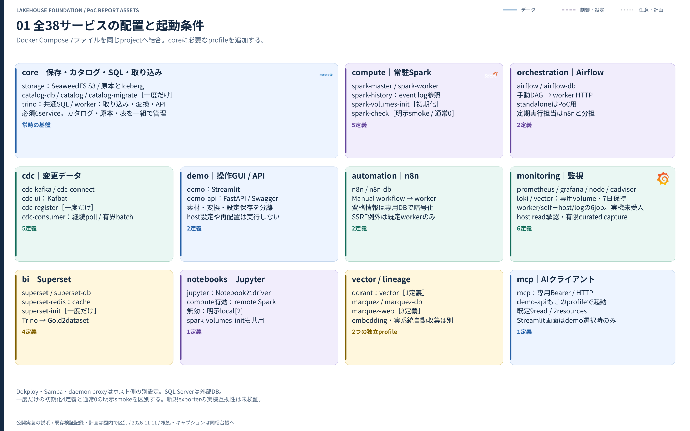
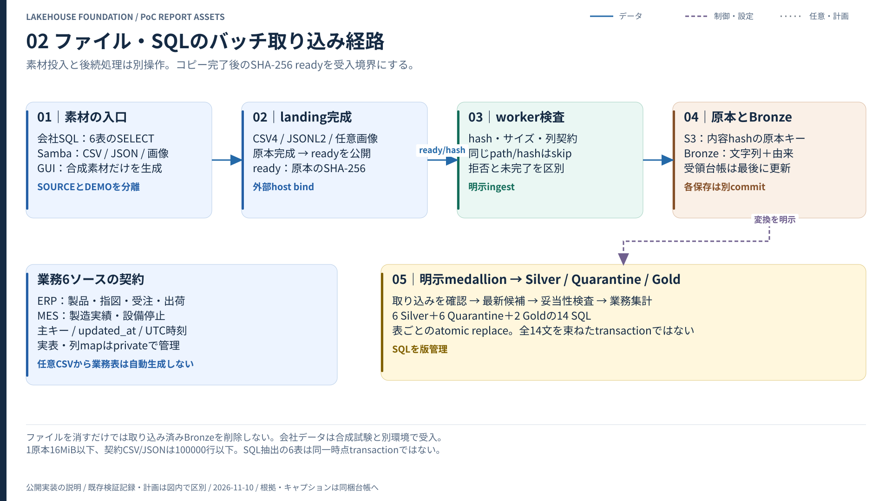
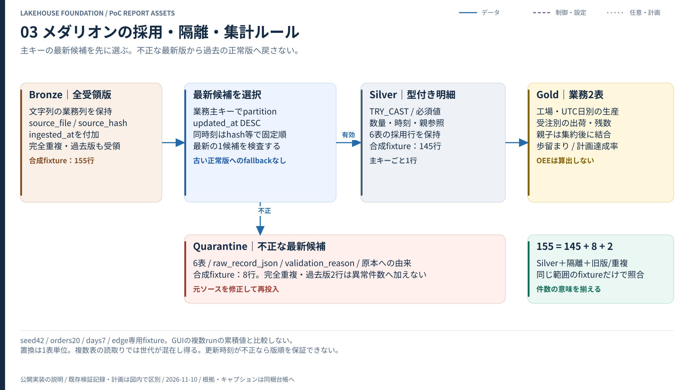
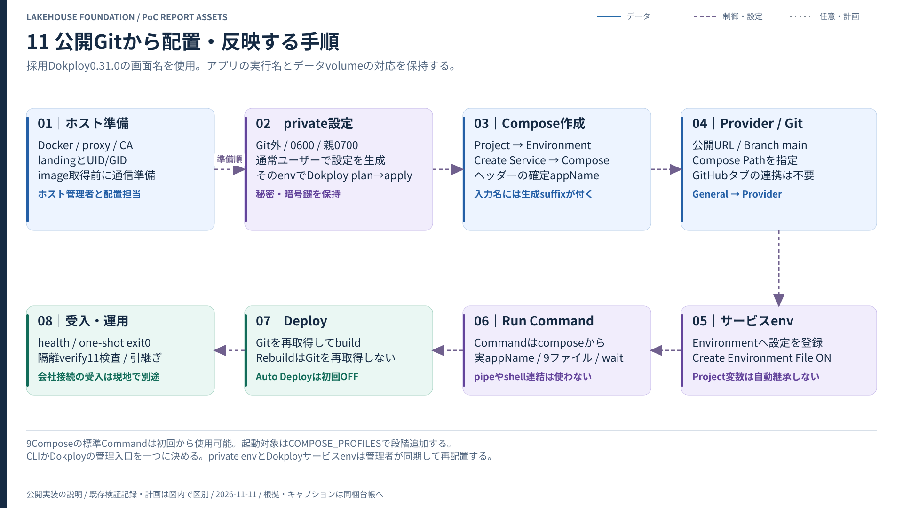
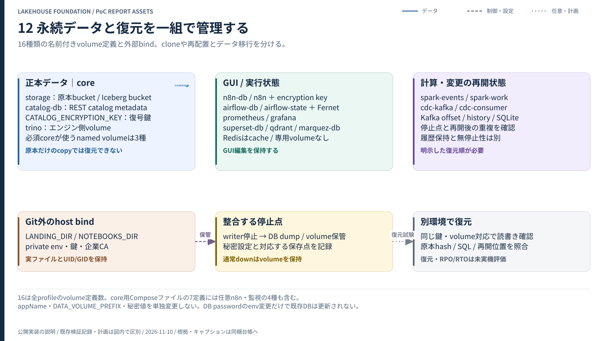
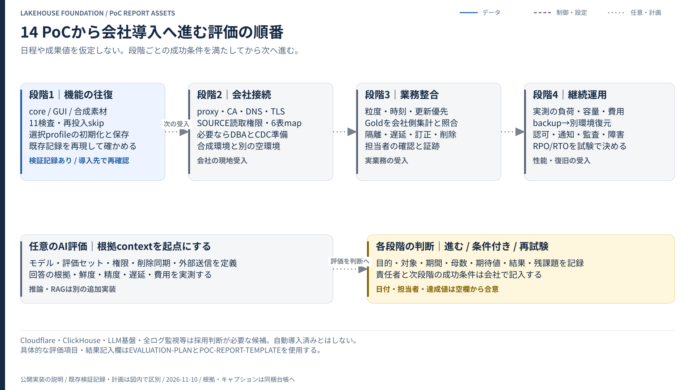

# データレイクハウスPoC 報告書テンプレート

作成日: ［記入］ ／ 評価期間: ［記入］ ／ 対象commit: ［記入］ ／ 文書版: ［記入］

このファイルは、導入先でコピーして記入するための雛形です。空欄や判定欄は今回の評価結果で置き換えます。既存検証の数値を会社での測定結果として転記しません。記入済み原本、画面、接続先、実データはGit外の社内管理先に保存します。[素材一覧](README.md)・[評価計画](EVALUATION-PLAN.md)・[根拠対応表](EVIDENCE-MATRIX.md)

## 要旨

**今回の判断: ［次段階へ進む／条件付きで進む／再評価する／見送る］**

［解決したい業務上の問題、今回確認できた経路、その結果で何を判断できるかを3〜5文で記入します。未解決の条件が判断を変える場合は同じ段落に書きます。］

| 判断に必要な論点 | 今回の結果 | 根拠ID | 次に必要な条件 |
| --- | --- | --- | --- |
| MES/ERPを共通形式で保持できるか | ［記入］ | ［記入］ | ［記入］ |
| 取り込み・品質・改訂を説明できるか | ［記入］ | ［記入］ | ［記入］ |
| GUI/APIから安全に試行できるか | ［記入］ | ［記入］ | ［記入］ |
| 継続運用へ進めるか | ［記入］ | ［記入］ | ［記入］ |

## 1. 目的と評価範囲

対象業務、現在の作業、利用者、対象期間、入力件数、求める意思決定を記入します。性能や費用の改善を目的にする場合は、比較対象と同一条件の測定方法を先に決めます。

| 項目 | 記入内容 |
| --- | --- |
| 業務上の課題 | ［誰が、どの判断や作業で困っているか］ |
| PoCで答える問い | ［結果によって採用判断が変わる問い］ |
| 対象データ | ［合成／匿名化／実データ、6契約との対応、入力の粒度］ |
| 対象の経路 | ［ファイル／SQL抽出／CDC、利用するprofile］ |
| 対象外 | ［今回実施しない負荷、復旧、IdP、推論等］ |
| 比較対象 | ［現行手順、条件、比較できない要素］ |
| 成功条件 | ［評価前に合意した数値や動作条件］ |

### 図1: 評価対象の構成

キャプション文例: 「本図は単一ホストPoCの構成要素と役割を示す。追加profileの有効化、会社の既存SQL Server、外部サービスへの接続状況は、今回の評価範囲表で個別に示す。」

図へ実ホスト名やIPを書き込む場合は、社内版だけに追加します。公開版では一般化した役割名を使います。

## 2. 評価条件と再現に必要な情報

| 項目 | 今回の値 | 保管先・補足 |
| --- | --- | --- |
| 評価したGit commit | ［40桁のcommit］ | 文書版・配置版・測定版を区別 |
| 稼働profile | ［記入］ | coreは常時、追加は必要な分だけ |
| image/JAR/Python依存 | ［lockのcommitまたはhash］ | [互換性](../COMPATIBILITY.md) |
| OS・CPU・RAM・disk | ［記入］ | 実ホスト名やdisk pathは社内付録 |
| 同時実行・既存負荷 | ［記入］ | 他アプリと共有する資源も含む |
| proxy・CA・DNS・時刻 | ［有無と検証範囲］ | 実設定と証明書は社内のみ |
| 入力条件 | ［seed、件数、期間、異常、画像の有無］ | manifest、原本hash、DB対象範囲 |
| 実行・記録時刻 | ［タイムゾーンを含める］ | JST/UTCと業務時刻の対応 |
| 結果の保存先 | ［社内の証跡ID］ | tokenや資格情報を本文へ貼らない |

合成データを試した環境と、会社データを受け入れる環境は分離します。landingから素材を削除するだけでは、取り込み済みのBronzeは消えません。[会社受入](../COMPANY-ROLLOUT.md)

## 3. データを受け取り、整備する流れ

キャプション文例: 「完成した原本とSHA-256のreadyを受領後、原本をS3へ保存し、文字列のBronzeから型・主キー・参照を検査する。素材投入と下流の取り込み・変換は別の明示操作である。」

| 層・処理 | 今回確認する内容 | 結果・根拠ID |
| --- | --- | --- |
| 原本 | バイト列とhash、ready、再取得 | ［記入］ |
| Bronze | 6契約、元文字列、ファイル由来 | ［記入］ |
| Silver | 最新候補、型、主キー、親参照 | ［記入］ |
| Quarantine | 不正値と理由、原本への追跡 | ［記入］ |
| Gold | 工場・UTC日別生産、受注別出荷 | ［記入］ |
| 再実行 | 同じファイルのskip、更新時の置換 | ［記入］ |

キャプション文例: 「Silverは主キーの最新候補を選んでから検証する。不正な最新版を古い正常版へ戻さない。Goldの集計式は同梱SQLで管理し、各表を個別に置き換える。全表を同時に公開するtransactionではない。」

### 指標の定義

| 指標 | 定義 | 解釈上の条件 |
| --- | --- | --- |
| 歩留まり | 良品数 ÷ 生産数 × 100 | 生産数0はNULL。行別割合を単純平均しない |
| 計画達成率 | 良品数 ÷ 計画数 × 100 | 計画数0はNULL。100%超過はあり得る |
| 出荷履行率 | 出荷数量 ÷ 受注数量 × 100 | 受注ごと。過剰出荷は100%を超え得る |
| 未出荷残 | max(受注数量 − 出荷数量, 0) | 出荷の取消や返品は別契約が必要 |
| 納期後出荷 | UTC出荷日が約束日より後の出荷 | 未出荷受注の本日時点の遅延判定とは別 |

停止時間は開始日へ計上し、日跨ぎの按分や停止区間の重複控除は行いません。稼働カレンダー等がないため、OEEは算出しません。[メダリオンの正本](../MEDALLION.md)

## 4. CDC・計算・AIの追加評価

必要な節だけを採用します。未使用の機能は「未評価」とし、図があることを導入済みの根拠にしません。

| 追加機能 | 掲載する図 | 今回の結果・条件 |
| --- | --- | --- |
| SQL Server CDC | [変更取得と再開](figures/04-cdc-sequence.svg) | ［Agent、権限、I/U/D、lag、再起動、保持期間］ |
| Spark / Jupyter | [常駐計算と履歴](figures/06-spark-compute.svg) | ［remote実行、driver/executor依存、Iceberg/Trino相互参照］ |
| AI向けcontext / MCP | [根拠データの参照](figures/07-ai-context.svg) | ［表・snapshot・行数上限・read/write境界］ |

キャプション文例: 「CDCはraw変更と主キー別現在値を分け、派生表の更新とcheckpointを確認してKafka offsetを進める。今回の会社環境での遅延・保持・再開条件は評価結果に記す。」

キャプション文例: 「AI向けcontextは表ごとにmain snapshotを固定した上限付き参照である。LangChain Document変換、合成vectorの検索、モデル推論・意味検索品質は別の評価項目である。」

## 5. 操作・接続・監視

| 論点 | 掲載する図 | 結果・根拠ID |
| --- | --- | --- |
| 設定保存と再配置、非同期job | [GUI / API](figures/05-control-api.svg) | ［保存済みと適用済みを区別できたか］ |
| 外向き通信と企業CA | [proxy / CA](figures/08-proxy-ca.svg) | ［daemon、build、runtime、Java、内部bypassを別確認］ |
| 認証と接続許可 | [境界](figures/09-security-boundaries.svg) | ［入口認証、共有鍵、SSRF、利用者権限］ |
| healthと業務品質 | [監視](figures/10-observability.svg) | ［監視対象、ジョブ結果、データ品質、通知の範囲］ |

healthが正常なこと、ジョブが成功したこと、業務数値が正しいことを別々に確認します。ポータルの履歴は最大20件のメモリ内記録であり、監査台帳として永続化されません。

## 6. 評価結果

[EVIDENCE-MATRIX.md](EVIDENCE-MATRIX.md) のIDと結果を使い、個別の合否を記入します。既存公開検証は比較用の参考情報として別欄へ置きます。

| 評価ID | 事前の成功条件 | 今回の実測・観測 | 判定 | 根拠ID | 残る条件 |
| --- | --- | --- | --- | --- | --- |
| ［記入］ | ［記入］ | ［記入］ | 未実施 | ［記入］ | ［記入］ |

性能を報告する場合は、行数、byte数、対象処理、計測開始/終了点、cold/warm、同時実行、回数、各回の値を添えます。機能確認用の小件数から最大スループットやSLAを推定しません。費用は実単価・利用量・対象範囲を集めて別に算定します。

### 既存公開検証を引用する場合の書き方

「公開の合成データ検証では、6契約のBronze155行からSilver145行、Quarantine8行、旧版・重複2行となる固定期待値を照合した。これは当社業務データの品質率や処理性能を示す値ではない。」[根拠](../VALIDATION.md)

公開記録日は2026-11-10（JST）です。`verification.json` の公開配置欄にはapplication commit `b5acdb6b642a1bb31ae95cfd2a114912526c3d15` が記録されています。これはその欄の記録で、全項目を同一commitで再試験した保証ではありません。今回の配置・測定commitは上の評価条件へ別に記録します。[機械可読の記録](../verification.json)

## 7. 継続運用へ進む条件

| 項目 | 今回の状態 | 次に確認すること | 担当・期限 |
| --- | --- | --- | --- |
| 設定・暗号鍵・データの保管 | ［記入］ | ［記入］ | ［記入］ |
| バックアップと別環境復元 | ［記入］ | ［記入］ | ［記入］ |
| 利用者認証・テーブル認可 | ［記入］ | ［記入］ | ［記入］ |
| CDC保持期間・停止許容時間 | ［記入］ | ［記入］ | ［記入］ |
| 負荷・容量・保存期間 | ［記入］ | ［記入］ | ［記入］ |
| 障害検知・通知・運用担当 | ［記入］ | ［記入］ | ［記入］ |

volumeの保持試験はバックアップ復元試験と別です。復元して参照・原本hash・GUI状態を照合するまでは、RPO/RTOを確定しません。

## 8. 判断と次段階

| 判断候補 | 選ぶ条件 | 今回の判断 |
| --- | --- | --- |
| 次段階へ進む | 合意した必須条件が成立し、残課題に担当と期限がある | ［記入］ |
| 条件付きで進む | 未評価の条件を明示し、適用範囲を限定できる | ［記入］ |
| 再評価する | 根拠不足または再現できない失敗が判断を左右する | ［記入］ |
| 見送る | 合意した制約と目的をこの構成で満たせない | ［記入］ |

採用/見送りの理由と代替案は [意思決定記録](DECISION-RECORD-TEMPLATE.md) へ残します。段階の日付・予算・性能目標は、この図から自動的に決まるものではありません。

## 付録: 証跡と画面を安全に扱う

公開するのは合成データ・一般化した構成・レビュー済みの結果だけです。画面原本は社内へ保存し、共有用コピーで必要な箇所を見せます。

| 画面・資料 | 見せる内容 | 共有前に取り除く内容 |
| --- | --- | --- |
| Dokploy | 一般化した所属、対象サービス、正常終了 | 実appName、URL、接続先、Environment全文、Terminalの秘密出力 |
| Streamlit / Swagger | 合成run、非同期job、品質件数 | token、社内source設定、業務行、実ファイル名・path |
| Grafana / n8n / Airflow | 合成実行、保存・実行結果 | 利用者、通知先、credentials、DB情報、ログ中の秘密 |
| Superset / Jupyter | 合成Gold、Notebookの計算手順 | 実行出力の実データ、接続URI、token、実テーブル名 |
| Qdrant / Marquez | 合成点、demo系統 | 実payload、schema、実dataset/job名、接続先 |

隠した文字列がHTML・SVG・Notebookのsource、画像metadata、PDF text/添付、編集履歴に残っていないかも確認します。見た目のぼかしだけで元情報が消えるとは扱いません。根拠IDと匿名化内容は [EVIDENCE-MATRIX.md](EVIDENCE-MATRIX.md) の台帳へ記録します。
