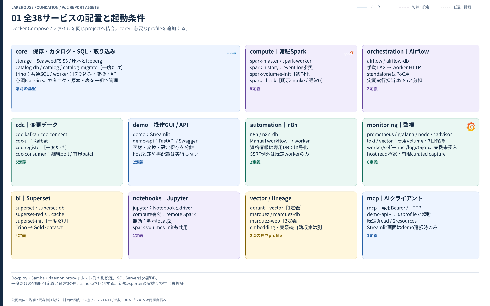
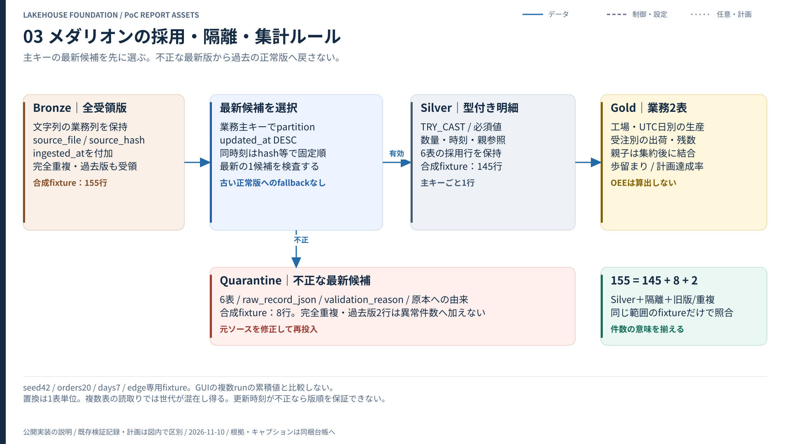
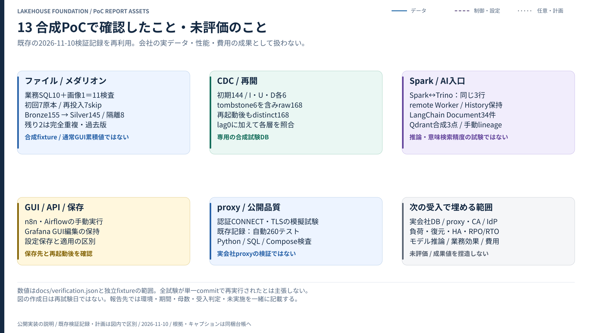

# PoC報告書・発表に使う図版と雛形

**詳細図14種、編集用Mermaid、図キャプション、報告書・評価計画・スライド構成をまとめた素材集です。** 図を一枚選んでWord/PowerPointへ貼り、同じ図のキャプションと根拠を添えて使えます。実装の照合基点は `b63b9d00d664d3e547679d0da4dd63f76fe1f45f`、照合日は2026-11-10（JST）です。図の作成日は全機能の再試験日を意味しません。

[全図のHTMLギャラリー](gallery.html) / [キャプション・根拠](CAPTIONS.md) / [CSV索引](figure-index.csv) / [実装の技術付録](IMPLEMENTATION-INVENTORY.md)

HTMLはダウンロードしてブラウザーで開くと、14枚のSVGをオフラインで確認できます。SVGと公式ロゴはHTML内に埋込済みで、CDNから取得しません。GitHubでは下表のSVGを直接開けます。

## 最初に選ぶ3枚

| 説明する相手 | 使う図 | 次に添える資料 |
| --- | --- | --- |
| 全体構成を確認する基盤担当 | 図01 サービス配置 | 実装構成一覧・採用版 |
| 業務ルールを確認するMES/ERP担当 | 図03 メダリオン | 入力契約・隔離理由・指標の式 |
| PoCの結果を判断する責任者 | 図13 検証結果 | 根拠対応表・未評価・次の受入条件 |







## 全14図の使い分け

| 図 | 内容・報告書の用途 | 編集用 |
| --- | --- | --- |
| [01 詳細配置](figures/01-platform-detail.svg) | 全34service・11profile・core/常駐/one-shot/smoke。技術付録に | [Mermaid](mermaid/01-platform-detail.mmd) |
| [02 バッチ経路](figures/02-batch-flow.svg) | SELECT/Samba/GUI→ready→原本/Bronze→明示変換 | [Mermaid](mermaid/02-batch-flow.mmd) |
| [03 メダリオン](figures/03-medallion.svg) | 最新候補・妥当性・隔離・粒度・合成fixtureの件数 | [Mermaid](mermaid/03-medallion.mmd) |
| [04 CDC確定順](figures/04-cdc-sequence.svg) | Debezium→Kafka→raw→現在値→派生表→checkpoint→offset | [Mermaid](mermaid/04-cdc-sequence.mmd) |
| [05 操作API](figures/05-control-api.svg) | GUI/APIと素材/処理/保存の責任、n8n/Airflowの直接経路 | [Mermaid](mermaid/05-control-api.mmd) |
| [06 Spark計算](figures/06-spark-compute.svg) | driver/Master/Worker、local/remote、event log/History | [Mermaid](mermaid/06-spark-compute.mmd) |
| [07 AIの根拠](figures/07-ai-context.svg) | snapshot→context→Document、MCP、推論/RAGとの境界 | [Mermaid](mermaid/07-ai-context.mmd) |
| [08 proxy/CA](figures/08-proxy-ca.svg) | daemon/build/runtime/Java、canonical、内部bypass、信頼 | [Mermaid](mermaid/08-proxy-ca.mmd) |
| [09 認証境界](figures/09-security-boundaries.svg) | 管理者/利用者/内部DB、API token、SSRF、未完成の認可 | [Mermaid](mermaid/09-security-boundaries.mmd) |
| [10 監視と品質](figures/10-observability.svg) | 2targetのmetrics、health、業務品質、各履歴を分離 | [Mermaid](mermaid/10-observability.mmd) |
| [11 配置手順](figures/11-deployment-lifecycle.svg) | private準備→Dokploy→実appName→サービスenv→Deploy | [Mermaid](mermaid/11-deployment-lifecycle.mmd) |
| [12 永続化・復旧](figures/12-persistence-recovery.svg) | 16volume・外部bind・DB/鍵・整合backup・別環境復元 | [Mermaid](mermaid/12-persistence-recovery.mmd) |
| [13 既存検証の結果](figures/13-evidence-summary.svg) | 合成機能確認・模擬proxyと、会社/負荷/推論の未評価 | [Mermaid](mermaid/13-evidence-summary.mmd) |
| [14 次の評価](figures/14-poc-roadmap.svg) | 現地接続・業務整合・負荷・復旧・AI評価の段階と判断 | [Mermaid](mermaid/14-poc-roadmap.mmd) |

各図にタイトル・対象範囲・注記を含めています。実線はデータ、破線は制御/設定、点線は任意/計画です。色だけに依存しません。灰色の箱や点線を使った追加案を、配備・受入済みと説明しないでください。Mermaidは同じ内容の編集用略図で、SVGと同じ座標配置を再現するものではありません。

## PNG・PDF・PowerPointを一括で作る

リポジトリのルートで、Python3.12・uv0.13.7と日本語フォントを準備します。図の生成は外部サービス、site.env、DB、Dockerを使用しません。追加Python依存は専用venvへ入れ、稼働アプリの環境と分離します。

UbuntuでCairoと日本語フォントが未導入の場合だけ、管理者が次を実行します。会社proxyが必要なら [会社proxy手順](../COMPANY-PROXY.md) のapt/uv取得経路を先に用意します。

```bash
sudo apt-get update
sudo apt-get install --no-install-recommends libcairo2 fontconfig fonts-noto-cjk
```

通常ユーザーで専用環境を作ります。既存venvを使う場合は、このlock専用であることを確認します。

```bash
uv venv --python 3.12 "$HOME/.local/share/lakehouse-foundation/report-venv"
uv pip sync \
  --python "$HOME/.local/share/lakehouse-foundation/report-venv/bin/python" \
  --require-hashes docs/reports/requirements-export.lock
uv pip check \
  --python "$HOME/.local/share/lakehouse-foundation/report-venv/bin/python"
```

**Git外の新しい絶対パス**を選び、一括出力します。既存ディレクトリは上書きしません。実接続先・資格情報は指定不要です。

```bash
"$HOME/.local/share/lakehouse-foundation/report-venv/bin/python" \
  scripts/render_report_assets.py \
  --export-dir "$HOME/.local/share/lakehouse-foundation/report-exports/review-01"
```

| 出力 | 使い方 |
| --- | --- |
| `png/` | 幅2880pxの14枚。Word/PowerPointへ画像として挿入 |
| `pdf/` | 日本語font埋込・検索可能な14枚。図01はA3横、他はA4横 |
| `lakehouse-poc-figures.pdf` | 14図を一冊にまとめたPDF |
| `lakehouse-poc-figures.pptx` | 14スライド。図は画像、タイトル・キャプション・ノートは編集可能 |
| `contact-sheet.png` | 全図を小さく並べた選択用一覧 |
| `svg/` / `mermaid/` | 拡大・編集用の原稿。`figures/`にもSVGの参照用copy |
| `gallery.html` / `figure-index.csv` | オフライン一覧・表計算用索引 |
| `lakehouse-poc-report-assets.zip` | 図・雛形・索引・hash記録の一式 |
| `export-manifest.json` | 図の基点、出力の相対名・サイズ・SHA-256 |

図01は34serviceの名前を含むため、拡大表示かA3の技術付録で使います。他の用途別図を説明スライドに選ぶと読みやすくなります。PPTX内の図は箱やラベル単位のPowerPoint shapeではありません。図内の編集はSVG/Mermaid/figures.jsonで行い、再生成します。

Gitには編集可能なSVGと生成元・手順を保存します。PNG/PDF/PPTXは上の操作でGit外へ出力し、公開ソースのbinary/機密検査方針を維持します。出力ZIPは公開素材だけを集め、private設定やGUIの実画面を収集しません。

## 報告書を書くときの素材

| 素材 | 用途 |
| --- | --- |
| [報告書テンプレート](POC-REPORT-TEMPLATE.md) | 目的・構成・結果・制約・判断をまとめる |
| [評価計画](EVALUATION-PLAN.md) | 35項目の前提・操作・期待・結果欄を使用 |
| [根拠対応表](EVIDENCE-MATRIX.md) | 17項目の既存記録と会社受入を区別 |
| [スライド構成](PRESENTATION-OUTLINE.md) | 14枚の説明順・伝える点・図・キャプション |
| [意思決定の記録](DECISION-RECORD-TEMPLATE.md) | 導入/条件付き/再試験と、次の成功条件を合意 |
| [画面キャプチャ手順](SCREENSHOT-GUIDE.md) | native画面の撮影箇所・期待結果・匿名化を確認 |
| [実装構成一覧](IMPLEMENTATION-INVENTORY.md) | service・profile・port・volume・通信・資源の技術付録 |
| [キャプション台帳](CAPTIONS.md) | 図ごとの説明・注意点・根拠へのリンク |

会社で記入する欄は空欄です。架空の担当者、日付、性能、費用、本番成功を埋めていません。既存の合成検証の数値には対象・母数・条件を添えます。図13は既存記録の要約であり、業務効果・性能改善・ROIの証明ではありません。

## 図を編集・再生成する

[図とスクリプトの編集ガイド](EDITING-GUIDE.md)で項目・座標・処理順を確認できます。図の正本は [figures.json](figures.json) です。各図のタイトル、説明、用途、根拠、panel、線、注記、Mermaidを編集します。SVGとHTMLを直接直すと再生成で置き換わります。

```bash
python3 scripts/render_report_assets.py
python3 scripts/render_report_assets.py --check
```

生成はPython標準ライブラリだけで動きます。`--check` は図仕様と生成済みSVG/Mermaid/HTML/台帳の一致、参照ファイル、文字領域を確認します。実サービスの起動確認ではありません。図で構成を変更したら、Compose・固定版・根拠・文書も同じ変更として確認します。

公式ロゴの権利・取得元は [図版出典](../assets/README.md)、採用版の公式資料は [REFERENCES.md](../REFERENCES.md)、機能の実機記録は [VALIDATION.md](../VALIDATION.md) を参照します。ロゴを新たな製品の商標として再利用したり、各上流による認定と説明したりしません。
